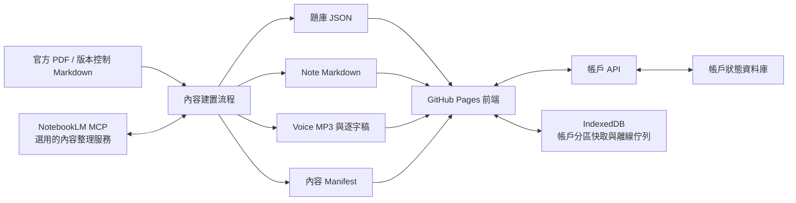

# iPAS 模擬考系統分階段改造工作計畫

- 文件狀態：Draft v0.1
- 建立日期：2026-08-20
- 適用範圍：`exam/` 模擬考、帳戶資料、題庫、Note、Voice、NotebookLM MCP、離線能力、安全與測試
- 文件性質：本文件是後續修改藍圖，不代表功能已完成或已上線

## 執行狀態

| 階段 | 狀態 | 2026-08-20 進度 |
| --- | --- | --- |
| Phase 0 | 自動基線完成，待實際瀏覽器點擊驗收 | 建立 Node 內建測試、三題庫 smoke test 與本機 HTTP 資產檢查 |
| Phase 1 | 已實作，待實際瀏覽器點擊驗收 | 修正評分中斷、重複持久化、練習完成摘要、單一流程與牆鐘計時 |
| Phase 2–8 | 尚未開始 | 依相依順序於 Phase 0–1 驗收後繼續 |

目前自動測試 14/14 通過，三份題庫及必要網站資產均可由本機 HTTP 取得。瀏覽器控制環境因 Windows 沙箱無法存取使用者 AppData，故本輪尚未執行實際 UI 點擊驗收；不得將此項標記為已完成。

## 1. 改造目標

將目前的純前端模擬考系統，逐步整理為具備下列能力、且仍可部署於 GitHub Pages 的學習平台：

1. 評分、練習、錯題與統計結果一致且可測試。
2. 每一題都有跨版本穩定的識別碼，題庫可重新產生、驗證與追溯來源。
3. 標記、錯題、作答紀錄、複習排程、閱讀與聆聽進度都歸屬帳戶，支援跨裝置同步。
4. IndexedDB 保留為離線快取與待同步佇列，不再是唯一資料來源。
5. Note 與 Voice 成為可版本化、可連結題目與帳戶進度的正式內容。
6. NotebookLM MCP 作為可替換的內容整理工具，不成為網站執行時的必要依賴。
7. 透過自動測試、資料契約、安全檢查與分階段上線，降低改造風險。

## 2. 已確認的主要問題

### 2.1 核心流程

- 評分流程先使用 `score`、後宣告 `score`，可能在完成測驗時直接中斷，導致結果與歷史紀錄無法正確顯示。
- `gradeQuiz`、`startPracticeMode`、`showPracticeFeedback` 使用多層 wrapper 擴充，責任分散且存在重複副作用。
- 練習模式在選項點擊與畫面重繪時可能重複寫入錯題及題目統計，造成答題次數膨脹。
- 練習模式缺乏一致的結束摘要，與模擬考使用不同的統計路徑。
- 計時器以每秒遞減計算，瀏覽器分頁休眠或節流後可能失準。

### 2.2 題庫資料

- 現有錯題與題目統計使用 `certId + q.num` 作為鍵值，但同一題庫中的顯示題號會重複。
- 靜態盤點結果：營運智慧 163 題中有 44 組重複題號；AI 初級 530 題中有 50 組；AI 中級 298 題中有 50 組。
- 現有 JSON `id` 雖然在單次產物中唯一，但解析器以流水號重新指派；題庫插入、刪除或排序後，`id` 可能改變，不能直接當長期帳戶資料鍵值。
- JSON 與 JavaScript wrapper 同時存在，缺少自動化的一致性驗證。
- 題庫載入策略、Service Worker 快取與文件描述不完全一致。

### 2.3 帳戶與本機資料

- 現有 IndexedDB 以瀏覽器為範圍，未依帳戶分區；同一裝置切換使用者時可能共用錯題與進度。
- 標記、錯題、SM-2、測驗歷史與閱讀進度尚未形成一致的帳戶資料模型。
- 身分證號不適合作為應用程式資料主鍵；需要由伺服器提供不透明的 `user_id` 與工作階段。
- 尚未定義離線操作重送、重複請求、跨裝置衝突與版本合併規則。

### 2.4 Note、Voice 與 NotebookLM

- `studyNotes` 是手動對應，部分證照或單元不完整，且缺少穩定的筆記識別碼與版本資訊。
- `Source/`、`exam/notes/`、教材目錄與 `out/` 各有內容，但尚未明確定義唯一來源、發佈產物與關聯清單。
- 現有 Voice 是由 `generate_lecture.py` 產生的整份 TXT/MP3，尚未與 Note 章節、播放進度或帳戶同步連結。
- NotebookLM 尚未連接至本工作階段；其 MCP/CLI 為非 Google 官方工具並使用內部 API，能力與穩定性必須在實際授權後驗證。
- NotebookLM 不應直接由瀏覽器呼叫，也不應保存任何登入憑證到 Git。

### 2.5 品質、安全與分析

- 題目、解析及 Markdown 部分透過 `innerHTML` 顯示，缺少完整的清理與 Content Security Policy。
- 外部前端套件、離線快取、API timeout、錯誤重試與隱私界線尚未完整定義。
- 目前稱為 IRT/Cronbach α 的統計是以彙總正確率估算，不能視為正式 IRT 或有效的信度分析。
- 尚未建立單元測試、整合測試、端對端測試及題庫資料契約測試。

## 3. 目標架構與責任邊界

核心原則：

- 版本控制內的題庫與 Markdown 是內容來源；NotebookLM 只產生可審核的衍生內容。
- 帳戶 API/資料庫是使用者狀態的權威來源；IndexedDB 是帳戶分區的本機副本。
- 網站在 NotebookLM 無法使用時，仍可進行考試、讀 Note、播既有 Voice 及同步帳戶資料。
- 前端維持靜態部署；需要保密、授權與跨裝置同步的工作由外部 API 處理。

## 4. 建議資料模型

### 4.1 題庫 `Question`

| 欄位 | 用途 |
| --- | --- |
| `question_uid` | 跨重新產生仍穩定的永久識別碼；帳戶紀錄只能引用此欄位 |
| `display_num` | 原始試卷題號，只供顯示，不當主鍵 |
| `cert_id` / `subject_code` / `topic_code` | 證照、科目、主題分類 |
| `source_id` / `source_version` | 來源文件與版本追溯 |
| `question` / `options` / `answer` / `explanation` | 題目內容 |
| `tags` / `media` | 搜尋、弱點分類及圖表等附件 |
| `content_hash` | 偵測題目內容是否變更 |

`question_uid` 建議由「證照代碼 + 來源文件代碼 + 原始題號/題組位置 + 穩定內容特徵」產生。解析器每次重跑都必須得到相同結果；單純的陣列流水號不合格。

### 4.2 Note `NoteAsset`

| 欄位 | 用途 |
| --- | --- |
| `note_uid` | 筆記永久識別碼 |
| `cert_id` / `subject_code` / `topic_code` | 與證照大綱及題庫連結 |
| `title` / `file` / `anchor` | 顯示名稱、檔案與章節位置 |
| `version` / `source_refs` | 內容版本與來源 |
| `notebook_ref` | 選用的 NotebookLM notebook 對應，不作為主鍵 |

### 4.3 Voice `VoiceAsset`

| 欄位 | 用途 |
| --- | --- |
| `voice_uid` / `note_uid` | 語音識別碼及所屬 Note |
| `locale` / `voice_name` / `provider` | 語系與產生方式 |
| `audio_path` / `transcript_path` | 音訊與逐字稿 |
| `duration` / `checksum` / `version` | 播放、快取及版本驗證 |
| `generation_source` | SAPI、Edge TTS 或其他來源及產生時間 |
| `notebook_audio_ref` | 若 MCP 實測支援 Audio Overview，保存可選參照 |

### 4.4 帳戶狀態

- `UserQuestionState`：`user_id`、`question_uid`、標記、答對/答錯次數、最近結果、熟練度、下次複習時間、`revision`、更新時間。
- `QuizAttempt`：一次測驗的模式、證照、開始/結束時間、分數、狀態與內容版本。
- `AttemptAnswer`：該次測驗每題答案、結果、作答時間與題目版本。
- `CourseProgress`：Note 閱讀位置、完成狀態、Voice 播放秒數、播放速度與最後存取時間。
- `SyncOperation`：`operation_id`、帳戶、裝置、操作型別、payload、建立時間與同步狀態，用於離線重送及去重。

所有本機索引至少包含 `user_id`。帳戶 API 不接收身分證號作為資料主鍵；登入成功後只使用不透明的使用者識別碼與短效工作階段。

## 5. 分階段工作計畫

### Phase 0：基線、決策與安全網

目的：在改動前保留可比較的基線，避免修正一處、破壞另一處。

工作項目：

- 建立最小測試框架與三種證照的 smoke test。
- 保存現有 IndexedDB 匯出格式及題庫摘要，作為移轉與回復依據。
- 建立題庫資料稽核報告：題數、重複題號、缺欄位、選項數、答案範圍及 JSON/JS 差異。
- 確認帳戶後端現況與 API 權限；短期可保留 Google Apps Script，但前端先加入 API adapter，避免綁死單一服務。
- 定義內容來源：版本控制 Markdown 為 Note 主來源，`out/` 是 Voice 產物，NotebookLM 是選用衍生服務。

完成條件：三個題庫皆可載入；現有考試與練習流程已有可重現測試；帳戶 API 能力與缺口有書面紀錄。

### Phase 1：P0 核心流程穩定化

目的：先停止錯誤評分與重複記錄，確保後續同步的是可信資料。

工作項目：

- 修正 `score` 宣告順序與測驗完成時的例外。
- 將評分、練習回饋、錯題更新、統計更新整理為單一路徑；同一作答事件只允許持久化一次。
- 移除多餘 wrapper 與未使用的原函式別名，建立清楚的事件與狀態轉換。
- 補上練習完成摘要，使測驗與練習共享一致的結果模型。
- 計時改以截止時間與目前時間計算，避免背景分頁造成漂移。

完成條件：三種證照的模擬考與練習可完成；一次作答只增加一次統計；重新渲染或返回題目不會重複寫入。

### Phase 2：穩定題目識別與題庫建置流程

目的：讓題庫可再生、可驗證，並能安全承載長期帳戶資料。

工作項目：

- 修改三支解析器，產生可重現的 `question_uid`、`source_id`、`source_version` 與 `content_hash`。
- 將 `q.num` 降級為 `display_num`；錯題、統計、標記、SM-2 與測驗答案全面改用 `question_uid`。
- 建立 JSON Schema 或等價驗證器，於產生後檢查所有必要欄位與唯一性。
- 選定 JSON 為題庫唯一發佈格式；若仍保留 JS wrapper，必須由建置流程自動產生並檢查內容一致。
- 實作真正按證照載入題庫，並使 Service Worker 的版本與內容 Manifest 一致。
- 制定舊資料移轉規則：能唯一對應者自動搬移；因重複 `q.num` 無法判定者先匯出、隔離並提示重建，不進行猜測式合併。

完成條件：三支解析器連續執行兩次得到相同 `question_uid`；163/530/298 題皆通過契約檢查；所有使用者狀態不再以 `q.num` 為鍵。

### Phase 3：帳戶狀態與跨裝置同步

目的：讓標記、進度、錯題與複習排程真正隨帳戶管理。

工作項目：

- 建立帳戶 API 契約：工作階段、裝置識別、狀態讀取、增量同步、登出與資料刪除。
- 實作 `UserQuestionState`、`QuizAttempt`、`AttemptAnswer`、`CourseProgress` 與同步操作資料表。
- IndexedDB 升版為帳戶分區快取；登出時清除敏感 session，依產品決策保留或移除該帳戶離線內容。
- 每次離線變更建立唯一 `operation_id`，伺服器以冪等方式處理重送。
- 以 `revision`/伺服器時間處理衝突：計數器採可合併事件，布林標記採最後明確操作，進度採較新且可驗證的狀態。
- UI 顯示同步中、已同步、離線待同步與衝突狀態，不能把網路錯誤假裝成成功。

完成條件：帳戶 A/B 在同一瀏覽器完全隔離；同一帳戶在兩個瀏覽器可同步標記、錯題、進度與歷史；離線操作恢復網路後只套用一次。

### Phase 4：Note 內容模型與閱讀進度

目的：消除手動散落對應，讓筆記可搜尋、可追蹤、可連結題目。

工作項目：

- 建立 `content-manifest.json` 或同等清單，統一記錄三種證照的 Note、章節、版本與檔案。
- 盤點 `Source/`、`exam/notes/`、教材目錄與根目錄 `notes/`，明確區分來源、建置中間檔與發佈產物。
- 補齊 `studyNotes` 缺漏，無內容的項目明確標示「準備中」而非連到錯誤檔案。
- 閱讀器加入目錄、章節錨點、書籤、完成狀態與帳戶閱讀位置同步。
- Markdown 轉 HTML 前加入允許清單式清理，禁止不受信任的 script、事件屬性與危險 URL。
- 題目可連結到相關 `note_uid`/anchor，錯題頁可直接跳到對應考點。

完成條件：清單中的每一份 Note 都能開啟真實檔案與有效錨點；重新登入或換裝置後可恢復閱讀位置；缺檔不造成閱讀器崩潰。

### Phase 5：Note.Voice 語音學習

目的：將現有離線 MP3 整合為 Note 的正式語音版本。

工作項目：

- 擴充 `generate_lecture.py`，由 Note manifest 產生逐字稿、MP3、版本、checksum、時長及來源紀錄。
- 以 Note 或章節為粒度建立 `VoiceAsset`，避免只有大型整份音檔而難以定位。
- 閱讀器整合播放/暫停、進度條、速度、上一節/下一節及逐字稿定位。
- 將播放秒數、完成狀態與偏好速度寫入 `CourseProgress`，支援跨裝置續播。
- 允許使用者選擇下載特定證照或章節離線使用，避免 Service Worker 預載全部 MP3。
- Voice 缺檔、版本不一致或網路中斷時，以文字 Note 正常降級。

完成條件：至少一套完整 Note 可逐章播放、續播及離線使用；帳戶切換不會共用播放進度；重新產生音檔後能依版本安全更新快取。

### Phase 6：NotebookLM MCP 內容工作流

目的：利用 NotebookLM 輔助整理來源、摘要、問答與可能的 Audio Overview，同時維持可替換性與人工審核。

工作項目：

- 實作前先執行能力探測：確認 `uv`、`nlm`、登入狀態、MCP 註冊與目前版本；舊的 `nlm mcp` 指令不列入流程。
- 取得明確授權後才登入；憑證只留在本機使用者設定，不寫入 repository、log 或前端設定。
- 實際連接時建立測試 notebook、驗證讀寫後刪除，確認 MCP 的真實能力與限制。
- 建立 notebook 與 `note_uid` 的對應表，但以本機版本控制 Markdown 為權威來源。
- 匯入官方教材或核准來源，取得摘要、問答或可用的語音產物；所有結果先輸出成待審核檔，不直接覆寫正式 Note/Voice。
- 對每份衍生內容記錄來源、notebook、產生時間、工具版本、人工審核狀態與內容 checksum。
- 若目前 MCP 不支援 Audio Overview 匯出，保留既有 SAPI/其他 TTS 路徑，不以未驗證功能阻塞 Note.Voice。

完成條件：完成一份 Note 的試點往返與人工審核；關閉或移除 NotebookLM 後，正式網站功能與既有內容不受影響。

### Phase 7：PWA、安全、隱私與可及性

目的：在功能整合完成後建立可發布的防護與離線品質。

工作項目：

- Service Worker 改為版本化內容清單，分離 app shell、題庫、Note 與使用者選擇的 Voice 快取。
- 建立 CSP；前端相依套件改為本地固定版本或加入完整性驗證。
- 集中處理 HTML/Markdown 清理，減少直接 `innerHTML` 寫入。
- 帳戶 API 加入 timeout、有限重試、撤銷、速率限制與最小資料傳輸；補上隱私告知與資料刪除流程。
- 釐清登入定位：若是正式帳戶，不再只依本機身分證格式檢查；若只是考場模擬，必須清楚標示且不傳送敏感資料。
- 補齊鍵盤操作、焦點管理、ARIA、字幕/逐字稿與色彩對比。
- 將現有「IRT」改名為題目表現統計；若要正式 IRT/信度分析，另建具備樣本與方法驗證的分析服務。

完成條件：離線啟動、指定題庫/Note/Voice、更新與回復皆通過測試；安全與隱私檢查無未處理的高風險項目。

### Phase 8：資料移轉、灰度上線與回復

目的：讓既有使用者資料可控地轉入新架構，並保留退回舊版的能力。

工作項目：

- 上線前匯出舊 IndexedDB 摘要；建立 schema migration 與失敗回復流程。
- 可唯一對應的舊錯題/統計搬到 `question_uid`；無法消歧義的紀錄存入隔離區並向使用者說明。
- 以 feature flag 依序開啟：新評分 → 新題庫鍵值 → 帳戶同步 → Note 進度 → Voice → NotebookLM 內容。
- 先以單一測試帳戶及單一證照試行，再擴大至三種證照。
- 監控同步錯誤、重複事件、資料量、離線重送、播放失敗與版本不一致。
- 驗證一鍵停用新同步及回到只讀舊資料的回復方案。

完成條件：無跨帳戶資料洩漏；資料移轉結果可追蹤；新功能可分別停用；正式上線與回復演練均完成。

## 6. 相依順序與優先級

| 優先級 | 工作 | 必須先完成 |
| --- | --- | --- |
| P0 | 評分例外、重複持久化、計時與結束流程 | Phase 0 基線 |
| P0 | 穩定 `question_uid` 與題庫契約 | 核心流程測試 |
| P1 | 帳戶分區、錯題/標記/進度同步 | 穩定 `question_uid`、帳戶 API 契約 |
| P1 | Note manifest 與閱讀進度 | 帳戶進度模型 |
| P1 | Voice manifest、播放器與續播 | Note manifest |
| P2 | NotebookLM MCP 試點 | Note/Voice 邊界與人工審核流程 |
| P2 | PWA、安全、可及性與灰度上線 | 主要資料流穩定 |

不可顛倒的關係：

1. 不先修重複記錄，就不應啟用帳戶同步。
2. 不先建立穩定 `question_uid`，就不能可靠保存長期錯題與標記。
3. 不先定義 Note manifest，就不能可靠連結 Voice 或 NotebookLM 內容。
4. NotebookLM 只能是內容建置輔助，不能成為網站登入、考試或播放既有內容的單點故障。

## 7. 驗證矩陣

| 類型 | 最低驗證內容 |
| --- | --- |
| 單元測試 | 評分、截止時間、SM-2、`question_uid`、同步合併、內容清理 |
| 題庫契約 | 必要欄位、唯一 ID、答案範圍、選項數、來源、JSON/JS 一致性 |
| 整合測試 | 三種證照、登入/登出、考試、練習、錯題、標記、Note、Voice |
| 跨裝置測試 | 同帳戶同步、不同帳戶隔離、離線修改後重送、衝突處理 |
| 端對端測試 | 登入至完成測驗、錯題複習、閱讀續接、Voice 續播與登出 |
| PWA 測試 | 首次線上、再次離線、內容更新、快取失效、低儲存空間 |
| 安全測試 | XSS、工作階段失效、越權存取、敏感資料、CSP、依賴完整性 |
| NotebookLM 契約測試 | adapter 模擬、能力探測、失敗降級、來源與審核紀錄 |

## 8. 每階段固定交付物

每一階段完成時都應留下：

- 程式與資料模型變更。
- 自動測試及手動驗收紀錄。
- 資料移轉與回復方式。
- `README.md` 與 `work_log.md` 更新。
- 風險、未完成項目與下一階段輸入。
- 若有內容產物，附來源、版本、checksum 與人工審核狀態。

## 9. 建議的第一個實作批次

第一批只處理 Phase 0 與 Phase 1，不同時啟用帳戶同步：

1. 為三種證照建立最小 smoke test 與題庫稽核指令。
2. 修正完成測驗的 `score` 例外。
3. 將練習作答持久化改為一次性事件，消除重複錯題與統計。
4. 統一考試/練習結果資料模型並補上練習摘要。
5. 將計時器改為截止時間計算。
6. 驗證既有 IndexedDB 不被意外破壞，再進入 `question_uid` 改造。

這個批次的成果是「現有功能可信且可測」，也是帳戶、題庫、Note.Voice 與 NotebookLM 後續整合的必要基礎。

## 10. 待確認但不阻塞第一批的決策

- 現有帳戶管理後端可提供哪些 API、資料表與登入權杖能力。
- Voice 檔案長期存放於 GitHub Pages、Release、物件儲存或 CDN；預設先依檔案量評估，不把所有 MP3 強制預快取。
- NotebookLM MCP 實際可否建立/更新來源、匯出摘要與 Audio Overview；未實測前不承諾特定能力。
- 舊 IndexedDB 中無法由重複題號辨識的資料，要選擇保留唯讀匯出或提示清除；建議不做猜測式移轉。
- 正式帳戶是否仍需要身分證欄位；建議登入與資料主鍵全面改用帳戶系統提供的不透明識別碼。
