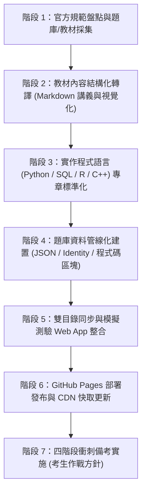

# iPAS 證照備考與題庫／講義建置標準作業程序（SOP）

> **適用對象**：新增任何 iPAS 證照科目（如資訊安全、物聯網、巨量資料、智慧製造等），或既有證照擴增新考科之標準化作業指引。

---

## 流程總覽架構圖



---

## 階段 1：官方規範盤點與教材採集（定位命題範圍）

### 1.1 必備官方核心文件
任何新考科啟動時，切忌直接閱讀民間參考書，必須先取得並對照經濟部產業人才能力鑑定（iPAS）官方公告之核心文件：

1. **評鑑內容範圍參考（簡章規範）**：
   * 取得各考科之三層架構代碼：**考科代號（如 `L21`） → 評鑑主題（如 `L211`） → 評鑑內容（如 `L21101`）**。
   * 建立全科評鑑內容代碼對照表（作為講義命名與題庫標籤的唯一真理來源）。
2. **官方學習指引（Study Guide）**：
   * 官方推薦核心概念、名詞標準定義（例如：召回率 Recall 與 靈敏度 Sensitivity 之官方統一中文譯名）。
3. **官方學習指引勘誤表**：
   * **極度重要**：歷次指引常見印刷錯題、公式正負號相反或答案反轉。所有講義與題庫必須標註 `⚠ 勘誤` 並以最新勘誤為準。
4. **歷屆公告試題與考猜（程式碼題型盤點）**：
   * **全面檢視試卷中的程式語言出現頻率**（如 Python、PySpark、SQL、R、C/C++）：
     - 統計「純程式碼題 / 語法判讀題 / 套件報表輸出題」在考卷中的佔比。
     - 若考科含 15% 以上程式相關題（如中級大數據、機器學習、資訊安全或物聯網嵌入式系統），必須在講義與題庫中**全面升級為實作代碼規範**。

---

## 階段 2：教材內容結構化轉譯（重點筆記編寫）

將官方指引轉譯為工程化、結構化的 Markdown 筆記，同時維護於 `exam/notes/` 與根目錄 `notes/`：

### 2.1 筆記命名與粒度規範
* **目錄結構**：按考科分層（例如：`notes/ai_mid/L22_大數據處理分析與應用/`）。
* **檔案粒度**：以「**評鑑主題**」為單一檔案單位（例如：`L221_機率統計基礎.md`），內含該主題下的所有評鑑內容小節（`L22101`～`L22103`）。
* **小節錨點規範**：每個小節標題必須嚴格冠上官方代號，如 `## 📌 L22101 敘述性統計與資料摘要技術`，以便 Web App 解析 `#L22101` 錨點平滑捲動。

### 2.2 講義內容必備核心要素
每份講義均須包含以下模組，杜絕流水帳敘述：
1. **考點精華速覽表**：比較型概念一律使用 Markdown 表格（如 RDBMS vs NoSQL、批次 vs 串流處理）。
2. **核心公式與 Worked Examples（帶數值範例）**：
   * 所有數學符號必須使用標準 LaTeX 語法（`$...$` 或 `$$...$$`）。
   * 公式下方**必須附帶帶入具體數值的計算示範**（例如：混淆矩陣求 F1-score、四分位距求離群值邊界）。
3. **高品質圖形表示法（向量 SVG 與 Mermaid 優先，杜絕粗糙 ASCII）**：
   * 曲線圖、幾何分佈（如常態曲線、偏態分佈長尾、IQR 箱形圖結構）一律使用**內嵌響應式向量 SVG**（附平滑貝茲曲線、漸層填色與色彩標籤），**嚴禁使用純文字 ASCII 拼湊符號**以防行動裝置或字型排版錯位。
   * 系統架構、生命週期流程一律繪製為 **Mermaid 圖表**（如 CRISP-DM 流程、Kafka 分區架構）。
   * 🛑 **【Mermaid 禁用自訂色彩渲染規範】**：
     - **全面禁用自訂顏色與內嵌樣式**：**嚴禁**在 Mermaid 代碼區塊中使用 `style <節點> fill:...`、`stroke:...` 或 `classDef` / `class` 進行自訂背景色、邊框色與文字色彩渲染。
     - **原因與原則**：系統具備深色（Dark）與淺色（Light）主題切換功能，若在 Mermaid 內寫死顏色樣式（例如寫死深色背景 `#1e293b` 或自訂邊框），在淺色主題切換時會發生文字嚴重反白或無法閱讀（Contrast Collision），且會破壞系統預設的主題原生風格。
     - **標準規範**：Mermaid 圖表**必須保持乾淨的原生語法**（僅使用節點形狀如 `[矩陣]`, `(圓角)`, `[(資料庫)]`、標籤文字與箭頭連結），色彩與邊框完全交由前端 Mermaid 引擎與主題樣式表自動適配渲染。
4. **⚠ 勘誤與官方陷阱警示（GitHub Alert 區塊）**：
   * 使用 `> [!WARNING]` 或 `> [!CAUTION]` 標記歷屆高頻混淆點。
5. **考前衝刺「一句話考點」清單**：
   * 每份筆記結尾收錄 8～10 點高頻快記口訣，供考前 10 分鐘速讀。

---

## 階段 3：實作程式語言 (Python / SQL / PySpark 等) 標準化規範 🌟

若該考科屬於具備實作代碼之技術科目（例如：AI 應用規劃師中級、AIoT 應用工程師、資訊安全、巨量資料等），**筆記中必須獨立設立「🐍 實戰代碼與高頻程式陷阱」專區**，依循以下標準建置：

### 3.1 核心資料處理與巨量資料運算標準
1. **資料管線與 OOM 記憶體溢位防禦**：
   - 必須示範使用 `pd.read_csv(..., chunksize=...)` 串流迭代讀取超大檔案。
   - 必須示範分散式運算（如 PySpark / Spark SQL）之 `df.agg(...)` 分散聚合，並明確標記**嚴禁在 Driver 端呼叫 `collect()` 拉取全量數據**之考點。
2. **型別轉換與缺失值陷阱 (Data Type Pitfalls)**：
   - 說明 Pandas 在遇到 `NaN` 時將整數自動向上轉型為 `float64` 的機制，以及使用 `Int64` (nullable integer) 或 `fillna()` 轉型為 `int` 的標準做法。
3. **分組、排序與營收排行高頻查詢**：
   - 標準化範例：`df.groupby('Key')['Value'].sum().sort_values(ascending=False).head(N)`。
   - 條件布林遮罩篩選單一類別（如 `df[df['Category'] == 'X']['Price'].mean()`）。

### 3.2 語言語法特性與工程陷阱 (Language Pitfalls)
1. **可變預設參數閉包陷阱 (Mutable Default Argument)**：
   - 強制收錄典型常考陷阱題：`def process(record, tags=[]):` 的閉包共享錯誤，並對照提供 `tags=None` 的安全防禦寫法。
2. **淺拷貝 vs 深拷貝 (Shallow vs Deep Copy)**：
   - 說明 `copy.copy()` 與 `copy.deepcopy()` 在巢狀物件修改時之行為差異。

### 3.3 機器學習模型訓練與評估報表 (ML & Stats Libraries)
1. **Scikit-learn 標準工作流程**：
   - `train_test_split` 切分資料集（`stratify` 參數分層抽樣之考點）。
   - 模型建立、擬合（`.fit()`）與推論（`.predict()` / `.predict_proba()`）。
2. **分類評估報表完整解讀 (`classification_report`)**：
   - 逐一標註欄位：`precision`、`recall`、`f1-score`、`support`（實際樣本數）。
   - 對比解讀：`macro avg`（純算術平均）與 `weighted avg`（依 support 權重平均）的差異。
3. **統計迴歸報表輸出解讀 (`statsmodels.api.OLS` / Summary)**：
   - 說明需手動補上常數項 `sm.add_constant(X)`。
   - 解讀關鍵四指標：$R^2$（決定係數）、Adj. $R^2$、`P > |t|`（p-value 顯著性檢定，判斷是否 $< 0.05$）、`coef`（自變數係數方向與大小）。
4. **機率分佈函式庫呼叫 (`scipy.stats`)**：
   - 卜瓦松分佈：單點機率 `poisson.pmf(k, mu)` vs 累積機率 `poisson.cdf(k, mu)`。
   - 常態分佈：累積機率 `norm.cdf(x, loc, scale)` 與雙尾經驗法則區間計算。

### 3.4 數據視覺化圖表語法 (Seaborn / Matplotlib)
1. 類別平均與置信區間柱狀圖：`sns.barplot(x=..., y=..., data=...)`。
2. 兩特徵散佈與分組顏色：`sns.scatterplot(x=..., y=..., hue=..., data=...)`。
3. 特徵相關性熱力圖：`corr = df.corr(); sns.heatmap(corr, annot=True, cmap="coolwarm")`。

---

## 階段 4：題庫資料管線化建置（確定性與唯一識別）

為確保題庫長期維護不遺失使用者的作答紀錄、錯題本與 SM-2 排程，禁止手動修改產生後的題庫 JSON。

### 4.1 題庫架構標準規範
建立專屬解析器腳本（如 `parse_<cert>_questions.py`），題庫資料必須滿足：
* **穩定題目識別碼 (`question_uid`)**：
  * 使用 `question_identity.py` 生成唯一雜湊（結合來源試卷、原始題號與題幹特徵）。即使修改詳解排版或更正錯字，永久 ID 維持不變。
* **標準三段式解析規範**：
  * 題目解析一律採用結構化教育詳解：**【核心考點】**、**【正確答案說明】**、**【選項辨析】**，逐選項剖析除錯。
* **程式碼排版與轉譯保護**：
  * 題幹或選項內包含代碼時，必須使用標準 Markdown 程式碼區塊（````python ... ````），並防範反斜線轉義與跳脫字元遺失。
* **標準欄位契約**：
  ```json
  {
    "question_uid": "ai_mid-11595177fb62e3db3dba062a",
    "display_num": 19,
    "subject": "大數據處理分析與應用",
    "chapter": "115年第一次歷屆考題",
    "assessmentTopic": "L223",
    "assessmentContent": "L22301",
    "question": "【背景說明：附圖程式碼如下】\n```python\nimport pandas as pd\n...```\n若需計算總銷售額...",
    "options": ["(A) 選項1", "(B) 選項2", "(C) 選項3", "(D) 選項4"],
    "answer": 0,
    "ans_text": "(A)",
    "explanation": "【核心考點】...\n【正確答案說明】...\n【選項辨析】..."
  }
  ```

---

## 階段 5：模擬測驗 Web App 整合與雙目錄同步

### 5.1 雙目錄同步原則（重要）
專案支援 GitHub Pages 根目錄直接發布：
* **`exam/notes/`**：開發與單機測試端講義目錄。
* **`notes/`**：GitHub Pages 靜態網站線上 fetch 之正規路徑。
* **同步要求**：每次修改講義，必須確保 `exam/notes/` 與 `notes/` **二者內容 100% 同步**。

### 5.2 `exam/config.js` 模組宣告
在 `EXAM_CONFIG.modules` 陣列新增考科配置：
```javascript
{
    id: "your_cert_id",
    name: "新考科名稱",
    icon: "🎯",
    description: "簡介與題數說明",
    questionCount: 566,
    questionsFile: "your_cert_questions.js",
    questionsVar: "YOUR_QUESTIONS_DATA",
    jsonFile: "your_cert_questions.json",
    subjects: [
        { id: "s1", name: "第一科目名稱" },
        { id: "s2", name: "第二科目名稱" }
    ],
    studyNotes: [
        { subjectGroup: "第一科：..." },
        { topicGroup: "主題 Lxxx：..." },
        { title: "Lxxx01 小節名稱", file: "notes/.../file.md#Lxxx01" }
    ]
}
```

### 5.3 核心機制與自動化測試檢驗
1. **配題策略**：全真模考均勻抽題（Balanced Sampling）與排除歷屆試題切換。
2. **單元練習篩選**：評鑑主題下拉篩選、未作答新題與錯題特訓切換。
3. **公式與代碼渲染**：KaTeX 數學符號保護、Markdown 表格與代碼區塊高亮（`pre code.code-block`）。
4. **自動化回歸測試**：
   ```powershell
   python -m unittest tests.test_question_identity
   node --test tests/*.test.js
   ```

---

## 階段 6：GitHub Pages 部署發布與 CDN 快取更新

為了確保靜態前端 SPA 與講義在線上環境能順暢執行：
1. **提交與推送**：所有程式碼、講義與題庫 commit 至 `main` 分支並推送到 `github` 遠端。
2. **CDN 與快取更新檢查**：
   * 由於 Service Worker 與瀏覽器存在快取，若更新了核心樣式或程式碼，應同步遞增 `exam/sw.js` 內的 `CACHE` 版本。
   * 使用者於瀏覽器瀏覽時，若發現內容未立即更新，應按 **`Ctrl + F5`**（強制略過本機快取重新載入）。

---

## 階段 7：四階段衝刺備考實施法（考生作戰方針）

| 階段 | 階段名稱 | 核心任務 | Web 系統推薦功能 | 達標檢驗指標 |
| :---: | :--- | :--- | :--- | :--- |
| **第 1 階段** | **官方指引精讀** | 逐單元精讀 Markdown 筆記，掌握向量圖形架構、公式推導與實戰代碼。 | **課程學習**（閱讀講義） | 筆記最後的「一句話考點」能自行默背 80% 以上。 |
| **第 2 階段** | **主題地毯式刷題** | 按評鑑主題逐章進行單元自主練習，即時看三段式詳解。 | **單元自主練習**（依評鑑主題篩選） | 該主題練習答對率達到 **75% 以上**。 |
| **第 3 階段** | **SM-2 錯題集中特訓** | 針對歷次答錯的題目進行間隔重複複習，徹底消滅盲點。 | **單元自主練習**（勾選「錯題特訓」） | 待複習錯題池數量歸零。 |
| **第 4 階段** | **全真模擬考衝刺** | 開啟 80 分鐘 50 題計時模考，交卷後覆盤弱點雷達圖與審題儀表板。 | **50題全真模擬考**（依主題均勻配題） | 連續 3 次模考成績均達 **75 分以上**。 |

---

## SOP 檢核清單（Checklist）

- [ ] 已取得官方最新「評鑑內容範圍參考」三層代碼表
- [ ] 已檢視「官方學習指引勘誤表」並在講義中標示 `⚠ 勘誤`
- [ ] 所有公式使用標準 LaTeX 撰寫並附帶數值計算實例
- [ ] 分佈與幾何圖形採用向量 SVG 卡片或 Mermaid，杜絕純文字 ASCII
- [ ] **Mermaid 圖表嚴格保持原生乾淨語法，全面禁用 `style`/`fill`/`classDef` 等色彩樣式渲染，確保深淺主題自動適配**
- [ ] **已盤點真題程式碼題型，並在講義中依【階段 3】規範建立 Python / SQL / PySpark 實戰專區**
- [ ] **題庫代碼題使用標準 ````python ```` 區塊排版，且詳解完成【核心考點/正確答案說明/選項辨析】三段式解析**
- [ ] 題庫解析器產生具備確定性雜湊的 `question_uid`
- [ ] 講義修改後確保 `exam/notes/` 與 `notes/` 雙目錄 100% 同步
- [ ] `config.js` 正確掛載考科、題數與帶錨點的講義清單
- [ ] 執行 `node --test tests/*.test.js` 通過所有資料與功能回歸測試
- [ ] 驗證 GitHub Pages 線上部署狀態與 CDN 快取更新
