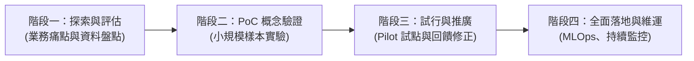

# L212 AI 導入評估規劃 考點精華筆記

> **對應科目**：L21 人工智慧技術應用與規劃  
> **評鑑內容**：L21201 AI 導入評估、L21202 AI 導入規劃、L21203 AI 風險管理  
> **官方指引章節**：科目一 第四章（4.1 ~ 4.3 節）

---

## 📌 L21201 AI 導入評估

### 1. 企業 AI 導入前置評估步驟 [🎯 常考]
1. **業務需求與痛點識別**：導入 AI 的**第一步必須聚焦於釐清具體的業務問題與價值**，而非盲目追逐新穎技術。
2. **資料就緒度評估 (Data Readiness)**：評估現有資料的品質、完整性、時效性、標註成本與資料量是否足以支撐模型訓練。
3. **技術可行性分析 (Feasibility Study)**：評估現有演算法能力是否能滿足預期指標（如辨識率需達 98%）。
4. **經濟效益分析 (Cost-Benefit / ROI)**：
   * **總擁有成本 (TCO, Total Cost of Ownership)**：包含硬體採購/雲端租用算力、資料清洗與標註、演算法開發、系統維運監控、授權費用。
   * **投資報酬率 (ROI)**：量化產出（營收增加、人力成本節約、不良率下降）相對於投入成本之比例。

### 2. 解決方案選型決策矩陣 (Make vs. Buy)

| 方案型態 | 適用情境 | 優點 | 限制 / 缺點 |
|---|---|---|---|
| **商業現成軟體 (SaaS / COTS)** | 通用型需求（如通用 OCR、通用翻譯客服） | 上線速度最快、初期建置成本低 | 無法深度客製、資料外傳隱私風險高、長期授權費用可觀 |
| **開源模型 + 自行微調** | 具備一定技術能力、重視私有資料安全 | 具備客製彈性、無軟體授權綁定 | 需自備算力硬體、需專屬工程人力進行維護與更新 |
| **從頭自研 (Custom Build)** | 涉及企業核心專利、獨特高價值業務場景 | 掌控度最高、完全貼合業務邏輯 | 開發週期漫長、初期研發成本極高、失敗風險大 |

### 3. PoC (概念驗證) 與 PoV (價值驗證)
* **PoC (Proof of Concept)**：驗證「技術在技術層面是否做得出來」（如：演算法能否在樣本資料達到特定準確率）。
* **PoV (Proof of Value)**：驗證「技術在業務層面是否能帶來實質商業價值」（如：實際上線後能否節省 30% 處理時間）。

---

## 📌 L21202 AI 導入規劃

### 1. 目標設定原則 (SMART 原則) [🎯 常考]
* **S (Specific, 具體明確)**：明確界定要優化的業務指標（如：降低客訴處理時間）。
* **M (Measurable, 可衡量)**：設定具體量化目標（如：處理時間從 15 分鐘降至 3 分鐘）。
* **A (Achievable, 可達成)**：評估技術與資料限制，設定合理目標而非好高騖遠。
* **R (Relevant, 相關性)**：目標需與企業整體的策略與核心業務利益保持一致。
* **T (Time-bound, 明確時限)**：設定具體的交付里程碑（如：三個月內完成試行）。

### 2. AI 導入實施的四階段生命週期

### 3. 組織資源規劃與變更管理
* **跨領域團隊組建**：領域專家 (Domain Expert / SME)、資料工程師 (Data Engineer)、資料科學家 (Data Scientist)、AI 產品經理與合規法律顧問。
* **變更管理 (Change Management)**：員工對 AI 取代工作的抗拒是導入失敗的主因之一，必須提供操作培訓、建立人機協同 (Human-in-the-loop) 流程。

---

## 📌 L21203 AI 風險管理、法規與倫理

### 1. [⚠ 勘誤重點] 台灣個人資料保護法 (PDPA) 之「事前告知義務」
> 官方學習指引 P.4-34 勘誤重點：蒐集個人資料前，必須向當事人明確履行「事前告知義務」之核心 **六大法定項目**：

1. **蒐集機關名稱**（包含公務機關及非公務機關之合法主體）。
2. **蒐集目的與使用範圍**（目的需具體合法，不得逾越必要範圍）。
3. **個人資料之類別**（識別類、特徵類、財務類等）。
4. **個人資料利用之情形**：包含**利用期間、地區、對象及利用方式**。
5. **當事人法定權利及行使方式**（依個資法第 3 條：查詢、閱覽、製給複製本、補充/更正、請求停止蒐集處理利用、請求刪除）。
6. **不提供資料之影響**（當事人得自由選擇，且機關必須明確告知不提供時對其權益之具體影響）。

### 2. 歐盟人工智慧法案 (EU AI Act) 風險四級分類 [🎯 常考]

| 風險等級 | 定義與標準 | 典型案例 | 法規監管要求 |
|---|---|---|---|
| **不可接受之風險 (Unacceptable Risk)** | 嚴重威脅人類安全、權益與尊嚴 | 政府社會信用評分 (Social Scoring)、認知行為操縱、無限制人臉識別 | **全面嚴格禁止 (Banned)** |
| **高風險 (High Risk)** | 涉及人身安全、重要基礎建設、攸關公民權益之系統 | 醫療輔助器材、交通關鍵基礎建設、**AI 招募履歷篩選**、信用貸款審核、司法判決輔助 | **上市前嚴格合格評定、強制建立風險管理、高水準資安、透明度與人為監督** |
| **有限風險 (Limited Risk)** | 存在資訊不對稱或欺騙消費者疑慮 | AI 客服機器人 (Chatbot)、Deepfake 深偽影音 | **強制履行透明度義務**（明確告知使用者「正在與 AI 互動」或內容係 AI 生成） |
| **極低/最小風險 (Minimal Risk)** | 絕大多數日常生活商業應用 | AI 垃圾郵件過濾器、AI 遊戲 NPC、影片智慧推薦 | **無需額外強制監管**，鼓勵自願遵守行為準則 |

### 3. 負責任 AI (Responsible AI) 六大治理原則 [🎯 常考]
* **公平性與防偏見 (Fairness & Bias Mitigation)**：防止演算法對性別、種族、年齡產生歧視（如招募系統對女性或特定族群的系統性降權）。
* **透明度與可解釋性 (Transparency & Explainability / XAI)**：決策流程非完全黑箱，能向利害關係人說明模型預測依據（如 SHAP, LIME 工具）。
* **隱私與安全保護 (Privacy & Security)**：落實資料去識別化 (De-identification)、差分隱私，防範對抗樣本攻擊 (Adversarial Attacks)。
* **可靠性與安全性 (Robustness & Safety)**：系統在高併發與極端異常輸入下具備容錯與穩定運行能力。
* **人為監督 (Human Oversight / Human-in-the-loop)**：高風險決策保留人類最終覆核與覆蓋決策權。
* **問責機制 (Accountability)**：明確界定開發者、部署者、使用者之權責與申訴救濟管道。

---

## 💡 考前 10 句精華速記 (L212)

1. **AI 導入第一步**：首要聚焦於「業務痛點與價值識別」，絕非先決定技術工具。
2. **Make vs Buy 選擇**：標準通用需求選 SaaS/現成套件最快；具高客製與機敏隱私場景採開源微調或自研。
3. **PoC vs PoV**：PoC 驗證「技術能不能做出來」；PoV 驗證「商業上有沒有實質價值回報」。
4. **SMART 原則核心**：導入目標必須「具體 (S)、可量化衡量 (M)、具時限 (T)」。
5. **PDPA 事前告知 6 大要件**：蒐集機關、目的範圍、個資類別、利用情形 (期間/地區/對象/方式)、當事人權利、不提供之影響。
6. **EU AI Act 風險四級**：不可接受風險（全面禁止）、高風險（嚴格合格審查）、有限風險（透明告知）、最小風險（自由運作）。
7. **AI 招募與貸款審核**：在 EU AI Act 中被歸類為「**高風險 (High Risk)**」，必須有人為監督與風險評估。
8. **Chatbot 法規歸類**：客服機器人屬「**有限風險 (Limited Risk)**」，關鍵在於必須「主動向用戶揭露其為 AI」。
9. **可解釋 AI (XAI)**：解決模型黑箱問題，常見特徵貢獻度歸因工具有 SHAP 與 LIME。
10. **組織變更管理**：推動人機協同 (Human-in-the-loop) 與教育訓練，是化解員工抵制 AI 的關鍵手段。
