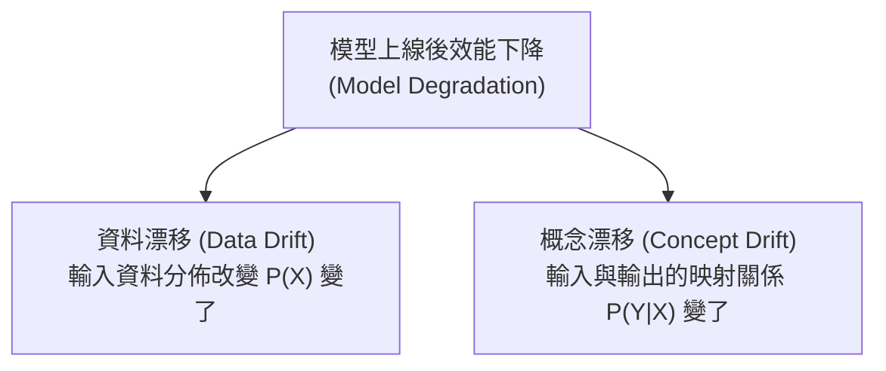

# L213 AI 技術應用與系統部署 考點精華筆記

> **對應科目**：L21 人工智慧技術應用與規劃  
> **評鑑內容**：L21301 數據準備與模型選擇、L21302 AI 技術系統集成與部署  
> **官方指引章節**：科目一 第五章（5.1 ~ 5.2 節）

---

## 📌 L21301 數據準備與模型選擇

### 1. 資料前處理關鍵技術 (Data Preprocessing) [🎯 常考]
* **缺失值處理 (Missing Values)**：
  * **刪除法**：僅當缺失比例極低（< 1%~3%）或整列關鍵欄位完全缺失時適用。
  * **插補法 (Imputation)**：
    * 數值型：**平均值 (Mean)**（易受離群值影響）、**中位數 (Median)**（耐偏態與離群值）、眾數 (Mode)。
    * 類別型：眾數插補或新增獨立缺失類別（如 "Unknown"）。
    * 進階插補：KNN 近鄰插補、迴歸模型預測插補、隨機森林插補。
* **異常值/離群值處理 (Outlier Treatment)**：
  * 偵測方法：$3\sigma$ 原則（常態分佈假設）、四分位距法 ($IQR = Q3 - Q1$，邊界為 $[Q1 - 1.5 IQR, Q3 + 1.5 IQR]$）、孤立森林 (Isolation Forest)。
  * 處理方式：截尾 (Trimming/Winsorizing)、轉換或標記為缺失值重新插補。
* **特徵工程 (Feature Engineering)**：
  * **特徵編碼**：One-Hot Encoding（適用於低基數無順序類別）、Label / Ordinal Encoding（適用於有等級順序類別，如教育程度）、Target Encoding（高基數類別，但需嚴防目標洩漏 Data Leakage）。
  * **特徵縮放**：Min-Max 歸一化 ($[0, 1]$) 與 Z-Score 標準化 ($\mu=0, \sigma=1$)。樹狀模型（隨機森林、XGBoost）不受縮放影響；距離型（KNN、K-Means）與梯度下降模型（SVM、神經網路）必須縮放。

### 2. 過擬合 (Overfitting) 與 欠擬合 (Underfitting) 的診斷與對策 [🎯 常考]

| 狀態 | 表現特徵 | 核心原因 | 解決對策 |
|---|---|---|---|
| **欠擬合 (Underfitting)** | 訓練集表現差、測試集表現也差（高偏差 High Bias） | 模型太簡單、特徵不足、訓練不充分 | 增加模型複雜度、添加多項式或互動特徵、減少正則化強度、延長訓練 Epochs |
| **過擬合 (Overfitting)** | 訓練集表現極好、測試集表現差（高變異 High Variance） | 模型太複雜、樣本數不足、雜訊過多 | **增加訓練資料 (Data Augmentation)**、**正則化 (L1/L2)**、**Dropout**、Early Stopping、剪枝 (Pruning) |

* **L1 正則化 (Lasso)**：損失函數加 $\lambda \sum |w_i|$，促使部分權重嚴格歸零，產生**稀疏解 (Sparse Weights)**，兼具**特徵選擇**功能。
* **L2 正則化 (Ridge)**：損失函數加 $\lambda \sum w_i^2$，促使權重趨近於零但不歸零，限制模型權重大小以平滑預測曲線。

### 3. 模型選擇權衡維度 (Trade-offs)
* 模型選擇並非「準確度越高越好」，需依場景權衡：
  * **推論延遲 (Latency)**：即時自動駕駛/產線檢測要求低延遲（< 10ms），可能優先選輕量模型 (MobileNet, YOLO-tiny) 而非超大模型。
  * **運算資源與成本**：邊緣邊界設備算力有限，需評估模型量化 (Quantization) 與剪枝 (Pruning)。
  * **可解釋性需求**：金融信用評分需符合監管解釋要求，線性迴歸或決策樹比深度黑箱神經網路更受偏好。

---

## 📌 L21302 AI 技術系統集成與部署

### 1. 部署環境架構選型比較 [🎯 常考]

| 架構類型 | 核心優勢 | 主要缺點 / 限制 | 適用業務情境 |
|---|---|---|---|
| **雲端部署 (Cloud AI)** | 算力彈性擴展 (Auto-scaling)、集中維護、支援超大型模型 | 網路依賴度高、延遲較大、資料外傳隱私與法規限制 | 大規模離線分析、無即時性要求之企業應用、SaaS 服務 |
| **邊緣部署 (Edge AI)** | **超低推論延遲、斷網可離線運作、資料不出本地高隱私** | 邊緣端硬體算力/記憶體有限、設備分散維護難度高 | 智慧工廠 AOI 即時檢測、自動駕駛車輛、行動裝置攝影辨識 |
| **混合架構 (Hybrid AI)** | 兼顧邊緣端的即時響應與雲端端的龐大模型再訓練能力 | 架構設計最複雜、跨端同步與通訊開銷需精細控制 | 邊緣執行輕量模型即時推論，難題或日誌回傳雲端進行深度分析與模型再訓練 |

### 2. 容器化與服務化架構
* **容器技術 (Docker)** [🎯 常考]：將模型、程式碼、底層函式庫依賴環境完整打包，**確保跨平台環境一致性**，徹底解決「在我電腦上能跑，在伺服器上跑不動」的痛點。
* **容器編排 (Kubernetes / K8s)**：管理多容器之自動部署、負載平衡、自動擴縮容 (Auto-scaling) 與自我修復 (Self-healing)。
* **API 微服務 (RESTful API / gRPC)**：以標準化接口將推論服務獨立封裝，支援高併發並與前後端業務系統解耦。

### 3. MLOps 與模型生命週期治理 [🎯 常考極高頻]
* **MLOps 核心精神**：將 DevOps 原則引進機器學習，建立包含資料提取、模型訓練、自動化評估、發布部署、上線監控與回饋循環的端到端自動化管線 (Pipeline)。
  * **CI (Continuous Integration)**：程式碼與資料/模型驗證的持續整合。
  * **CD (Continuous Delivery/Deployment)**：模型服務與管線的持續交付與上線。
  * **CT (Continuous Training)**：當模型效能衰退時，自動觸發重新訓練的持續訓練機制。

### 4. 模型漂移 (Model Drift) 類型與因應對策 [🎯 必考概念]

* **資料漂移 (Data Drift / Covariate Shift)**：
  * 定義：**輸入特徵的分佈 $P(X)$ 發生變化**，但特徵與目標的實質關係未變。
  * 案例：攝影機鏡頭因老化磨損導致拍攝照片色溫偏移；疫情爆發導致電商搜尋的熱門詞彙分佈劇變。
* **概念漂移 (Concept Drift)**：
  * 定義：**輸入特徵與輸出標籤之間的映射關係 $P(Y|X)$ 發生實質改變**。
  * 案例：新型信用卡詐欺手法的轉變，使得原本被判定為正常的刷卡行為實際上已是盜刷行為。
* **因應對策**：
  * 建立即時監控告警看板（追蹤 KS 檢定、PSI 群體穩定性指標、預測準確率與延遲）。
  * 設定自動觸發重新訓練門檻 (Trigger Retraining)。
  * 採行 **藍綠部署 (Blue-Green)**、**金絲雀部署 (Canary)** 或 **A/B 測試** 逐步切換流量，驗證新模型穩定性。

---

## 💡 考前 10 句精華速記 (L213)

1. **偏態資料插補**：面對具偏態分佈或離群值的數值資料，補值首選**中位數 (Median)** 而非平均值。
2. **L1 vs L2 正則化**：L1 (Lasso) 能使權重稀疏歸零，具備特徵選擇能力；L2 (Ridge) 限制權重極端大小以防止過擬合。
3. **過擬合核心症狀**：訓練集表現極好、測試集表現急遽下降（高變異）；解法為增補資料、Dropout、正則化。
4. **容器技術 Docker 優勢**：提供模型運行的獨立環境，保證跨平台部署的一致性與可移植性。
5. **邊緣部署 (Edge) 核心價值**：實現「**極低推論延遲、斷網離線運作、資料本地隱私不外流**」。
6. **MLOps 核心目標**：實現機器學習生命週期的自動化，包含 CI/CD 與自動再訓練 (CT)。
7. **資料漂移 (Data Drift)**：輸入特徵分佈 $P(X)$ 改變，如相機老化產生色差。
8. **概念漂移 (Concept Drift)**：輸入與輸出的關係 $P(Y|X)$ 改變，如詐欺手法更新使舊有正常模式變成異常。
9. **金絲雀部署 (Canary)**：先放行 5%~10% 小部分流量至新模型測試穩定度，無誤後再全面切換。
10. **模型選擇黃金法則**：不是選準確率最高的，而是要在精度、推論速度、硬體成本與可解釋性間取得最佳平衡。
