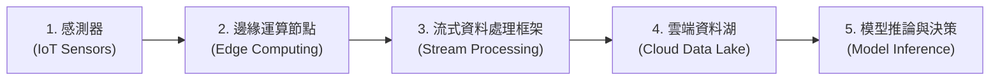

# L222 大數據處理技術 考點精華筆記

> **對應科目**：L22 大數據處理分析與應用  
> **評鑑內容**：L22201 數據收集與清理、L22202 數據儲存與管理、L22203 數據處理技術與工具  
> **官方指引章節**：科目二 第四章（4.1 ~ 4.3 節）

---

## 📌 L22201 數據收集與清理

### 1. 大數據 5V 特徵架構 [🎯 常考]
* **Volume (大量性)**：資料規模龐大，由 TB 躍升至 PB、EB 等級，超越傳統單機資料庫處理極限。
* **Velocity (高速性)**：資料生成與傳輸速度極快（如物聯網感測器、金融高頻交易、即時社群訊息），需即時或近即時處理。
* **Variety (多樣性)**：資料型態繁雜，包含結構化、半結構化與非結構化資料。
* **Veracity (真實性/可信度)**：資料中存在雜訊、缺失值、異常值或偽造資訊，資料品質控制至關重要。
* **Value (價值性)**：資料整體價值極高，但**價值密度往往極低 (Low Value Density)**，需透過深度挖掘才能提煉商業洞察。

### 2. 資料結構型態分類

| 資料型態 | 定義與特徵 | 典型格式與案例 | 適用儲存系統 |
|---|---|---|---|
| **結構化資料 (Structured)** | 具固定 Schema，二維表格型態（行列分明） | SQL 表格、CSV、關聯式資料庫 | MySQL, PostgreSQL, Oracle |
| **半結構化資料 (Semi-Structured)** | 無嚴格固定表格，但具自描述結構標籤 (Self-describing) | **JSON, XML, YAML, 網頁日誌 (Log)** | MongoDB, ElasticSearch |
| **非結構化資料 (Unstructured)** | 完全無特定預定義結構，佔企業資料 80% 以上 | 文字文章、PDF、影像 (JPEG/PNG)、音訊 (MP3)、影片 | 物件儲存 (S3)、HDFS、向量資料庫 |

---

## 📌 L22202 數據儲存與管理

### 1. RDBMS vs. NoSQL 核心架構對照 [🎯 常考極高頻]

| 比較維度 | 關聯式資料庫 (RDBMS) | 非關聯式資料庫 (NoSQL) |
|---|---|---|
| **事務特性** | **ACID** (原子性、一致性、隔離性、持久性) | **BASE** (基本可用 Basically Available, 軟狀態 Soft state, 最終一致性 Eventual consistency) |
| **資料架構** | 靜態強綱要 (Schema-on-Write) | 動態無綱要 (Schema-less / Dynamic) |
| **擴展方式** | **垂直擴展 (Scale-Up)**（升級單機 CPU/RAM，硬體上限高、昂貴） | **水平擴展 (Scale-Out / Sharding)**（向外擴充低成本伺服器叢集） |
| **分散式理論** | 保證強一致性 (CA 傾向) | 遵循 **CAP 定理**（一致性 C、可用性 A、分區容忍性 P 三者不可兼得，通常在 AP 或 CP 間取捨） |

* **ACID 四大事務特性與多節點交易運作** [🎯 必考情境]：
  * **原子性 (Atomicity)**：定義為**「交易不可分割 (All-or-Nothing)」**。在分散式多節點交易中，若其中**任一節點發生錯誤或寫入失敗**，系統必須透過原子性機制確保整筆交易**全部成功提交 (Commit) 或全部回復 (Rollback)**，絕不允許部分節點成功、部分節點失敗的中間不一致狀態。
  * **一致性 (Consistency)**：交易執行前後，資料庫必須始終符合所有預定義的完整性約束規則（如帳戶總額守恆、外鍵約束）。
  * **隔離性 (Isolation)**：多個併發交易同時執行時彼此隔離互不干擾，防止髒讀 (Dirty Read)、不可重複讀與幻讀。
  * **持久性 (Durability)**：一旦交易成功提交，其對資料的修改即永久保存，即使系統隨後斷電或當機也不會遺失。

### 2. NoSQL 四大儲存模型選型表與圖譜建模 [🎯 常考]

| 類型 | 特點與運作機制 | 典型代表 | 適用場景 |
|---|---|---|---|
| **鍵值儲存 (Key-Value)** | 透過 Key 快速存取 Value，讀寫效能極高，不支援複雜查詢 | **Redis**, AWS DynamoDB | 快取 (Cache)、使用者 Session 狀態、購物車 |
| **文件儲存 (Document)** | 以 JSON/BSON 格式儲存階層式文件，支援巢狀查詢 | **MongoDB**, CouchDB | 內容管理系統 (CMS)、電商產品型錄、日誌收集 |
| **欄式儲存 (Column-Family)** | 依欄位 (Column) 聚合儲存，極利於特定欄位的大規模聚合運算與高壓縮 | **Apache Cassandra**, HBase | 大規模時間序列資料、物聯網感測器數據、點擊流追蹤 |
| **圖形儲存 (Graph)** | 以節點 (Node) 與邊 (Edge) 建立複雜實體關係，查詢關係鏈極快 | **Neo4j**, Amazon Neptune | **社群網路互動關係分析**、反洗錢金流網絡追蹤、知識圖譜 |

* **圖形資料庫 (Graph Database) 之「邊屬性 (Edge Property)」設計實務** [🎯 常考建模題]：
  * **節點 (Node / Vertex)**：代表實體物件（如「使用者 User」、「貼文 Post」、「商品 Product」），存放實體自身屬性（如姓名、貼文內容）。
  * **邊 (Edge / Relationship)**：代表兩個節點之間的**互動行為或關聯**（如「按讚 LIKE」、「追蹤 FOLLOW」、「購買 BUY」）。
  * **邊的屬性 (Edge Property)**：當社群平台需要記錄某次「按讚行為」發生的**時間戳記 (Timestamp)** 與使用的**裝置類型 (Device Type，如 iOS/Android/Web)** 時，因為這些資訊屬於「該次互動關係本身」而非使用者或貼文的固定屬性，應將按讚時間與裝置類型設計為**「邊的屬性 (Edge Property)」**來連結使用者節點與貼文節點。
* **知識圖譜 (Knowledge Graph) 與 RDF 三元組** [🎯 常考定義]：
  * 為了支援**語意查詢 (Semantic Query)** 與**關聯邏輯推理 (Reasoning)**，知識圖譜常採用 W3C 標準之 **RDF (Resource Description Framework，資源描述框架)** 進行知識表達。
  * RDF 的核心資料結構為**「主體–謂詞–客體 (Subject–Predicate–Object, SPO)」三元組**（例如：`[愛因斯坦 (主體)] — [提出 (謂詞)] → [相對論 (客體)]`），其中主體與客體對應圖中的節點，謂詞則對應有向邊。

### 3. 分散式儲存與現代架構演進
* **HDFS (Hadoop Distributed File System)**：
  * **架構主從分離**：**NameNode**（管理檔案系統中繼資料 Metadata 與 Block 映射，單點關鍵）、**DataNode**（分散式實體儲存 Data Block）。
  * **容錯機制**：預設採用 **3 份冗餘複本 (Replication = 3)** 分散儲存於不同機架，確保節點損毀時資料不遺失。
* **資料儲存架構演變**：
  * **資料倉儲 (Data Warehouse)**：預先定義 Schema (Schema-on-Write)，高度清洗後之結構化資料，專注於歷史 BI 報表與 SQL 分析（如 Snowflake, BigQuery）。
  * **資料湖 (Data Lake)**：儲存原始格式 (Schema-on-Read)，支援各類結構/非結構資料，成本低；若缺乏治理容易淪為「資料沼澤 (Data Swamp)」。
  * **資料湖倉 (Lakehouse)**：結合資料湖的低成本彈性與資料倉儲的 ACID 事務與資料治理能力（如 Apache Iceberg, Delta Lake）。

---

## 📌 L22203 數據處理技術與工具

### 1. 批次處理 vs. 串流處理架構

| 維度 | 批次處理 (Batch Processing) | 串流即時處理 (Stream Processing) |
|---|---|---|
| **資料特性** | 有界資料 (Bounded Data)、靜態歷史批次 | 無界資料 (Unbounded Data)、連續動態流入 |
| **延遲等級** | 分鐘至數小時等級 (High Latency) | **毫秒至秒級 (Low Latency)** |
| **代表技術** | Hadoop MapReduce, **Apache Spark (Core)** | **Apache Kafka**, **Apache Flink**, Spark Streaming |
| **適用情境** | 每日財務結算報表、大規模模型離線訓練 | **金融信用卡即時防詐**、物聯網設備異常告警、即時推薦 |

* **IoT 高頻即時流式架構鏈條 (End-to-End IoT Streaming Pipeline)** [🎯 必考架構順序]：
  * 在智慧製造與車聯網等高頻感測場景中，為了同時兼顧**毫秒級低延遲即時回應**與**雲端海量歷史資料留存/模型推論**，標準端到端處理鏈條順序為：
    **感測器 (Sensors) → 邊緣運算節點 (Edge Computing，就近初步過濾與降噪) → 流式資料處理框架 (Stream Processing，如 Kafka/Flink 即時彙整與視窗計算) → 雲端資料湖 (Cloud Data Lake，持久化歸檔海量原始與特徵資料) → 模型推論與應用 (Model Inference)**。



### 2. Apache Kafka 核心組件架構 [🎯 常考]
* **Broker**：Kafka 叢集中的伺服器節點。
* **Topic (主題)**：訊息分類發布的邏輯頻道。
* **Partition (分區)**：Topic 內部的物理切分，**是 Kafka 實現高吞吐平行處理與水平擴展的核心關鍵**。
* **Offset (偏移量)**：每條訊息在 Partition 內部的唯一遞增序列編號，確保消費者能依序讀取。
* **Producer (生產者)** 與 **Consumer Group (消費者群組)**：實踐發布-訂閱 (Pub/Sub) 模式，同一群組內的消費者互斥消費不同分區，實現負載平衡。

### 3. ETL vs. ELT 現代架構變遷
* **傳統 ETL (Extract-Transform-Load)**：在資料載入目標倉儲**之前**先進行轉換，轉換工作由獨立 ETL 伺服器承擔，適合地端傳統運算。
* **現代 ELT (Extract-Load-Transform)**：先將原始資料直接載入雲端資料倉儲或資料湖，再利用雲端分散式強大算力進行即時隨需轉換，具更高彈性與效率。

---

## 🐍 Python / PySpark 大數據處理高頻考點與實戰代碼

歷屆考題常出現巨量資料前處理、記憶體溢位 (OOM) 應對、Pandas 型態特性與 Spark 分散式運算的核心代碼考題：

### 1. 處理巨量資料避免記憶體溢位 (OOM, Out of Memory)
* **情境**：單機記憶體 16GB，需要讀取並處理 50GB 的超大型 CSV 檔。
* **解法**：使用 `chunksize` 參數分塊串流讀取，而非一次性載入記憶體。
```python
import pandas as pd

# 考點：使用 chunksize 分批迭代處理大型檔案，防止 OOM
chunk_size = 50000  # 每次載入 50,000 筆
total_revenue = 0

for chunk in pd.read_csv('massive_transactions_50gb.csv', chunksize=chunk_size):
    # 針對各 chunk 做欄位聚合運算
    total_revenue += chunk['sales_amount'].sum()

print("總銷售金額:", total_revenue)
```

### 2. Pandas 型態轉換陷阱（NaN 導致整數轉浮點數與 `Int64` 轉型） [🎯 必考程式碼題]
* **考點原因**：CSV 檔案中的整數欄位（如遊戲發售年份 `Year`：2006、2008）被載入後卻變成 `float64`（顯示為 `2006.0`），主因是**該欄位中含有空值 (`NaN`)**，而傳統 NumPy 整數型別 (`int64`) 不支援 `np.nan`，迫使 Pandas 自動將整欄向上轉型為浮點數 `float64`。
* **標準解決語法**：若要在**保留空值 (`<NA>`) 的同時將欄位轉為整數型態**，應採用 Pandas 的 Nullable Integer 擴充型態 **`data['Year'].astype('Int64')`**（注意開頭為大寫 `I`；若直接寫小寫 `.astype('int64')` 或 `.astype(int)` 會在遇到 `NaN` 時拋出 `ValueError: Cannot convert non-finite values (NA or inf) to integer`）。
```python
import pandas as pd

# 載入資料（Year 欄位含缺失值 NaN）
data = pd.read_csv('vgsales.csv')
print(data['Year'].dtype)  # 輸出: float64 (主因：欄位中含有空值 NaN)

# ✔️ 考題標準寫法：保留空值的同時轉為整數型態（大寫 Int64）
data['Year'] = data['Year'].astype('Int64')

# 替代方式：若不保留空值，需先以 fillna() 填補後才能轉一般 int
# data['Year'] = data['Year'].fillna(0).astype(int)
```

### 3. Python 函式預設參數可變物件陷阱 (Mutable Default Argument)
* **考點**：在資料清洗 pipeline 中，定義函式時若將可變物件（如 `list`、`dict`）作為預設參數，該預設物件會在所有函式呼叫間被**共享引用**，導致上一筆資料的處理結果殘留在下一筆中。
```python
# ❌ 錯誤寫法（考題常考抓錯）：
def process_record_buggy(record, tags=[]):
    tags.append("checked")       # 每次呼叫都會持續累積到同一個 tags 列表中！
    record['tags'] = tags
    return record

# ✔️ 正確寫法：使用 None 作為預設值，內部動態初始化
def process_record_correct(record, tags=None):
    if tags is None:
        tags = []
    tags.append("checked")
    record['tags'] = tags
    return record
```

### 4. PySpark / 分散式 RDD & DataFrame 統計與避免 Driver OOM
* **情境**：在 Spark 叢集上處理包含 10 億筆紀錄的大規模資料集，計算標準差等統計量。
* **正確策略**：善用 Spark 內建的分散式統計方法（如 `DataFrame.agg({'col': 'stddev'})` 或 `RDD.aggregate()`），由各 Executor 節點平行計算部分統計量後再行匯總。
* **致命錯誤考點**：**嚴禁呼叫 `collect()` 將 10 億筆資料全部拉回 Driver 本機記憶體**，這會瞬間導致 Driver 端 Out of Memory 崩潰！
```python
from pyspark.sql import SparkSession
from pyspark.sql.functions import stddev, avg

spark = SparkSession.builder.appName("BigDataStats").getOrCreate()
df = spark.read.parquet("hdfs://cluster/logs/1b_records.parquet")

# ✔️ 正確作法：利用分散式計算引擎進行聚合
stats = df.agg(avg("duration"), stddev("duration")).collect()
print("分散式計算完成之統計結果:", stats)

# ❌ 錯誤作法（考題陷阱）：
# all_data = df.collect()  # 10 億筆直接撐爆 Driver 記憶體！
```

---

## 💡 考前精華速記 (L222)

1. **半結構化資料格式**：典型代表為 **JSON、XML 與系統日誌 (Log)**，具自描述性標籤。
2. **大數據 5V 之首要特性**：大量性 (Volume)、高速性 (Velocity)、多樣性 (Variety)、真實性 (Veracity)、價值性 (Value)。
3. **RDBMS vs NoSQL**：RDBMS 強調 ACID 與垂直擴展；NoSQL 強調 BASE、CAP 權衡與**水平擴展 (Scale-Out)**。
4. **ACID 原子性 (Atomicity)**：交易不可分割，多節點交易中若任一節點發生錯誤，必須確保**全部成功或全部回復 (Rollback)**。
5. **圖形資料庫邊屬性 (Edge Property)**：社群平台中按讚行為若包含「時間戳記」與「裝置類型」，應設計為**邊的屬性 (Edge Property)** 來連結使用者與貼文節點。
6. **知識圖譜與 RDF 三元組**：支援語意查詢與關聯推理的知識圖譜，常建構為 **RDF** 的**主體–謂詞–客體 (Subject–Predicate–Object)** 三元組。
7. **IoT 高頻即時流式架構鏈條**：標準順序為 **感測器 → 邊緣運算節點 → 流式資料處理框架 → 雲端資料湖 → 模型推論**。
8. **Pandas 整數變 `float64` 與轉型**：主因是欄位含空值 (`NaN`)；應使用 **`data['Year'].astype('Int64')`** 在保留空值的同時轉為整數。
9. **HDFS 核心容錯與 NameNode**：預設建立 **3 份複本 (Replicas)** 容錯；NameNode 專責維護目錄樹與 Block 映射**中繼資料 (Metadata)**。
10. **Kafka 高吞吐與資料湖倉**：Kafka 透過 **Topic 分區 (Partition)** 實現平行吞吐；**資料湖倉 (Lakehouse)** 兼具資料湖彈性與資料倉儲 ACID 治理。
