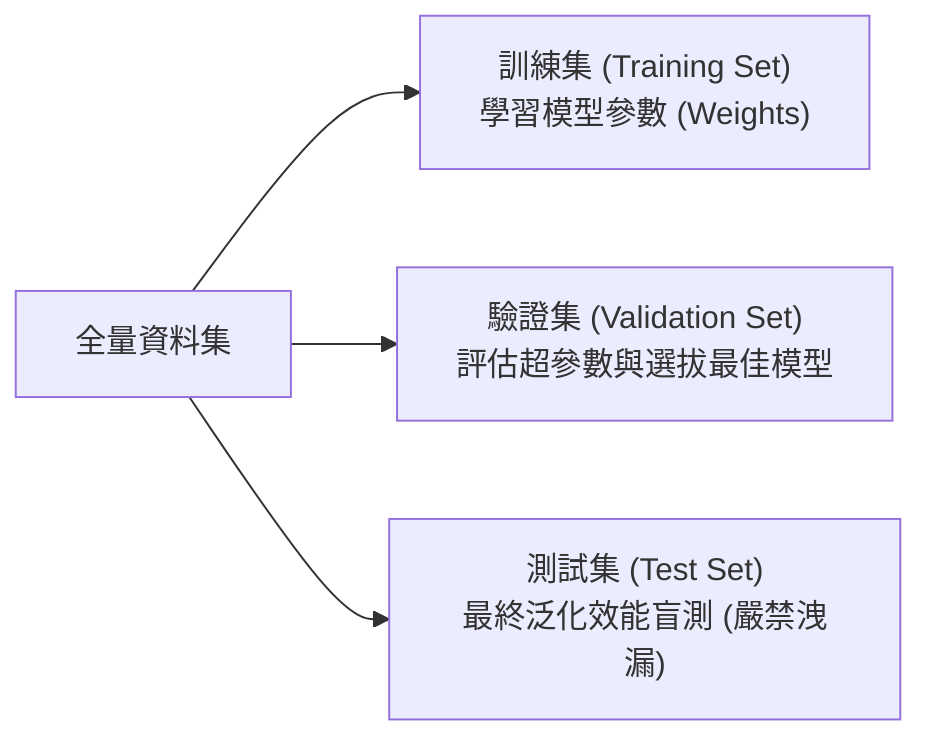

# L233 機器學習建模與參數調校 考點精華筆記

> **對應科目**：L23 機器學習技術與應用  
> **評鑑內容**：L23301 數據準備與特徵工程、L23302 模型選擇與架構設計、L23303 模型訓練/評估/驗證、L23304 模型調整與優化  
> **官方指引章節**：科目三 第五章（5.1 ~ 5.4 節）

---

## 📌 L23301 數據準備與特徵工程

### 1. 特徵選擇三大方法深度比較 [🎯 常考極高頻]

| 方法類型 | 運作機制 | 優點 | 缺點 / 限制 | 經典代表演算法 |
|---|---|---|---|---|
| **過濾法 (Filter)** | **完全獨立於機器學習模型**，利用單一統計指標評估特徵與標籤的相關性或資訊量 | 計算速度極快，能快速篩除巨量無用維度 | 忽略特徵之間的組合交互作用，且無法針對特定模型優化 | 卡方檢定 ($\chi^2$)、皮爾森相關係數、互資訊 (Mutual Information)、變異數閾值 (Variance Threshold) |
| **包裝法 (Wrapper)** | **將特徵選擇視為搜尋優化問題**，將特定學習演算法作為黑箱，以模型預測評分反覆評估特徵子集 | 考慮了特徵間的交互作用，且完美契合特定模型架構 | **計算複雜度極其昂貴**，特徵維度高時極易發生嚴重過擬合 | **遞迴特徵消除 (RFE, Recursive Feature Elimination)**、前向逐步選擇 (Forward Selection)、後向逐步淘汰 (Backward Elimination) |
| **嵌入法 (Embedded)** | **特徵選擇直接內建於演算法訓練過程中**，在擬合參數時同步完成特徵重要性篩選 | 兼具 Filter 的計算效率與 Wrapper 的模型匹配度 | 依賴特定支援特徵篩選的演算法架構 | **L1 正則化 (Lasso)**、決策樹 / 隨機森林之**特徵重要性 (Feature Importance)**、XGBoost |

---

## 📌 L23302 模型選擇與架構設計

### 1. 核心理論定理：沒有白吃的午餐定理 (No Free Lunch Theorem, NFL)
* **定理核心**：在對所有可能問題與資料分佈進行平均評估的前提下，**沒有任何單一機器學習演算法可以恆久勝過其他演算法**。
* **實務指導意涵**：脫離具體業務場景、資料分佈型態與資料規模討論「哪個模型最強」是毫無意義的；模型選擇必須依據特徵型態、線性/非線性、可解釋性需求與運算資源進行客製化權衡。

### 2. 模型參數 (Parameters) vs. 超參數 (Hyperparameters) [🎯 常考]
* **模型參數 (Model Parameters)**：
  * 定義：**在模型訓練過程中，由演算法根據訓練資料自動學習與更新的內部變數**。
  * 範例：線性迴歸的權重 $w$ 與偏置 $b$、神經網路各層的神經元連接權重矩陣、SVM 的支援向量權重。
* **超參數 (Hyperparameters)**：
  * 定義：**在模型訓練啟動之前，必須由工程師手動指定或透過調優演算法設定的外部配置值**。
  * 範例：學習率 (Learning Rate, $\eta$)、隨機森林中的樹木數量 (n_estimators) 與最大深度 (max_depth)、K-Means 的分群數 $K$、KNN 的鄰居數 $k$、正則化強度 $\lambda$、批次大小 (Batch Size)。

---

## 📌 L23303 模型訓練、評估與驗證

### 1. 資料切分與交叉驗證 (Cross-Validation)



* **$K$-折交叉驗證 ($K$-fold CV)**：將訓練資料切分成 $K$ 個互斥子集，輪流將 1 份作為驗證集、其餘 $K-1$ 份作為訓練集，最終取 $K$ 次評估結果的平均值。
* **分層 $K$-折交叉驗證 (Stratified $K$-fold CV)** [🎯 必考]：
  * 在資料集存在**類別分佈不平衡 (Imbalanced Classes)** 時，**保證每一折子集中各類別標籤的百分比嚴格等於原始母體的類別比例**，避免某一折完全沒有少數類樣本。

### 2. 迴歸模型核心評估指標

| 指標名稱 | 數學公式 | 關鍵特性與判讀準則 |
|---|---|---|
| **均方誤差 (MSE)** | $\text{MSE} = \frac{1}{n}\sum_{i=1}^{n}(y_i - \hat{y}_i)^2$ | 誤差平方放大，**對離群極端誤差極度敏感懲罰** |
| **均方根誤差 (RMSE)** | $\text{RMSE} = \sqrt{\text{MSE}}$ | 開根號後與原始標籤單位一致，具備物理直觀性 |
| **平均絕對誤差 (MAE)** | $\text{MAE} = \frac{1}{n}\sum_{i=1}^{n}|y_i - \hat{y}_i|$ | 取絕對值，**對離群值具備較高穩健性 (Robust)** |
| **決定係數 ($R^2$ Score)** | $R^2 = 1 - \frac{\sum(y_i - \hat{y}_i)^2}{\sum(y_i - \bar{y})^2} = 1 - \frac{SS_{\text{res}}}{SS_{\text{tot}}}$ | 衡量特徵變數能解釋目標變數變異的比例：<br>• $R^2 = 1$：完全完美預測。<br>• $R^2 = 0$：預測能力等同於直接猜平均值 $\bar{y}$。<br>• $R^2 < 0$：模型表現比直接猜平均值還要差。 |

---

## 📌 L23304 模型調整與超參數調優 (Hyperparameter Tuning)

### 1. 偏差-方差權衡 (Bias-Variance Tradeoff) [🎯 常考]

```
總誤差 (Total Error) = 偏差² (Bias²) + 方差 (Variance) + 不可化約誤差 (Noise)
```
* **高偏差 (High Bias) $\rightarrow$ 欠擬合 (Underfitting)**：模型過於簡單（如用線性迴歸擬合高度非線性資料），訓練集與測試集表現均差。解法：提高模型複雜度、增加特徵交互項、減少正則化。
* **高方差 (High Variance) $\rightarrow$ 過擬合 (Overfitting)**：模型過於複雜（如深度無限制的決策樹），對訓練集雜訊強行擬合，測試集表現暴跌。解法：增補資料、特徵選擇、增加正則化懲罰、Early Stopping、集成學習。

### 2. 三大超參數搜尋策略比較

| 調參方法 | 搜尋邏輯與運作原理 | 運算成本與效率 | 適用場景 |
|---|---|---|---|
| **網格搜尋 (Grid Search)** | 在使用者預先定義的離散參數網格中，**窮舉評估所有可能的笛卡爾積參數組合** | 隨著超參數數量增加，組合數呈指數級爆炸，極為耗時 | 超參數數量極少（1~2 個）且搜尋區間明確時 |
| **隨機搜尋 (Random Search)** | 在連續或離散的參數空間中進行**均勻隨機採樣** | 在相同運算時間預算下，**覆蓋的參數多樣性遠勝網格搜尋** | 超參數數量較多（3~6 個以上），探索效率極佳 |
| **貝氏優化 (Bayesian Optimization)** | **建立機率代理模型 (如高斯過程 GP)** 學習歷史超參數與目標分數的映射關係，利用獲取函數 (Acquisition Function, 如 Expected Improvement) **平衡探索 (Exploration) 與利用 (Exploitation)** | **以最少評估迭代次數精準收斂至全域最優解** | 深度學習模型單次訓練極昂貴（數小時至數天）的情境 |

---

## 💡 考前 10 句精華速記 (L233)

1. **特徵選擇三方法**：Filter 速度最快不靠模型；Wrapper 靠特定模型反覆搜尋最準但最慢；Embedded 邊訓練邊選（如 Lasso）。
2. **NFL 沒有白吃午餐定理**：脫離具體資料背景，不存在任何一個永遠全知全能的最強演算法。
3. **參數 vs 超參數**：權重 $w$ 與偏置 $b$ 是模型參數（資料學的）；學習率 $\eta$、樹深、Batch size 是超參數（人定或調優的）。
4. **Stratified $K$-fold 核心價值**：在類別不平衡資料中，確保每一折子集的少數類與多數類**佔比嚴格維持原始母體比例**。
5. **MAE vs RMSE 離群值**：若資料包含極端異常雜訊，MAE 比 RMSE 更穩健不易被離群值拉偏。
6. **決定係數 $R^2$ 判別**：衡量模型解釋資料變異的比例，正常介於 0 到 1 之間，若小於 0 代表模型比猜平均值更爛。
7. **偏差高 vs 方差高**：偏差高是欠擬合（學不夠）；方差高是過擬合（學太死、對訓練集敏感）。
8. **隨機搜尋優於網格搜尋**：在高維參數空間中，隨機搜尋在相同算力下能探索更多維度的關鍵連續值。
9. **貝氏優化超參數調校**：利用代理模型（高斯過程）結合歷史試驗結果，以最少試驗次數智慧定位最佳參數。
10. **Early Stopping 終止判準**：持續監控「驗證集損失 (Validation Loss)」，一旦數個 Epoch 不再下降立即停止訓練以防過擬合。
