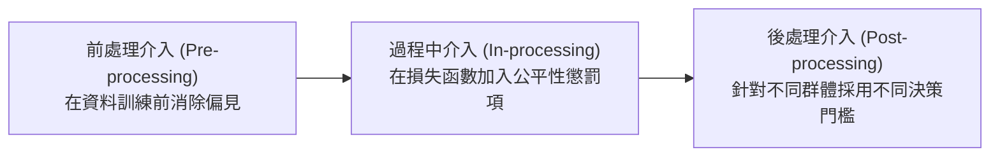

# L234 機器學習治理 考點精華筆記

> **對應科目**：L23 機器學習技術與應用  
> **評鑑內容**：L23401 數據隱私、安全與合規、L23402 演算法偏見與公平性  
> **官方指引章節**：科目三 第六章（6.1 ~ 6.2 節）

---

## 📌 L23401 數據隱私、安全與對抗性威脅

### 1. 針對機器學習模型的五大核心安全攻擊類型 [🎯 常考極高頻]

| 攻擊類型 | 攻擊發生的生命週期階段 | 攻擊手法與運作機制 | 危害後果 | 防禦與對抗策略 |
|---|---|---|---|---|
| **資料投毒 (Data Poisoning)** | **模型訓練階段 (Training)** | 攻擊者在公開或未經審核的訓練集中**惡意植入被污染的樣本或後門觸發器 (Backdoor Trigger)** | 模型在正常樣本上表現正常，但遇到特定觸發特徵時必然做出攻擊者指定的惡意決策 | 嚴格的資料來源驗證、資料清洗去噪、強健異常值檢測、模型參數完整性校驗 |
| **對抗樣本攻擊 (Adversarial Attacks / Evasion)** | **模型推論階段 (Inference)** | 在正常輸入資料（如圖片）中加入**人類肉眼完全無法察覺的極微小數學微擾噪聲**（如 FGSM 演算法） | 深度神經網路以高達 99% 的信心度給出完全荒謬的錯誤分類（如將熊貓誤判為長臂猿） | **對抗訓練 (Adversarial Training)**（將對抗樣本納入訓練集）、輸入平滑化、隨機防禦 |
| **模型反推攻擊 (Model Inversion)** | **模型部署推論階段** | 攻擊者僅透過反覆呼叫黑箱預測 API 並觀察輸出機率，**逆向推導重建訓練集中的敏感私有資料** | 洩漏受訓者個人的高清人臉影像、機敏醫療病歷或金融隱私 | **差分隱私 (Differential Privacy)**、限制 API 回傳機率小數位數、輸出雜訊擾動 |
| **成員推論攻擊 (Membership Inference)** | **模型部署推論階段** | 透過比對目標樣本在模型上的預測損失或信心度分佈，判斷**某特定個人的資料是否存在於該模型的私有訓練集中** | 洩漏特定個人曾參與特定疾病研究（間接曝光隱私） | 正則化防止過擬合（過擬合程度越高越容易被識別）、Early Stopping、差分隱私 |
| **模型竊取 / 萃取 (Model Stealing / Extraction)** | **模型部署推論階段** | 透過海量呼叫商業 API，以「輸入-輸出對」訓練一個功能幾乎完全相同的影子複製品 (Distillation) | 侵害企業核心智慧財產權與商業資產 | API 頻率限制 (Rate Limiting)、防禦性浮水印 (Watermarking)、異常存取告警 |

---

## 📌 L23402 演算法偏見、公平性與倫理治理

### 1. 演算法偏見三大來源分析
1. **歷史偏見 (Historical Bias)**：
   * 來源：現存社會結構中既有的偏見與刻板印象，忠實地反映在歷史資料記錄中（例如：過往女性晉升主管比例偏低，模型直接從中學會歧視性規則）。
2. **抽樣 / 表徵偏見 (Representation / Sampling Bias)**：
   * 來源：訓練資料集在抽樣時嚴重失真，特定次群體 (Subgroups) 的樣本量極端稀少（例如：人臉辨識訓練集中 80% 為淺膚色男性，導致對深膚色女性的辨識錯誤率暴增）。
3. **測量偏見 (Measurement Bias)**：
   * 來源：在量化概念時選用了存在系統性誤差的「代理指標 (Proxy)」（例如：在司法風險評估中，將「被警察盤查逮捕的次數」直接當作「實際犯罪傾向」的代理變數）。

### 2. 機器學習三大核心公平性量化指標 [🎯 常考]

| 公平性準則 | 數學定義與要求 | 核心直觀哲學 | 局限性 / 適用情境 |
|---|---|---|---|
| **人口統計均等 (Demographic Parity)** | 各個受保護群體（如男性 vs 女性）獲得**正面結果（如核准貸款）的百分比必須完全相等**： $$P(\hat{Y}=1 \mid A=0) = P(\hat{Y}=1 \mid A=1)$$ | 追求最終結果的絕對平等 (Equality of Outcome) | 忽略不同群體間真實資質可能存在的客觀差異，可能損害商業利潤或模型精度 |
| **機會均等 (Equal Opportunity)** | 在**所有實際真正符合資格 ($Y=1$) 的受試者中**，各群體被模型成功挑選出的**真陽性率 (TPR / Recall) 必須相等**： $$P(\hat{Y}=1 \mid A=0, Y=1) = P(\hat{Y}=1 \mid A=1, Y=1)$$ | 追求機會面前人人平等，真正有實力者不因身分被差別對待 | 僅約束實際符合資格者，未限制對不符合資格者的誤報率 (FPR) |
| **均等賠率 (Equalized Odds)** | 各群體在**真陽性率 (TPR) 與 偽陽性率 (FPR) 上皆必須同時維持相等**： $$\text{TPR}_{A=0} = \text{TPR}_{A=1} \quad \text{且} \quad \text{FPR}_{A=0} = \text{FPR}_{A=1}$$ | 最嚴格的群體公平性標準，兼顧正確獎勵與錯誤處罰的平等性 | 數學上條件極度嚴苛，往往對模型預測精準度產生顯著壓制 |

### 3. 去偏見技術介入的三大階段

* **前處理 (Pre-processing)**：
  * **重新加權 (Reweighting)**：為歷史弱勢群體的少數樣本賦予更高的權重。
  * **對抗去偏編碼 (Adversarial Debiasing)**：學習一組特徵表示，在保留任務資訊的同時，使得鑑別器無法從中預測出敏感屬性（如性別）。
* **過程中處理 (In-processing)**：
  * 在模型的目標損失函數中，除了最小化預測誤差外，加入違反公平性指標（如群體預測差距）的**正則化約束懲罰項 (Fairness Constraints)**。
* **後處理 (Post-processing)**：
  * 保持既有模型預測分數不變，透過**動態調整不同敏感群體的二元分類決策閾值 (Thresholding)**，使輸出滿足機會均等。

---

## 💡 考前 10 句精華速記 (L234)

1. **資料投毒 (Data Poisoning)**：在訓練階段污染資料集或植入後門觸發器，使模型在特定條件下做出惡意預測。
2. **對抗樣本 (Adversarial Example)**：在推論階段加入人眼無法察覺的數學噪聲，誘騙深度神經網路產生荒謬誤判。
3. **對抗訓練價值**：將對抗樣本主動加入訓練集中進行重新訓練，是目前抵禦對抗攻擊最有效的方法。
4. **模型反推攻擊 (Model Inversion)**：僅靠查詢 API 輸出機率，即可逆向還原訓練集中的高解析度人臉個資。
5. **成員推論攻擊指標**：用以探測特定目標樣本是否曾被包含在私有訓練集中，過擬合模型最易遭受此攻擊。
6. **表徵偏見核心**：訓練資料集中特定弱勢次群體樣本數過少，導致模型對其泛化錯誤率顯著偏高。
7. **人口統計均等要求**：無論任何敏感群體，被判定為正類（如錄取、核貸）的**總比例必須嚴格相等**。
8. **機會均等 (Equal Opportunity)**：在所有實際合資格者中，各群體的**真陽性率 (TPR / Recall) 必須相等**。
9. **公平性介入三階段**：前處理（資料重加權）、過程中（損失函數加約束懲罰）、後處理（分群動態調整分類閾值）。
10. **差分隱私 (DP) 的防禦功效**：在模型梯度中加入數學噪聲，能徹底粉碎模型反推攻擊與成員推論攻擊。
