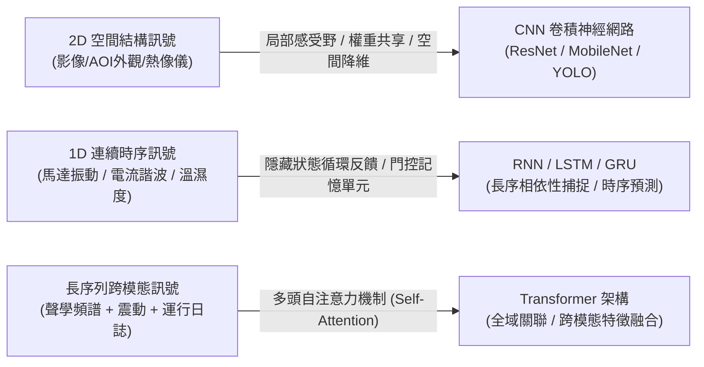
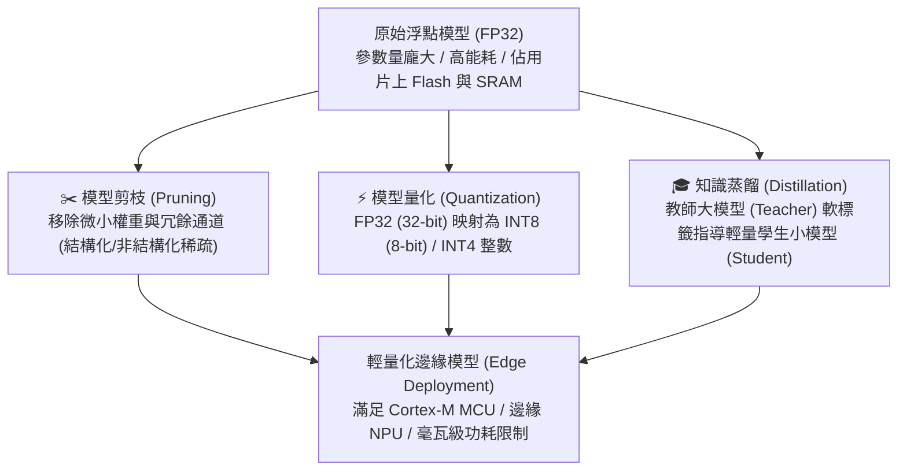
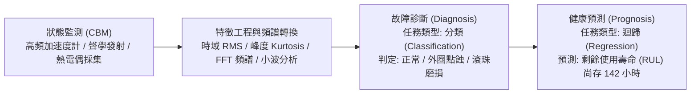

# L111 AI基礎知識與應用 考點精華筆記

> **對應科目**：科目 1【AIoT基礎概論】  
> **評鑑主題**：1. AI基礎知識與應用  
> **涵蓋單元**：L11101 AI基礎概念、L11102 AIoT應用案例  

---

## 📌 L11101 AI基礎概念

### 1. 機器學習三大學習範式比較矩陣

機器學習（Machine Learning, ML）為 AI 的核心分支。在 AIoT 邊緣與雲端系統中，依據「資料標籤狀態」與「決策回饋機制」，可分為三大主流學習範式：

| 學習範式 (Paradigm) | 核心特徵與資料需求 | 數學本質與任務目標 | 典型演算法 | AIoT 工業/物聯網典型應用場景 |
|---|---|---|---|---|
| **監督式學習 (Supervised Learning)** | 必須依賴包含**特徵 (Features, $X$)** 與**對應地面真值標籤 (Ground Truth Labels, $Y$)** 的大量訓練資料 | • **分類 (Classification)**：輸出為離散類別標籤（如正常/異常）<br>• **迴歸 (Regression)**：輸出為連續型物理數值（如溫度、壓力） | • SVM、隨機森林 (Random Forest)<br>• 邏輯迴歸 (Logistic Regression)<br>• 深度類神經網路 (CNN, MLP) | • 產線光學自動瑕疵分類 (AOI)<br>• 電機軸承表面刮傷等級判定<br>• 設備刀具剩餘壽命 (RUL) 連續時間預測 |
| **非監督式學習 (Unsupervised Learning)** | 訓練資料**完全無需任何人工標籤 ($X$ only)**，僅依賴特徵分佈與空間幾何關係 | • **分群 (Clustering)**：發掘資料內在自然結構與群集特徵<br>• **降維 (Dimensionality Reduction)**：消除特徵共線性、特徵壓縮 | • K-Means 分群、DBSCAN<br>• 主成分分析 (PCA)<br>• 自動編碼器 (Autoencoder, AE)<br>• 孤立森林 (Isolation Forest) | • 無標籤感測器未知異態偵測 (Anomaly Detection)<br>• 智慧電表用戶用電行為模式分群<br>• 高維度振動頻譜降維與特徵萃取 |
| **強化學習 (Reinforcement Learning, RL)** | 智慧代理人 (Agent) 在環境 (Environment) 中進行試錯 (Trial-and-Error)，依據即時回傳的**獎勵訊號 (Reward, $R$)** 進行動態最佳化 | 學習最優控制策略 (Policy $\pi^*$)，使長期累積折扣回報 (Cumulative Discounted Return $G_t$) 最大化：<br>$\max \mathbb{E}\left[\sum_{t=0}^{\infty} \gamma^t R_t\right]$ | • Q-Learning、DQN<br>• 策略梯度 (Policy Gradient)<br>• PPO (Proximal Policy Optimization)<br>• A3C | • 智慧大樓與晶圓廠 HVAC 空調節能動態溫控<br>• 自主移動機器人 (AMR/AGV) 即時避障與路徑規劃<br>• 智慧電網儲能充放電排程最佳化 |

---

### 2. 深度學習核心架構演進：CNN vs RNN/LSTM vs Transformer

在 AIoT 應用中，不同結構的神經網路針對特定物理感測訊號展現高度特化能力：



| 模型架構 | 核心數學原理與特徵捕捉機制 | 優勢特點 | 邊緣端部署挑戰 | AIoT 代表性應用 |
|---|---|---|---|---|
| **卷積神經網路 (CNN)** | • **局部感受野 (Local Receptive Fields)**<br>• **權重共享 (Weight Sharing)**<br>• 卷積核 (Kernel) 滑窗提取空間幾何特徵，池化層 (Pooling) 降維 | 對平移不變性 (Translation Invariance) 具有極佳適應力；參數量遠低於全連接網路 (MLP) | 高解析度影像需佔用大量片上 SRAM 影像緩衝區 (Line Buffers) 與 MAC (乘加) 運算單元 | 產線外觀瑕疵檢測 (AOI)、智慧車載 DMS 駕駛疲勞人臉辨識、紅外線熱成像過熱分析 |
| **循環神經網路 (RNN) & 長短期記憶模型 (LSTM)** | • 具備時間反饋循環隱藏狀態 ($h_t = \sigma(W x_t + U h_{t-1} + b)$)<br>• LSTM 引入**遺忘門 (Forget Gate)、輸入門 (Input Gate)、輸出門 (Output Gate)** 與細胞狀態 ($C_t$) | 完美保留時間序列長程歷史相依性 (Long-term Dependencies)，徹底解決傳統 RNN 的**梯度消失 (Vanishing Gradient)** 難題 | 屬於遞迴循序計算，無法在硬體端平行加速；隱藏狀態反覆讀寫記憶體頻寬開銷大 | 馬達三相電流諧波分析、軸承振動加速度計時序預測、智慧溫室微氣候溫濕度預報 |
| **Transformer 架構** | • **自注意力機制 (Self-Attention)**：<br>$\text{Attention}(Q, K, V) = \text{softmax}\left(\frac{Q K^T}{\sqrt{d_k}}\right)V$<br>• 矩陣平行化運算，無時間遞歸瓶頸 | 捕捉極長跨度的全域上下文語意；跨感測模態融合 (視覺+震動+聲學) 能力極強 | 計算複雜度隨序列長度成二次方增長 $O(N^2)$；參數量龐大，難以直接塞入低階 MCU | 工業音訊多模態異常事件辨識、智慧電網多站點負載聯合長週期預測 |

---

### 3. Edge AI 邊緣運算優勢與資源受限挑戰

將 AI 模型從雲端下放至終端（Edge Devices）或邊緣閘道器（Gateway）已成為 AIoT 的必然趨勢：

#### (1) Edge AI 五大核心優勢
1. **極低延遲 (Ultra-Low Latency)**：即時在毫秒（ms）等級甚至微秒級做出推論響應，無需等待封包往返雲端（Round-Trip Time, RTT）。
2. **頻寬成本大幅降低 (Bandwidth Efficiency)**：感測原始資料（如 4K 60fps 影像、10kHz 高頻振動原始訊號）在邊緣就地處理，僅需上傳「推論結果特徵值」或「異常警報」，節省 90% 以上頻寬開銷。
3. **隱私與資料安全 (Privacy & Security)**：機密製程參數、人臉圖像「數據不離地 (Data Stays On-Premise)」，符合資安法規與營業秘密保護。
4. **離線自主運作 (Offline Autonomy)**：在網路斷線、封包遺失或嚴苛工廠環境下仍具備 100% 本地即時控制與安全防護能力。
5. **雲端能耗與伺服器成本分攤**：將算力分散至成千上萬個邊緣終端，降低雲端中心算力伺服器之資本支出 (CAPEX) 與營運費用 (OPEX)。

#### (2) 邊緣嵌入式資源受限挑戰
* **SRAM 限制**：嵌入式微控制器 (MCU) 片內靜態記憶體極小（典型僅 64KB 至 2MB），推論時的中間特徵圖 (Activation Maps) 容易引發 Out-of-Memory (OOM)。
* **Flash 儲存空間受限**：模型權重 (Weights) 必須壓縮在片上 NOR Flash（典型 512KB 至 8MB）內。
* **功耗預算嚴苛**：電池供電或太陽能供電節點之功耗上限通常在毫瓦 (mW) 甚至微瓦 ($\mu W$) 級別。
* **散熱無風扇限制**：工業工控機多採無風扇密閉機箱，熱設計功耗 (TDP) 受限。

---

### 4. MCU 模型壓縮三神技：量化、剪枝與知識蒸餾

為了讓參數量動輒數十 MB 的深度模型能夠運行於 Cortex-M 等資源受限的 MCU，模型壓縮為不可或缺的核心技術：



| 壓縮技術 | 原理與執行機制 | 記憶體與算力收益 | 準確度影響與代價 |
|---|---|---|---|
| **模型量化 (Quantization)** | 將神經網路的權重 (Weights) 與激勵值 (Activations) 從 **32 位元浮點數 (FP32)** 映射轉換為 **8 位元整數 (INT8)** 或更低位元 (INT4)：<br>$q = \text{round}\left(\frac{r}{S}\right) + Z$ ($S$: 縮放比例 Scale, $Z$: 零點 Zero-point) | • **模型檔案大小縮小至 1/4 (75% 節省)**<br>• SRAM 讀寫記憶體頻寬減少 75%<br>• 整數 SIMD 指令計算速度提升 2~4 倍且大幅節電 | 推論精確度僅產生微幅衰減（通常 $<1\%$）；可透過**量化感知訓練 (QAT, Quantization-Aware Training)** 進一步彌補精度損失 |
| **模型剪枝 (Pruning)** | • **非結構化剪枝 (Unstructured)**：將權重絕對值小於閾值的連接設為 0，形成稀疏矩陣 (Sparse Matrix)<br>• **結構化剪枝 (Structured)**：直接砍除一整個卷積核通道 (Filter/Channel Pruning) | • 參數量減少 50%~90%<br>• 結構化剪枝可直接減少 MAC 乘加運算次數與特徵圖體積，無需專門稀疏硬體支援 | 剪枝後需重新微調 (Fine-tuning)；過度剪枝會破壞特徵表徵能力導致嚴重欠擬合 |
| **知識蒸餾 (Knowledge Distillation)** | 採用 **Teacher-Student 雙架構**：以參數量龐大、準確率極高的教師模型（Teacher Model），輸出帶有暗知識的軟標籤機率分佈 (Soft Labels with Temperature $T$)，監督引導結構極簡的學生模型（Student Model）學習 | 學生模型參數量與計算複雜度可減少 80%~95%，非常適合部署於低成本 MCU | 訓練流程複雜，需要雙倍訓練時間與超參數調校 ($T$ 溫度參數與損失權重 $\alpha$) |

#### 數值算例：FP32 模型量化壓縮計算
* **已知條件**：某邊緣振動異常檢測 CNN 模型具有 $1.2 \times 10^6$ 個參數 (1.2 Million Parameters)，以標準 32-bit 浮點數儲存。
* **計算 FP32 原始模型大小**：
  $$\text{Size}_{FP32} = 1.2 \times 10^6 \times 4 \text{ Bytes} = 4.8 \times 10^6 \text{ Bytes} \approx 4.58 \text{ MB}$$
* **採用 INT8 量化後之模型大小**：
  $$\text{Size}_{INT8} = 1.2 \times 10^6 \times 1 \text{ Byte} = 1.2 \times 10^6 \text{ Bytes} \approx 1.14 \text{ MB}$$
* **結論**：模型儲存需求由 4.58 MB 降至 1.14 MB，完全滿足片上 2MB Flash 之 MCU 儲存限制，且 INT8 整數乘加運算比 FP32 運算節省超過 60% 之動態能耗。

---

### 5. NPU 專用推論加速器 vs CPU vs GPU 能效對比

在邊緣 AI 晶片選型中，**能效比 (Energy Efficiency, TOPS/Watt)** 是最關鍵的硬體評估指標：

| 運算處理核心 | 硬體架構特色 | 運算精度支援 | 核心任務定位 | 能效比 (TOPS/W) | AIoT 角色與優缺點 |
|---|---|---|---|---|---|
| **CPU (通用處理器)** | 具備多級 Cache、強大分支預測器與少數 ALU 核心；以循序指令執行為主 | 64-bit / 32-bit 浮點數及整數，支援 ARM Neon / SIMD 指令集 | 負責整體作業系統 (RTOS/Linux)、周邊通訊協定疊 (I2C/SPI/TCP/IP) 與邏輯控制 | 低 ($\sim 0.01 - 0.1$) | 邊緣系統大腦；通用性最佳但大規模平行矩陣乘加運算極為緩慢且耗電 |
| **GPU (圖形處理器)** | 擁有數千個微型流處理器核心 (Stream Processors)，專為大規模平行運算設計 | 支援 FP32、FP16、BF16、INT8，具有強大 Tensor Cores | 模型訓練 (Training) 首選；亦適用於高階邊緣複合推論 (如 Jetson 系列) | 中等 ($\sim 0.5 - 2$) | 矩陣平行算力極高；缺點為靜態與動態功耗龐大 (10W~300W)，無法用於電池鈕扣節點 |
| **NPU (神經網路處理器)** | **專用領域架構 (DSA)**：內部採用收縮陣列 (Systolic Array) 或專用 MAC 矩陣硬體；**徹底剝離複雜的反向傳播與分支預測邏輯** | 高度特化於 **INT8 / INT4 整數推論**，部分支援 FP16 | **僅專注於模型前向傳播 (Forward Propagation) 推論加速** | **極高 ($\sim 2 - 10+$)** | **AIoT 邊緣推論王者**；以最低毫瓦 (mW) 功耗實現數 TOPS 算力；缺點是不具備通用運算能力，必須依賴 Host CPU 協同排程 |

> [!WARNING] ⚠ 官方教材陷阱與實務細節：
> 1. **NPU 只能推論，不能在邊緣訓練**：考試常出陷阱選項「NPU 負責邊緣端深度神經網路的反向傳播訓練」。**這是完全錯誤的！** 邊緣 NPU 為了達到極限能效，硬體架構僅保留「前向推論 (Forward Propagation)」的乘加管線，所有的反向傳播梯度計算（Backpropagation）與權重梯度更新邏輯皆被拔除。
> 2. **量化與 ADC 的觀念混淆**：題目常混淆「類比訊號轉數位訊號的取樣量化 (ADC Quantization)」與「深度學習權重精度縮減的數值量化 (Model Quantization)」，前者是物理電壓離散化，後者是神經網路 FP32 轉 INT8 參數壓縮。
> 3. **由設計起始的隱私 (Privacy by Design, PbD)**：邊緣 AI 的隱私保護並非在資料庫加裝防火牆或讓使用者簽署免責同意書，而是「在架構設計初期就將資料不離地、特徵去識別化直接寫入推論管線」。

---

## 📌 L11102 AIoT應用案例

### 1. 智慧製造預測性維護 (PdM) 核心架構

工業 4.0 設備維護策略已從「事後維修 (Run-to-Failure)」與「定期保養 (Preventive Maintenance)」全面邁入「**預測性維護 (Predictive Maintenance, PdM)**」：



#### (1) 狀態監測 (Condition-Based Monitoring, CBM)
* 利用高頻加速度計（量測高頻衝擊與共振）、聲學發射 (AE) 感測器、紅外線測溫與三相電流互感器 (CT)，持續擷取馬達、主軸、泵浦運轉時的物理特徵。
* 訊號透過時域統計（RMS 均方根值、峰值因子 Kurtosis）與頻域轉換（FFT 快速傅立葉轉換、小波轉換 Wavelet）轉化為健康指標。

#### (2) 故障診斷 (Diagnosis) vs 健康預測 (Prognosis) 考點對照表

| 評估維度 | 故障診斷 (Diagnosis) | 健康預測 (Prognosis) |
|---|---|---|
| **核心問題** | **「現在設備壞了沒有？壞在哪裡？屬於哪種故障形態？」** | **「設備還能正常運轉多久？什麼時候會達到失效閾值？」** |
| **機器學習任務類型** | **分類任務 (Classification)** | **迴歸任務 (Regression)** |
| **模型輸出形式** | 離散類別標籤（如：0=正常、1=外圈點蝕、2=滾珠磨損、3=潤滑不足） | 連續型時間或週期數值（**剩餘使用壽命 Remaining Useful Life, RUL**） |
| **評估指標 (Metrics)** | 混淆矩陣、準確率 (Accuracy)、召回率 (Recall)、F1-score | 均方根誤差 (RMSE)、平均絕對誤差 (MAE)、評分函數 (Scoring Function) |
| **典型代表模型** | 支援向量機 (SVM)、隨機森林、ResNet-1D / 2D-CNN | LSTM / GRU、Transformer、高斯過程迴歸 (GPR)、Weibull 存活分析 |

---

### 2. 智慧農業與精準灌溉：時序特徵與端雲協作

* **感知部署**：在廣闊農田部署土壤墒情電導率 (EC) 感測器、土壤體積含水率 (VWC) 感測器、環境溫濕度與光照度光敏計。
* **低功耗傳輸**：農田缺乏有線網路與電源插座，節點必須採用電池供電，並透過 **LoRaWAN / NB-IoT** 等長距離低功耗廣域通訊（LPWAN）回傳。
* **端雲協作拓撲**：
  * **邊緣節點 (End Node)**：採休眠模式（Deep Sleep），每隔 15~30 分鐘定時喚醒，採集物理量並進行極限值超限檢測（如低溫霜害瞬時預警）。
  * **雲端平台 (Cloud AI)**：匯總多節點數週的溫濕度、土壤含水量時序資料，結合中央氣象署蒸發散量 (Evapotranspiration, $ET_0$) 公式與 LSTM 預測模型，動態下發精準灌溉電磁閥啟閉排程。

---

### 3. 智慧交通與車聯網 (V2X) 邊緣即時推論

車聯網（Vehicle-to-Everything, V2X）包含車對車 (V2V)、車對路側設施 (V2I)、車對行人 (V2P)：
* **感測融合 (Sensor Fusion)**：結合車載毫米波雷達（雷達抗天候雨霧佳但解析度低）、光達 LiDAR（3D 點雲高精確測距但雨霧穿透差）與車載攝影機（高解析度語意辨識但受光線影響），透過擴展卡爾曼濾波 (EKF) 或深層類神經網路實現互補融合，極大化系統強健性 (Robustness)。
* **路側邊緣運算單元 (RSU, Road-Side Unit)**：在十字路口燈桿部署 Edge AI 加速盒，即時執行 YOLO 檢測車流與行人軌跡，並藉由低延遲 C-V2X 通訊將「盲區鬼探頭」警報於 10ms 內廣播給周遭車輛。

---

### 4. 智慧醫療生理訊號 Edge AI 異常告警

* **感測訊號**：穿戴式智慧手錶/貼片採集光電容積脈搏波 (PPG) 與心電圖 (ECG) 訊號。
* **微型邊緣推論 (TinyML)**：直接在穿戴裝置的 Cortex-M4 微控制器內部運行輕量化 1D-CNN 或 Tiny-LSTM，即時偵測**心房顫動 (Atrial Fibrillation, AFib)** 等致命性心律不整。
* **隱私與合規實踐**：嚴格落實 **PbD 隱私原則**，患者的連續心電波形原始資料直接在穿戴端分析，僅於心律失常發生時才將結構化特徵摘要與求救警報經 BLE 加密推播至家屬手機，有效保護病人醫療隱私。

---


---

## 💻 🐍 邊緣端 Edge AI 輕量推論實戰代碼專區

在 AIoT 邊緣運算中，將訓練完成的雲端大型模型（TensorFlow / PyTorch）部署至邊緣設備（如工業閘道器、Raspberry Pi 或 NPU 加速單元）時，標準工業級工作流為：**「模型格式轉換 $\to$ INT8 後量化 (Post-Training Quantization, PTQ) $\to$ 輕量推論引擎載入執行」**。

以下展示兩種最主流的微秒級邊緣推論實作：**TFLite (INT8 量化模型)** 與 **ONNX Runtime (跨平台工業部署)**。

### 1. TFLite (TensorFlow Lite) INT8 量化模型邊緣推論

```python
import numpy as np
import time

try:
    # 支援標準 tensorflow 或輕量級 tflite_runtime (專為嵌入式 Linux/樹莓派優化)
    import tflite_runtime.interpreter as tflite
except ImportError:
    import tensorflow.lite as tflite

def run_tflite_edge_inference(model_path: str, sensor_input_data: np.ndarray):
    """
    在邊緣端載入 INT8 量化 TFLite 模型並執行高效率推論
    :param model_path: .tflite 模型檔案路徑
    :param sensor_input_data: 感測器特徵陣列 (例如: 128 點振動頻譜特徵)
    """
    print(f"[Edge AI] 載入 TFLite 輕量模型: {model_path}")
    # 1. 建立 TFLite Interpreter (可指定硬體加速 Delegate，如 EdgeTPU / NPU)
    interpreter = tflite.Interpreter(model_path=model_path)
    
    # 2. 分配靜態張量記憶體 (邊緣端避免動態記憶體配置引發 OOM)
    interpreter.allocate_tensors()

    # 3. 取得模型輸入與輸出張量之規格與量化參數 (Scale, Zero Point)
    input_details = interpreter.get_input_details()[0]
    output_details = interpreter.get_output_details()[0]
    
    print(f"輸入規格: 形狀={input_details['shape']}, 形態={input_details['dtype']}")
    print(f"量化參數: Scale={input_details['quantization_parameters']['scales']}, "
          f"ZeroPoint={input_details['quantization_parameters']['zero_points']}")

    # 4. 輸入特徵量化處理 (若模型為 Full INT8，需將浮點數感測物理量映射為 INT8 整數)
    scale, zero_point = input_details['quantization']
    if input_details['dtype'] == np.int8 and scale > 0:
        # 量化公式: q = round(r / Scale) + ZeroPoint
        quantized_input = np.round(sensor_input_data / scale + zero_point).astype(np.int8)
    else:
        quantized_input = sensor_input_data.astype(np.float32)

    # 5. 填入輸入張量緩衝區 (Set Tensor)
    interpreter.set_tensor(input_details['index'], quantized_input)

    # 6. 執行硬體推論並計時 (微秒級評估)
    t_start = time.perf_counter()
    interpreter.invoke()
    latency_ms = (time.perf_counter() - t_start) * 1000.0

    # 7. 提取輸出結果並反量化 (Dequantize: r = (q - ZeroPoint) * Scale)
    raw_output = interpreter.get_tensor(output_details['index'])
    out_scale, out_zero = output_details['quantization']
    if output_details['dtype'] == np.int8 and out_scale > 0:
        real_output = (raw_output.astype(np.float32) - out_zero) * out_scale
    else:
        real_output = raw_output

    predicted_class = np.argmax(real_output)
    confidence = float(np.max(real_output))
    
    print(f"[推論完成] 耗時: {latency_ms:.2f} ms | 預測類別: {predicted_class} | 置信度: {confidence:.4f}")
    return predicted_class, confidence, latency_ms

# 模擬工業電機 128 點振動 FFT 頻譜推論呼叫
if __name__ == "__main__":
    dummy_fft_features = np.random.uniform(0.0, 1.0, size=(1, 128)).astype(np.float32)
    # run_tflite_edge_inference("pdm_vibration_int8.tflite", dummy_fft_features)
```

---

### 2. ONNX Runtime 工業級邊緣推論引擎 (跨平台加速)

```python
import numpy as np
import time

try:
    import onnxruntime as ort
except ImportError:
    ort = None

def run_onnx_edge_inference(onnx_model_path: str, sensor_batch: np.ndarray):
    """
    使用 ONNX Runtime 載入 ONNX 模型並指定 CPU/NPU 執行提供者 (Execution Provider)
    """
    if ort is None:
        print("未安裝 onnxruntime，請執行 pip install onnxruntime")
        return None

    # 1. 設置 Execution Provider 優先級順序 (優先調用邊緣硬體加速單元)
    # 支援: 'CUDAExecutionProvider' (NVIDIA GPU), 'TensorrtExecutionProvider', 
    #       'OpenVINOExecutionProvider' (Intel CPU/iGPU), 'CPUExecutionProvider'
    providers = ['OpenVINOExecutionProvider', 'CPUExecutionProvider']
    
    session_options = ort.SessionOptions()
    session_options.graph_optimization_level = ort.GraphOptimizationLevel.ORT_ENABLE_ALL
    session_options.intra_op_num_threads = 2  # 限制 CPU 線程數，適配嵌入式多核
    
    session = ort.InferenceSession(onnx_model_path, sess_options=session_options, providers=providers)
    
    input_name = session.get_inputs()[0].name
    output_name = session.get_outputs()[0].name
    
    # 2. 執行推論
    t0 = time.perf_counter()
    outputs = session.run([output_name], {input_name: sensor_batch.astype(np.float32)})
    latency_ms = (time.perf_counter() - t0) * 1000.0
    
    print(f"[ONNX Runtime 推論] 耗時: {latency_ms:.3f} ms, 輸出維度: {outputs[0].shape}")
    return outputs[0]
```

#### 關鍵實務陷阱解析：
1. **輸入維度與 Batch 考量**：在邊緣推論中，通常使用 `Batch Size = 1`（即時單筆事件響應），此時應確認模型的 Batch 維度是否支援動態或固定為 1，避免維度不匹配拋出例外。
2. **記憶體抖動與預熱 (Warm-up)**：首次執行 `invoke()` 或 `session.run()` 時需進行記憶體映射與動態庫加載，延遲通常偏高（數十毫秒）。在邊緣程式開機初始化時，**必須執行 3~5 次虛擬推論預熱 (Warm-up)**，確保上線推論延遲平穩無抖動。

### 🎯 考前衝刺「一句話考點」

1. 機器學習三大範式中，監督式需要標籤資料，非監督式用於無標籤資料分群與未知異態探索，強化學習基於環境獎勵進行動態決策。
2. 卷積神經網路 (CNN) 核心具備局部感受野與權重共享，為產線 AOI 影像瑕疵辨識的首選架構。
3. RNN 與 LSTM 擁有隱藏狀態記憶機制，專門用於處理振動頻譜與微氣候等時間序列關聯資料。
4. 預測性維護 (PdM) 中，故障診斷 (Diagnosis) 判定設備狀態類別屬於「分類任務」，健康預測 (Prognosis) 估算剩餘壽命 RUL 屬於「迴歸任務」。
5. 模型量化 (Quantization) 將 FP32 浮點數權重轉換為 INT8 整數，可減少 75% 儲存空間與記憶體頻寬需求。
6. 模型剪枝 (Pruning) 透過移除絕對值微小的冗餘權重或通道，達成模型結構稀疏化與計算降載。
7. 神經網路處理器 (NPU) 為專用領域架構 (DSA)，專門針對前向推論進行加速，不具備雲端等級之反向傳播訓練硬體邏輯。
8. 邊緣運算 (Edge AI) 相比雲端的核心優勢為：極低毫秒延遲、節省傳輸頻寬、斷網離線自主運作與數據不離地之隱私保護。
9. 遵循「由設計起始的隱私 (PbD)」原則，AIoT 系統應在邊緣端執行特徵萃取或去識別化，避免原始隱私影音直傳雲端。
10. 感測融合 (Sensor Fusion) 透過整合影像、光達、雷達等異質資料互補盲點，是大幅提升自動駕駛與機器人強健性 (Robustness) 的關鍵技術。
