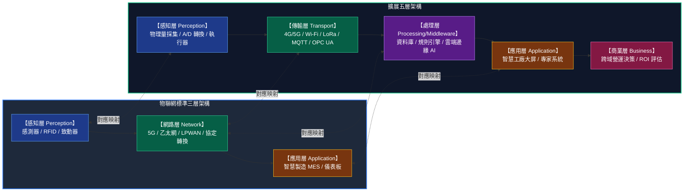
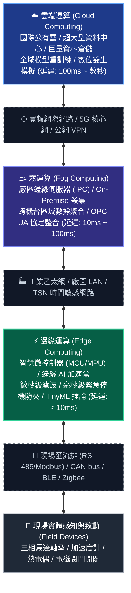
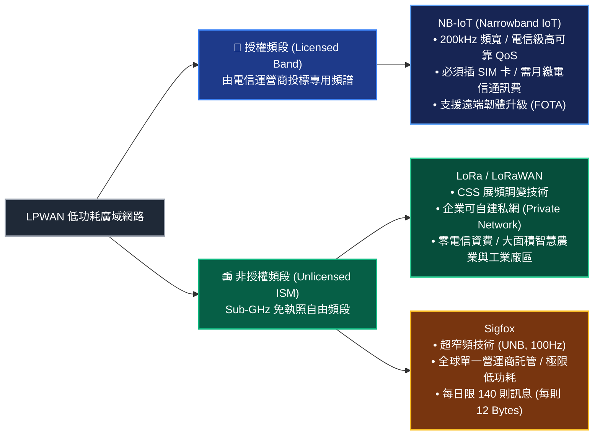
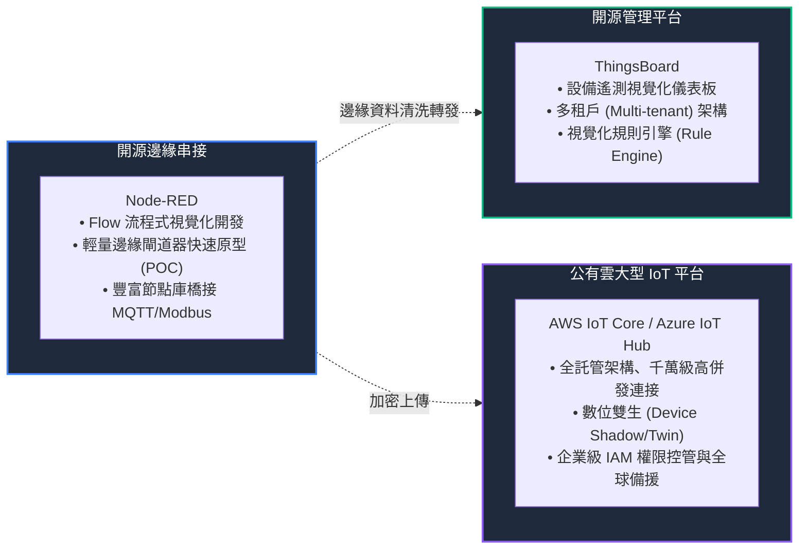
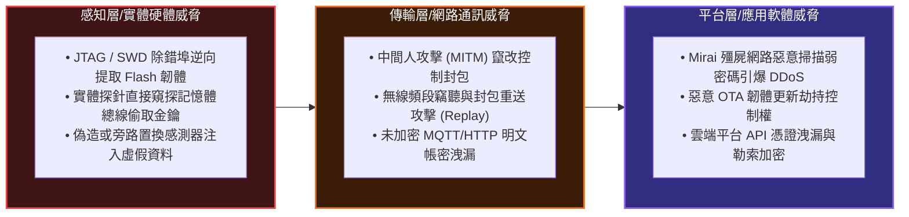

# L112 AIoT基礎與架構 考點精華筆記

> **對應科目**：科目 1【AIoT基礎概論】  
> **評鑑主題**：2. AIoT基礎與架構  
> **涵蓋單元**：L11201 物聯網架構與功能、L11202 常見通訊協定與網路層技術、L11203 工業通訊標準與資訊模型、L11204 中介軟體與平台、L11205 資安與隱私基本概念  

---

## 📌 L11201 物聯網架構與功能

### 1. 物聯網經典分層架構演進

物聯網（IoT）將物理實體世界數位化並連接至數位網路。依據系統抽象層次，最常見的標準劃分為**三層架構**與**五層架構**：



* **感知層 (Perception Layer)**：物聯網的「五官與神經末梢」，負責採集物理世界訊號（溫濕度、電流、壓力、聲學）或識別物體標籤（RFID/條碼），並將類比量轉換為微控制器可處理之數位資料。
* **網路/傳輸層 (Network/Transport Layer)**：物聯網的「傳導神經」，負責透過有線或無線通訊協定，將感知端海量遙測數據可靠、安全地路由並傳遞至伺服器或閘道器。
* **處理/中介層 (Processing/Middleware Layer)**：物聯網的「運算中樞」，負責異質通訊協定轉換、資料清洗、儲存、規則引擎事件觸發與模型推論。
* **應用層 (Application Layer)**：直接面向各垂直產業（智慧製造、智慧家庭、車聯網），提供視覺化圖表、告警通知與控制介面。
* **商業層 (Business Layer)**：最高管理維度，基於應用層數據分析結果制定企業策略、供應鏈優化與商業決策模型。

---

### 2. 雲-霧-邊緣 (Cloud-Fog-Edge) 三層次運算拓撲對比

現代大型 AIoT 系統不再單純依賴中心化雲端，而是形成「端-邊-霧-雲」協同分散式拓撲：



| 運算層次 | 實體硬體形態 | 網路延遲 (Latency) | 頻寬負載與成本 | 核心運算任務與職責 | 典型 AIoT 實例 |
|---|---|---|---|---|---|
| **邊緣運算 (Edge Computing)** | 嵌入式 MCU、智慧感測節點、Edge AI 邊緣運算盒 (Jetson) | **極低 (< 10 ms)** | 頻寬消耗極低；僅向上一層回傳結構化特徵值與異常警報 | • 感測訊號微秒級濾波與取樣<br>• 毫秒級緊急停機防撞保護<br>• 本地輕量神經網路推論 (TinyML) | 產線高速沖壓機防夾手偵測、無人機即時避障 |
| **霧運算 (Fog Computing)** | 廠區邊緣伺服器 (Edge Server)、工業工控機 (IPC)、微型資料中心 | **中等 (10 ~ 100 ms)** | 局域網路消化；大幅減少廠外公網出口頻寬負載 | • 跨多台設備之區域資料聚合<br>• 現場通訊協定轉換 (OPC UA Gateway)<br>• 中型深度學習模型即時複檢 | 整條 SMT 產線良率聯合分析、智慧大樓樓宇自動化控制器 |
| **雲端運算 (Cloud Computing)** | 公有雲 (AWS / Azure / GCP) 或企業私有超大型雲端資料中心 | **高 (> 100 ms ~ 數秒)** | 負擔最重；若直接傳輸高頻原始波形將導致頻寬開銷爆炸 | • 全廠與跨國多廠巨量歷史資料儲存<br>• 深度神經網路超參數搜尋與重訓練<br>• 全域數位雙生 (Digital Twin) 模擬 | 跨國半導體廠良率長週期大數據關聯分析、全球車隊能耗大模型調度 |

---

## 📌 L11202 常見通訊協定與網路層技術

### 1. 短距離通訊技術全面對比

短距離無線技術主要應用於場域內部（如室內、機台周邊、智慧家庭），其核心技術特點如下：

| 技術名稱 | 標準組織與頻段 | 網路拓撲架構 | 傳輸速率 | 典型通訊距離 | 功耗特性 | AIoT 典型定位與實務細節 |
|---|---|---|---|---|---|---|
| **BLE (藍牙低功耗)** | Bluetooth SIG<br>2.4 GHz ISM | 星狀 (Star)；<br>BLE Mesh (網狀) | 1 ~ 2 Mbps (BLE 5.0 可達 2Mbps) | 10 ~ 50 公尺 | 極低 (鈕扣電池可運行數月至數年) | 智慧穿戴式生理量測 (心率/血氧)、室內微定位 (Beacon)、近場設備參數快速設定 |
| **Zigbee** | Zigbee Alliance (CSA)<br>IEEE 802.15.4<br>2.4 GHz | **網狀網路 (Mesh)** (支援自組網與自動路由修復) | 250 kbps | 10 ~ 100 公尺 (可透過中繼節點多跳延伸) | 極低 | 智慧家庭照明控制、建築物室內溫濕度自動化監控；節點分為 Coordinator, Router, End Device |
| **Wi-Fi** | Wi-Fi Alliance<br>IEEE 802.11 b/g/n/ac/ax/be<br>2.4 GHz / 5 GHz / 6 GHz | 星狀拓撲 (AP 集中管理) | 高達數十 Mbps 至數 Gbps | 30 ~ 100 公尺 | **偏高** (通常需市電連續插電供電) | **IP Native 原生協定**：直接取得 IP 位址，無需閘道器轉譯即可連線網際網路；適合傳輸高畫質監控影像 |
| **Thread** | Thread Group<br>IEEE 802.15.4<br>2.4 GHz | **網狀網路 (Mesh)** | 250 kbps | 10 ~ 30 公尺 (支援多跳) | 極低 | **基於 6LoWPAN 支援原生 IPv6**；為新世代智慧家庭 **Matter 標準** 底層關鍵傳輸協定之一 |
| **NFC (近場通訊)** | ISO/IEC 18092<br>13.56 MHz | 點對點 (Point-to-Point) | 106 ~ 424 kbps | **極短 (< 10 公分)** | 極微（被動標籤無需電池） | 門禁身分識別、行動支付、工廠巡檢員手機感應產線機台進行身分認證與啟動通訊 |

---

### 2. 低功耗廣域網路 (LPWAN) 三雄對決

針對遠距離、野外覆蓋與電池供電需求，**LPWAN (Low-Power Wide-Area Network)** 是物聯網不可或缺的基石：



| 評鑑維度 | NB-IoT (Narrowband IoT) | LoRa / LoRaWAN | Sigfox |
|---|---|---|---|
| **頻譜性質** | **授權頻段 (Licensed Band)**<br>(由電信業者運營商投標專用頻段) | **非授權 ISM 頻段 (Unlicensed)**<br>(台灣/美洲 915MHz，歐洲 868MHz，中國 470MHz) | **非授權 ISM 頻段 (Unlicensed)**<br>(868 MHz / 902 MHz 等) |
| **頻寬規格** | **200 kHz** (相容於現有 LTE 基地台一組 PRB) | 125 kHz / 250 kHz / 500 kHz | **超窄頻 (Ultra Narrowband, UNB)**：僅 **100 Hz** |
| **調變技術** | SC-FDMA / OFDMA (蜂巢電信標準) | **Chirp Spread Spectrum (CSS, 展頻調變)** | BPSK / GFSK |
| **下行/上行速率** | 20 ~ 250 kbps (三者中傳輸速率最高) | 0.3 ~ 50 kbps (依展頻因子 SF 調整) | **極低：上行 100 bps** (每日上限 140 則訊息，每則 12 Bytes) |
| **通訊距離** | 市區約 1~5 km，空曠郊區 10~15 km | 市區 2~5 km，郊區可達 15 km 以上 | 郊區可達 30~50 km |
| **網路建置模式** | **必須依賴電信運營商基地台**，需插 SIM 卡 (或 eSIM/iSIM) 並每月支付電信資費 | **高度自主性**：企業可自購 LoRa 閘道器建置封閉私網 (Private Network)，免資費 | 由 Sigfox 官方委託單一運營商統一建網，客戶租用服務 |
| **服務品質 (QoS)** | **高 QoS 保證** (授權頻段無其他雜訊設備爭搶) | 中等 (非授權頻段可能受同頻設備干擾，但可自管) | 低至中等 (受限於發報次數法規與重送機制) |
| **韌體空中升級 (FOTA)** | 支援 (頻寬足夠下發韌體封包) | 極難/極慢 (僅限小補丁，需長時間分段下發) | **完全不支援** (頻寬極小且下行受限) |
| **典型應用場景** | 智慧水表電表抄表、路邊智慧停車感測樁、穿戴跌倒呼叫器 | **大面積智慧農業、智慧林業、大型工廠封閉園區內環境感測** | 長途冷鏈物流追蹤器、無電山區火警感測樁 |

---

### 3. 物聯網主流應用層協定大對比

| 通訊協定 | 底層傳輸協定 | 通訊架構模式 | 訊息標頭開銷 | 即時雙向性 | QoS 機制 | 適用物聯網場景 |
|---|---|---|---|---|---|---|
| **MQTT** | **TCP** | **發布/訂閱 (Publish/Subscribe)**<br>透過中心 Broker 仲介 | **極小 (最小僅 2 Bytes)** | 是 (Broker 異步主動推播) | 支援三種級別：<br>**QoS 0、QoS 1、QoS 2** | 感測器數據高頻遙測、即時設備監控、資源受限邊緣設備 |
| **HTTP / RESTful** | **TCP** | **請求/回應 (Request/Response)**<br>Client-Server 模式 | 龐大 (文字 ASCII 標頭動輒數百 Bytes) | 否 (半雙工；伺服器無法主動向客戶端推播) | 無內建 QoS；依賴 TCP 與應用層重試機制 | 邊緣閘道器批量資料定時上傳雲端、呼叫雲端 Web API、非即時大數據傳輸 |
| **CoAP** | **UDP** | 請求/回應與觀察者模式 (REST-like) | **極小 (固定 4 Bytes 二進位標頭)** | 支援異步通知 | 內建確認型訊息 (CON) 與非確認型 (NON) 達到輕量重傳保證 | 極度受限微控制器 (如 8-bit MCU)、LPWAN 窄頻網路節點傳輸 |
| **WebSocket** | **TCP** | **全雙工長連線 (Full-Duplex)** | 握手後僅 2 ~ 10 Bytes | **極高 (真雙向全雙工通訊)** | 依賴底層 TCP 保證傳輸 | Web 前端即時監控儀表板、數位雙生連續物理動態即時呈現 |

#### MQTT 核心機制必考細節：
1. **發布/訂閱 (Publish/Subscribe)**：發布者 (Publisher) 與訂閱者 (Subscriber) 彼此**完全解耦 (Decoupled)**，互不知道對方的 IP 位址與存在，全部由 MQTT Broker 進行主題路由。
2. **主題通配符 (Topic Wildcards)**：
   * `+`（加號）：**單層通配符**。例：`factory/line1/+/temp` 可匹配 `factory/line1/sensorA/temp`，但無法匹配多層。
   * `#`（井號）：**多層通配符**，必須放在主題最末尾。例：`factory/line1/#` 可匹配 `factory/line1` 底下的所有子層級主題。
3. **保留訊息 (Retained Message)**：發布者發布訊息時若設定 `retain = true`，Broker 會保留該主題的「最新一筆有效數據」。當任何新訂閱者剛加入連線時，Broker 會**立刻主動推送此保留訊息**，使新節點無須等待下次採樣即可獲知當前狀態。
4. **遺言機制 (Last Will and Testament, LWT)**：客戶端連線時在 Broker 預先註冊遺言主題與內容。當客戶端因斷電或斷網**非正常離線 (Abrupt Disconnection)** 時，Broker 會代為向全網廣播該設備的死亡遺言訊息。
5. **Keep Alive 心跳機制**：客戶端與 Broker 定時交換 `PINGREQ` 與 `PINGRESP` 封包，若 Broker 在 $1.5 \times \text{Keep Alive}$ 時間內未收到任何心跳，則判定該客戶端異常斷線並觸發 LWT。

---


#### 數值算例：AIoT 物聯網平台網路頻寬與日吞吐量容量試算 [🎯 常考工程設計題]
* **已知場景與參數**：
  * 某高科技園區部署了 $M = 2,000$ 台智慧感測電表節點。
  * 每個節點採集電壓、電流、瞬時功率與功率因數，經結構化打包為 JSON 封包，單筆有效負載大小為 $L_{payload} = 250\text{ Bytes}$。
  * 傳輸協定採用 MQTT over TCP/IP，平均傳輸層與協定標頭開銷（Header Overhead）約為 $L_{header} = 50\text{ Bytes}$，即單筆總封包大小 $L_{pkt} = 300\text{ Bytes}$。
  * 回傳週期：每隔 $T = 5\text{ 秒}$ 定時發送一筆監控封包。
* **步驟 1：計算單一節點每秒產生之傳輸資料率 (Data Rate)**
  $$R_{single} = \frac{L_{pkt}}{T} = \frac{300\text{ Bytes}}{5\text{ s}} = 60\text{ Bytes/s}$$
* **步驟 2：計算園區中心物聯網閘道器匯聚之總頻寬需求 (Throughput)**
  $$R_{total} = 2,000 \times 60\text{ Bytes/s} = 120,000\text{ Bytes/s} = 120\text{ KB/s}$$
  轉換為常用之網路頻寬位元率 (kbps)：
  $$\text{Bandwidth} = \frac{120,000 \times 8\text{ bits}}{1,000} = 960\text{ kbps} \approx 0.96\text{ Mbps}$$
* **步驟 3：計算該園區物聯網伺服器每日 (24 小時) 之歷史資料儲存累計量 (Data Ingestion Volume)**
  一天總秒數：$86,400\text{ 秒}$。
  $$\text{Daily Volume} = 120,000\text{ Bytes/s} \times 86,400\text{ s} = 10,368,000,000\text{ Bytes} \approx 10.37\text{ GB/日}$$
* **工程決策結論**：
  1. 連外網路必須至少保留 $2 \sim 3\text{ Mbps}$ 頻寬（考慮 $2 \sim 3$ 倍尖峰波動冗餘）。
  2. 若伺服器採用傳統關聯式資料庫，每日寫入 $10.37\text{ GB}$ 資料將在半年內耗盡常規硬碟空間；實務上應導入**邊緣死區過濾 (Deadband Filter)**（僅當數值變化大於 $1\%$ 才上傳）或採用**時序資料庫 (InfluxDB)** 高倍率壓縮儲存，使每日儲存需求縮減至 $1\text{ GB}$ 以下。

---

## 📌 L11203 工業通訊標準與資訊模型

### 1. 工業 4.0 互通標準：OPC UA vs MTConnect

在工業智慧製造中，產線充斥各廠牌 PLC（如 Siemens, Mitsubishi, Rockwell），通訊標準化為打破「資訊孤島」之關鍵：

| 特性比較 | OPC UA (IEC 62541) | MTConnect (ANSI/MTC1.4) |
|---|---|---|
| **全名** | Open Platform Communications Unified Architecture | MTConnect Standard for Machine Tools |
| **對應 OSI 體系** | **第七層 應用層 (Application Layer)** | 第七層 應用層 |
| **跨平台特性** | **完全跨平台** (支援 Windows, Linux, RTOS, 嵌入式 MCU，徹底擺脫微軟舊版 COM/DCOM 束縛) | 完全跨平台 |
| **資料架構模型** | **物件導向資訊模型 (Object-Oriented Information Model)**：節點由 **NodeId** 唯一標識，具備豐富屬性 (Attributes) 與引用關係 (References) | 採用 XML 階層式資料字典標準，專為金屬切削工具機領域定義 |
| **通訊互動模式** | 支援 Client/Server 模式 (讀寫變數、呼叫方法、事件通知) 以及 **PubSub 模式 (UDP / MQTT 廣播)** | **唯讀無狀態 (Read-Only Stateless)**：基於 HTTP GET 請求取得 XML 串流數據 |
| **內建資安機制** | **極為嚴密**：內建 X.509 數位憑證、PKI 基礎架構、AES 加密與 SHA 簽章 | 協定本身未內建資安驗證與加密，需依賴外掛 VPN 或代理伺服器防護 |
| **AIoT 角色** | **跨廠牌設備互通與工業大數據整合之全球事實標準 (De Facto Standard)** | 專注於工具機 (CNC) 運轉狀態監控與稼動率即時採集 |

---

### 2. Modbus RTU / TCP 與四大暫存器機制

Modbus 是工業自動化領域歷史最悠久、最廣泛使用的主從式（Master-Slave / Client-Server）請求協定：

```
Modbus 暫存器四象限分類法：
                  1-bit (布林開關量)            16-bit (暫存器整數值)
              ┌──────────────────────────┬──────────────────────────┐
  唯讀 (Read)  │   Discrete Input (1x)    │   Input Register (3x)    │
              │ (如: 極限開關、光電感應器) │ (如: 類比溫度、電流讀取值)│
              ├──────────────────────────┼──────────────────────────┤
  讀寫 (R/W)   │        Coil (0x)         │  Holding Register (4x)   │
              │ (如: 電磁閥、馬達啟動繼電器)│ (如: 設定目標溫度、PID 參數)│
              └──────────────────────────┴──────────────────────────┘
```

| 暫存器類型名稱 | 官方代號前綴 | 資料長度 | 存取權限 | 典型功能碼 (Function Code) | 工業物理量實例 |
|---|---|---|---|---|---|
| **線圈 (Coil)** | **0x** | **1-bit (布林值)** | **可讀、可寫** | 01 (讀), 05 (寫單個), 15 (寫多個) | 啟動馬達繼電器、打開電磁閥水路、開啟蜂鳴警報燈 |
| **離散輸入 (Discrete Input)** | **1x** | **1-bit (布林值)** | **唯讀 (Read-Only)** | 02 (讀離散輸入) | 機台安全防護門開關狀態、光電定位開關是否被遮蔽 |
| **輸入暫存器 (Input Register)** | **3x** | **16-bit (整數)** | **唯讀 (Read-Only)** | 04 (讀輸入暫存器) | 即時量測所得之三相交流電壓、熱電偶即時溫度值 |
| **保持暫存器 (Holding Register)**| **4x** | **16-bit (整數)** | **可讀、可寫** | 03 (讀), 06 (寫單個), 16 (寫多個) | PID 控制器的目標溫度設定值 (Set Point)、馬達轉速上限 |

* **Modbus RTU vs Modbus TCP 核心差異**：
  * **Modbus RTU**：底層為 RS-485 差動訊號串列傳輸，封包末尾必須附加 **CRC-16 循環冗餘校驗碼**；主站透過輪詢 (Polling) 查詢從站。
  * **Modbus TCP**：透過標準乙太網（連接埠 502），封包外層封裝 **MBAP (Modbus Application Protocol) 標頭**（7 Bytes，包含 Transaction ID 與 Unit ID），移除了 CRC-16（因乙太網 MAC 與 TCP 已有校驗保障）。

---

### 3. 現場匯流排 (Fieldbus) 與即時工業乙太網

| 匯流排名稱 | 實體介面與調變機制 | 即時性與傳輸週期 | 仲裁與錯誤處理機制 | 工業典型領域 |
|---|---|---|---|---|
| **CAN bus** | 雙絞線差動訊號：<br>**CAN_H** 與 **CAN_L**<br>(顯性位 Dominant: 0, 隱性位 Recessive: 1) | 典型速率 125 kbps ~ 1 Mbps；非嚴格等時但延遲極低 | **無損位元仲裁 (Non-destructive Bitwise Arbitration)**：ID 越小優先權越高，高優先權封包直接搶佔匯流排發送 | **汽車內部電控單元 (ECU) 聯網**、自動導引車 (AGV)、無人機飛控航電系統 |
| **Profibus** | 屏蔽雙絞線 RS-485 介面 | 9.6 kbps ~ 12 Mbps | 權杖環 (Token Ring) 結合主從輪詢架構 | 傳統西門子 PLC 自動化產線、連續製程儀表控制 |
| **Profinet** | 工業乙太網 (IEEE 802.3)，支援標準 RJ45 與光纖 | 包含非即時 (NRT)、即時 (RT, $<10ms$) 與等時即時 (IRT, $<1ms$) | 基於 VLAN 優先級標記與硬體時間排程 ASIC 切分時槽 | 歐洲主流智慧工廠產線自動化控制 |
| **EtherCAT** | 標準乙太網訊框，但終端設備使用專用 ESC 控制晶片 | **超高速極致即時 (< 100 $\mu s$ 刷新 1000 軸)** | **飛越處理 (Processing on-the-fly)**：資料封包穿過節點時，節點硬體直接於訊框動態提取與寫入資料，封包不落地 | **多軸高速高精度機械手臂運動控制**、半導體晶圓搬運設備 |

---

## 📌 L11204 中介軟體與平台

### 1. 物聯網中介軟體 (Middleware) 四大核心功能

中介軟體位於作業系統、網路傳輸與上層商業應用軟體之間，其核心任務為：
1. **裝置管理 (Device Management)**：管理邊緣硬體設備之全生命週期（開箱註冊 Provisioning、身分憑證配發、韌體版本庫管理、遠端重開機與心跳健康監控）。
2. **資料路由 (Data Routing)**：依據訊息主題、內容或來源標籤，將感測數據動態分流導向至時序資料庫、快取快照或即時告警管線。
3. **協定轉換 (Protocol Translation)**：扮演「多國語言翻譯官」，將底層異質的 Modbus RTU、CAN bus、BACnet 訊號統一轉換為標準 JSON / MQTT / OPC UA 格式。
4. **規則引擎 (Rule Engine)**：提供事件驅動邏輯（如 `IF temperature > 80 THEN send_SMS AND trigger_cooling_valve`），讓系統無須撰寫繁雜程式即可實現自動化聯動。

---

### 2. 開源與公有雲 IoT 平台技術生態



| 平台工具 | 架構定位與特色 | 核心優勢 | 適用情境 |
|---|---|---|---|
| **Node-RED** | 基於 Node.js 的**流程式 (Flow-based) 視覺化開發工具**；透過瀏覽器拖拉節點進行連線 | 開發速度極快；擁有龐大開源社群節點庫，輕鬆橋接 MQTT、Modbus、HTTP 與儀表板 | 工廠 POC (概念驗證) 快速雛型驗證、邊緣閘道器輕量資料清洗與轉譯 |
| **ThingsBoard** | 開源專業級物聯網平台，提供豐富的**可視化儀表板 (Dashboards)** 與強大規則引擎 | 支援多租戶 (Multi-tenant)、具備完善的設備身分認證、自帶時序資料圖表組件 | 企業自建私有物聯網監控中心、智慧園區環境監控、設備租賃後台 |
| **AWS IoT Core / Azure IoT Hub** | 國際頂級公有雲全託管物聯網服務，具備千萬級設備併發連接能力 | • **數位雙生 (Digital Twin / Device Shadow)**：在雲端維持一份虛擬設備狀態快照<br>• 內建嚴密 IAM 權限控管與全球多區域備援 | 全球跨國大型智慧聯網產品（如全球聯網車隊、跨國智慧家電營運） |

---

## 📌 L11205 資安與隱私基本概念

### 1. 物聯網安全威脅拓撲與縱深防禦 (Defense-in-Depth)

物聯網系統由於「硬體節點散落野外、運算資源貧乏、生命週期長達十年」等特性，成為駭客最偏好的跳板：



* **縱深防禦實踐**：不得依賴單一防線，必須在**晶片硬體、通訊鏈路、作業系統、雲端應用**建立層層防護。

---

### 2. 硬體信任根 (Root of Trust, RoT) 與安全啟動 (Secure Boot)

1. **硬體安全元件 (Secure Element, SE / TPM)**：
   * 專用防拆防篡改硬體晶片（如 Microchip ATECC608A、TPM 2.0 模組）。
   * **私鑰永不出晶片**：加密私鑰存於晶片內部受保護記憶體中，外部無法透過匯流排窺探；加密與簽章計算皆於晶片內部獨立完成。
2. **安全啟動 (Secure Boot) 驗證流程**：
   * **信任鏈 (Chain of Trust)**：從 ROM 中不可篡改的一級引導碼 (BootROM) 開始，逐級計算並驗證下一級程式碼的**數位簽章與雜湊值 (Hash)**。
   * 若韌體遭到駭客惡意篡改或植入木馬，簽章校驗將失敗，MCU 立即鎖死拒絕開機，防止惡意韌體取得控制權。

---

### 3. 通訊加密與由設計起始的隱私 (Privacy by Design, PbD)

* **傳輸層加密 (TLS 1.3 / DTLS)**：
  * 物聯網中嚴禁明文傳輸！MQTT 必須運行於 TLS 上（預設埠號 **8883**，明文為 **1883**）。
  * **雙向憑證認證 (Mutual TLS / mTLS)**：客戶端不僅驗證伺服器憑證真實性，伺服器亦主動要求並驗證終端設備所持有的 **X.509 數位憑證**，杜絕仿冒非法設備接入。
* **由設計起始的隱私 (Privacy by Design, PbD) 核心原則**：
  * **積極預防而非被動補救 (Proactive not Reactive)**：架構規劃首日即落實隱私保護。
  * **隱私為預設配置 (Privacy as the Default)**：使用者無需手動勾選隱私選項即可獲得最大保護。
  * **邊緣去識別化實踐**：例如智慧攝影機在邊緣端直接執行人臉骨架提取與特徵向量化，隨即銷毀原始 RGB 影音，上傳雲端之資料完全無法還原出人臉容貌。

---

> [!WARNING] ⚠ 官方教材陷阱與實務細節：
> 1. **MQTT QoS 1 保證送達但「可能重複」**：許多考生誤以為 QoS 1 絕無瑕疵。實務上在 PUBACK 確認封包於傳輸中遺失時，發布者因逾時會重新發送 PUBLISH，因此訂閱端必須實作冪等性 (Idempotency) 機制；只有 QoS 2 透過四步握手保證「恰好一次且不重複」。
> 2. **OPC UA 不是 Windows 專屬協定**：早期 OPC Classic 基於微軟 COM/DCOM 被綁定在 Windows，現代 OPC UA (IEC 62541) 是全新的「跨平台」物件導向架構（對應 OSI 第 7 層應用層），可運行在 Linux、RTOS 與嵌入式處理器上。
> 3. **Modbus 暫存器實體位移陷阱**：Modbus 規範中 Holding Register 習慣標註為 40001~49999，但實體通訊封包中傳輸的相對位移位址 (Offset) 是從 0 開始（40001 的實體位移是 0x0000），常造成工程師讀取錯位。
> 4. **NB-IoT vs LoRaWAN 頻段與營運歸屬**：NB-IoT 屬於「授權頻段 (Licensed)」，必須由電信運營商營運且需插 SIM 卡並繳交月租；LoRaWAN 屬於「非授權頻段 (Unlicensed Sub-GHz)」，企業可自主搭建私有閘道器與網路伺服器，免繳電信通訊費。

---


---

## 💻 🐍 Python paho-mqtt 物聯網通訊實戰代碼專區

在 AIoT 專案實作中，`paho-mqtt` 為業界最廣泛採用的 MQTT 客戶端函式庫。以下為符合工業標準的高可靠通訊範例，完整涵蓋 **QoS 0/1/2 差別示範、KeepAlive 設定、遺囑訊息 (LWT)、TLS 憑證連線**，以及**常考工程避坑指南**。

### 1. 工業級 MQTT 客戶端完整實作範例

```python
import time
import json
import ssl
import threading
import paho.mqtt.client as mqtt

# ----------------- 核心配置參數 -----------------
BROKER_HOST = "broker.emqx.io"       # MQTT Broker 位址 (可替換為自建 EMQX / Mosquitto)
BROKER_PORT = 8883                  # TLS 安全通訊埠 (明文為 1883)
CLIENT_ID   = "AIoT_EdgeGateway_001"
TOPIC_TELEMETRY = "factory/line1/sensor/telemetry"
TOPIC_CMD       = "factory/line1/control/command"
TOPIC_LWT       = "factory/line1/status"

# ----------------- 回呼函式 (Callbacks) -----------------
def on_connect(client, userdata, flags, rc):
    """連線建立回呼"""
    rc_status = {
        0: "連線成功 (Connection accepted)",
        1: "連線拒絕 - 協定版本不符",
        2: "連線拒絕 - 識別碼無效 (Client ID Rejected)",
        3: "連線拒絕 - 伺服器不可用",
        4: "連線拒絕 - 帳號密碼錯誤",
        5: "連線拒絕 - 未經授權 (Unauthorized)"
    }
    print(f"[MQTT] 連線結果碼: {rc} -> {rc_status.get(rc, '未知錯誤')}")
    
    if rc == 0:
        # 連線成功後立即連回正常在線狀態 (Retain=True 讓任何新訂閱者皆能獲知最新上線狀態)
        online_payload = json.dumps({"client_id": CLIENT_ID, "status": "ONLINE", "timestamp": time.time()})
        client.publish(TOPIC_LWT, payload=online_payload, qos=1, retain=True)
        print(f"[MQTT] 發布在線狀態至: {TOPIC_LWT}")

        # 訂閱下行控制主題 (示範 QoS 2: 嚴格恰好一次)
        client.subscribe(TOPIC_CMD, qos=2)
        print(f"[MQTT] 已訂閱控制主題: {TOPIC_CMD} (QoS 2)")

def on_disconnect(client, userdata, rc):
    """斷線回呼"""
    if rc != 0:
        print(f"[MQTT 警告] 非預期非正常中斷連線 (rc={rc})！背景執行緒將自動嘗試重連...")

def on_message(client, userdata, msg):
    """
    訊息接收回呼
    ⚠️ 重要工程警告：嚴禁在此函式內執行同步耗時任務 (如 sleep、大模型推論、資料庫長查詢)！
    """
    try:
        payload_str = msg.payload.decode('utf-8')
        print(f"[MQTT 接收] 主題: {msg.topic} | QoS: {msg.qos} | 內容: {payload_str}")
        
        # 將耗時任務丟入 Worker 執行緒池處理，避免阻塞 MQTT 網路事件循環
        threading.Thread(target=heavy_computation_worker, args=(payload_str,), daemon=True).start()
    except Exception as e:
        print(f"[MQTT 接收解析異常] {e}")

def heavy_computation_worker(data_payload):
    """獨立線程處理耗時任務，保證 MQTT on_message 瞬時退出"""
    print(f"  [Worker Thread] 開始執行非同步分析任務: {data_payload[:30]}...")
    time.sleep(1.5)  # 模擬 AI 推論或耗時 I/O
    print("  [Worker Thread] 耗時分析完成！")

# ----------------- 主程序初始化 -----------------
def main():
    # 1. 實例化 Client (指定最新 Protocol MQTTv311 或 v5.0)
    client = mqtt.Client(client_id=CLIENT_ID, clean_session=True, protocol=mqtt.MQTTv311)

    # 2. 註冊回呼函式
    client.on_connect = on_connect
    client.on_disconnect = on_disconnect
    client.on_message = on_message

    # 3. 配置遺囑訊息 (LWT, Last Will and Testament)
    # 當設備意外斷電或網路斷線時，Broker 會自動廣播此訊息
    lwt_payload = json.dumps({"client_id": CLIENT_ID, "status": "OFFLINE_UNEXPECTED", "timestamp": time.time()})
    client.will_set(topic=TOPIC_LWT, payload=lwt_payload, qos=1, retain=True)

    # 4. 配置 TLS 加密安全連線 (示範驗證伺服器憑證)
    # client.tls_set(
    #     ca_certs="ca.crt",                # 根憑證 CA
    #     certfile="client.crt",            # 客戶端憑證 (mTLS 雙向認證時需要)
    #     keyfile="client.key",              # 客戶端私鑰
    #     cert_reqs=ssl.CERT_REQUIRED,
    #     tls_version=ssl.PROTOCOL_TLSv1_2
    # )
    # 若為測試用 Broker，可啟用內建系統預設信任庫：
    client.tls_set(cert_reqs=ssl.CERT_NONE)
    client.tls_insecure_set(True)

    # 5. 連線至 Broker (keepalive=60 秒)
    print(f"[MQTT] 正在連線至 {BROKER_HOST}:{BROKER_PORT} ...")
    client.connect(BROKER_HOST, BROKER_PORT, keepalive=60)

    # 6. 啟動背景非阻塞網路循環執行緒 (loop_start vs loop_forever 關鍵考點)
    client.loop_start()

    # 7. 模擬感測資料發布循環 (QoS 0 vs QoS 1 示範)
    try:
        sample_count = 0
        while sample_count < 3:
            sample_count += 1
            # 建立感測資料
            telemetry_data = {
                "device_id": CLIENT_ID,
                "temperature": round(25.0 + sample_count * 0.5, 2),
                "vibration_rms": round(0.12 + sample_count * 0.01, 3),
                "timestamp": int(time.time())
            }
            payload = json.dumps(telemetry_data)

            # 發布示範：高頻遙測採用 QoS 0 (極低延遲)
            res_qos0 = client.publish(TOPIC_TELEMETRY, payload=payload, qos=0)
            
            # 告警事件示範：緊急警報採用 QoS 1 (保證送達 PUBACK)
            if sample_count == 2:
                alarm_payload = json.dumps({"alarm": "OVERHEAT_WARNING", "level": "CRITICAL"})
                res_qos1 = client.publish("factory/line1/alarm", payload=alarm_payload, qos=1)
                res_qos1.wait_for_publish() # 等待 PUBACK 到達
                print("  [MQTT] QoS 1 告警封包確認已成功送達 Broker！")

            time.sleep(2)
    except KeyboardInterrupt:
        print("[主程序] 接收到終止訊號")
    finally:
        # 正確優雅關閉：手動上報正常下線狀態、停止 loop 並中斷連線
        offline_payload = json.dumps({"client_id": CLIENT_ID, "status": "OFFLINE_NORMAL", "timestamp": time.time()})
        client.publish(TOPIC_LWT, payload=offline_payload, qos=1, retain=True)
        time.sleep(0.5)
        client.loop_stop()
        client.disconnect()
        print("[MQTT] 已安全中斷連線退出。")

if __name__ == "__main__":
    main()
```

---

### 2. 常考工程陷阱與避坑規範 (Exam Pitfalls)

| 陷阱場景 | 錯誤寫法與現象 | 正確設計規範與原理 |
|---|---|---|
| **陷阱 1：`loop_start()` vs `loop_forever()` 混淆** | 主執行緒需執行感測採樣迴圈，卻呼叫了 `client.loop_forever()`，導致**主程式徹底被阻塞死鎖**在 MQTT 監聽中，無法執行下方的採樣邏輯。 | • `loop_forever()`：**阻塞式 (Blocking)**，獨佔當前執行緒，僅適用於「純訂閱型背景服務」。<br>• `loop_start()`：**非阻塞式 (Non-blocking)**，自動在背景啟動獨立執行緒處理網路心跳、自動重連與封包收發，**主執行緒可自由執行業務迴圈**。結束時成對呼叫 `loop_stop()`。 |
| **陷阱 2：`on_message` 內部執行長耗時運算** | 在 `on_message` 回呼內直接進行深度學習推論（耗時 5 秒）或呼叫外部同步 REST API。此舉會**卡死 MQTT 網路執行緒**，導致無法及時發送 `PINGREQ` 心跳，Broker 判定超時直接斷線並觸發 LWT 遺言！ | **嚴格落實「非同步工作解耦」**：`on_message` 內僅進行 JSON 解析與特徵打包，隨即透過 `threading.Thread`、`concurrent.futures` 執行緒池或佇列 (`queue.Queue`) 將耗時計算非同步交由背景 Worker 處理，確保回呼函式在 **毫秒內立即返回**。 |
| **陷阱 3：QoS 1 接收端未處理重複訊息** | QoS 1 保證訊息至少送達一次。若接收端未設計**冪等性 (Idempotency)**，網路重傳時重複執行「扣款」或「重複累加生產件數」，造成嚴重商業數據錯誤。 | 訊息體內應附帶唯一訊息流水號 (UUID / Message ID) 或時間戳記；接收端維護一組已處理 ID 快取，過濾重複投遞之重複封包。 |

### 🎯 考前衝刺「一句話考點」

1. 物聯網三層架構包含感知層、網路層與應用層；五層架構則細分出處理/中介層與商業模式層。
2. 邊緣運算 (Edge) 延遲最低（<10ms）負責即時安全控制；雲端運算 (Cloud) 負責長期巨量資料累積與全域大模型訓練。
3. Wi-Fi 為 IP Native 架構可直連雲端但耗電較大；Zigbee 採用 2.4GHz IEEE 802.15.4 網狀網路 (Mesh) 具備自動路由中繼能力。
4. NB-IoT 運行於授權頻段（200kHz）具備電信級 QoS 保證；LoRaWAN 運行於 Sub-GHz 非授權頻段，企業可自主無資費搭建私網。
5. MQTT 協定基於 TCP，採用發布/訂閱架構，封包最小僅 2 Bytes，藉由主題通配符（`+` 單層、`#` 多層）進行路由。
6. MQTT 的 Retained 訊息可讓新加入訂閱者立即獲取最新狀態；LWT 遺言機制用於設備異常斷線時自動廣播警報。
7. OPC UA 為跨平台面向物件工業標準（對應 OSI 第 7 層），徹底擺脫微軟 Windows DCOM 限制，為打破工業資訊孤島之核心協定。
8. Modbus 四大暫存器中，Coil (0x) 為讀寫開關量，Discrete Input (1x) 為唯讀開關量，Holding Register (4x) 為讀寫數值，Input Register (3x) 為唯讀數值。
9. 現場匯流排中 CAN bus 透過顯性與隱性位進行無損仲裁（ID 越小優先權越高）；EtherCAT 藉由「飛越處理 (on-the-fly)」達成微秒級運動控制。
10. 安全啟動 (Secure Boot) 藉由硬體信任根 (Root of Trust) 逐級校驗數位簽章，確保未經授權的惡意韌體無法在邊緣設備開機運行。
