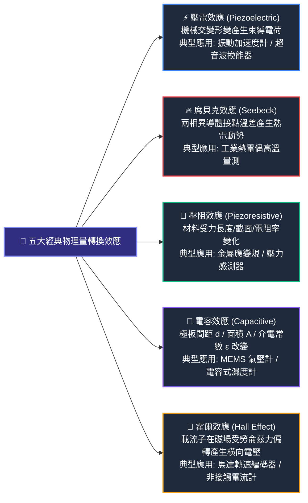
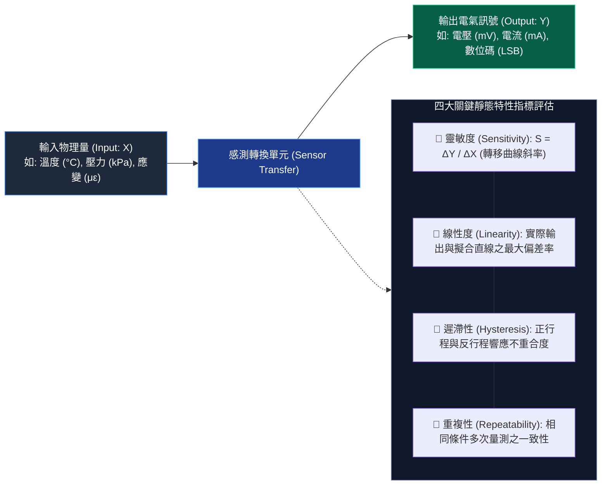
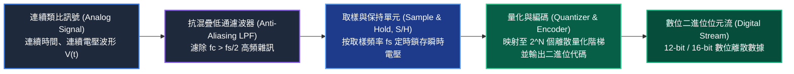

# L113 感測器原理與應用 考點精華筆記

> **對應科目**：科目 1【AIoT基礎概論】  
> **評鑑主題**：3. 感測器原理與應用  
> **涵蓋單元**：L11301 感測技術基礎、L11302 感測訊號與通訊基礎  

---

## 📌 L11301 感測技術基礎

### 1. 感測器根本分類：主動式 (Active) vs 被動式 (Passive)

在物聯網硬體設計中，感測器的能量來源分類是極高頻考點：

| 分類維度 | 定義與能量轉換機制 | 外加激勵電源需求 | 代表性元件實例 | 實務電路特色 |
|---|---|---|---|---|
| **主動式感測器 (Active Sensor / 外激型)** | 本身**無法自行產生電能**，必須由外部電路提供外加激勵電壓源或電流源，透過物理量改變其內在參數（電阻、電容、電感）來輸出訊號 | **必須外接電源** (如 +3.3V, +5V 偏壓) | • **熱敏電阻 (NTC / PTC)**<br>• **金屬應變規 (Strain Gauge)**<br>• **光敏電阻 (LDR / CdS)**<br>• **霍爾效應感測器 (Hall IC)**<br>• **電容式濕度感測器** | 通常需搭配分壓電路、惠斯登電橋或恆流源電路，將阻抗變化轉為電壓變化 |
| **被動式感測器 (Passive Sensor / 自激型)** | 直接基於物理效應**將被測物理能量轉化為自發性電能（電荷量、電壓或熱電動勢）**，量測過程本身即發電機 | **無須外加工作電源**即可自發產生電訊號 | • **熱電偶 (Thermocouple)**<br>• **壓電式感測器 (Piezoelectric)**<br>• **光伏電池 (Photovoltaic Cell)**<br>• **電磁感應式速度計** | 輸出訊號通常極微弱（$\mu V$ 或皮庫倫 $pC$ 級別），且內阻極高，必須搭配高輸入阻抗電荷放大器或精密放大器 |

---

### 2. 五大經典物理量轉換原理



1. **壓電效應 (Piezoelectric Effect)**：
   * **原理**：石英晶體或鋯鈦酸鉛 (PZT) 壓電陶瓷在承受外力產生形變時，內部正負電荷中心產生相對位移，在兩端表面感應出等量異號電荷：
     $$Q = d \cdot F$$
     其中 $d$ 為壓電常數，$F$ 為受力大小。
   * **特性**：產生的電荷容易經由測量電路洩漏，因此**壓電感測器僅能測量動態交變訊號（如機械振動、高頻衝擊），絕對無法測量靜態力！**
2. **席貝克效應 (Seebeck Effect / 熱電效應)**：
   * **原理**：將兩種不同的金屬導線 A 與 B 頭尾相接組成閉合迴路，當兩接觸端點存在溫度差 ($T_{hot}$ 與 $T_{cold}$) 時，迴路中會產生熱電動勢 (Seebeck EMF)：
     $$\Delta V = S_{AB} \cdot (T_{hot} - T_{cold})$$
     其中 $S_{AB}$ 為兩金屬之相對席貝克係數。
   * **冷點補償 (Cold Junction Compensation)**：熱電偶分度表皆以冷端 $0^\circ\text{C}$ 為基準。若現場量測時冷端處於室溫（例如 $25^\circ\text{C}$），測得電位差將偏低，**必須藉由另一顆環境溫度感測器（如 RTD 或熱敏電阻）測量冷端溫度進行「冷點補償」**。
3. **壓阻效應 (Piezoresistive Effect)**：
   * **原理**：根據歐姆定律與電阻公式 $R = \rho \frac{L}{A}$，當金屬或半導體受拉伸時長度 $L$ 增加、截面積 $A$ 縮小且電阻率 $\rho$ 改變，導致電阻值增大；受壓縮時電阻值減少。其靈敏度由**應變靈敏係數 (Gauge Factor, $G_F$)** 決定：
     $$\frac{\Delta R}{R} = G_F \cdot \epsilon$$
4. **霍爾效應 (Hall Effect)**：
   * **原理**：當厚度為 $t$ 的半導體薄片通有控制電流 $I$ 並垂直置於磁感應強度為 $B$ 的磁場中，載流子受勞侖茲力偏轉，在兩側感應出橫向霍爾電壓 $V_H$：
     $$V_H = \frac{R_H \cdot I \cdot B}{t}$$
   * **應用**：BLDC 無刷直流馬達轉子轉速計算、電流感測器（非接觸式開關）。

---

### 3. 常見感測器特性與選型評估

| 感測器類型 | 核心量測原理 | 關鍵選型規格與特性指標 | 優缺點分析 | AIoT 典型實務應用場景 |
|---|---|---|---|---|
| **慣性量測單元 (IMU)** | MEMS 微機電整合：<br>• 三軸加速度計 (測線加速度)<br>• 三軸陀螺儀 (測角速度) | 量程：$\pm 2g \sim \pm 16g$；陀螺儀：$\pm 250 \sim \pm 2000^\circ/\text{s}$；輸出取樣率 (ODR) | 體積極小、功耗低；但陀螺儀存在長期積分漂移 (Drift)，需感測融合校正 | 智慧手錶跌倒告警偵測、無人機飛控姿態解算、AGV 慣性導航 |
| **RTD (鉑電阻 Pt100)** | 鉑金屬電阻率隨溫度呈高度線性正相關增長 | **$0^\circ\text{C}$ 時阻值精確為 $100\,\Omega$**；$100^\circ\text{C}$ 時約為 **$138.5\,\Omega$**；具備三線式/四線式消除引線電阻 | **測溫範圍廣 ($-200^\circ\text{C} \sim +650^\circ\text{C}$)**、穩定度與線性度極高；但靈敏度較低、反應較慢 | 化工製程高精度反應槽控溫、半導體晶圓熱處理設備 |
| **熱敏電阻 (NTC)** | 燒結金屬氧化物半導體；電阻隨溫度升高呈指數型快速下降 (負溫度係數) | $25^\circ\text{C}$ 標稱阻值 $R_{25}$ (如 10k$\Omega$) 與材料常數 $B$ 值 ($B = 3950\,\text{K}$) | **靈敏度極高、成本低廉、反應快速**；但高度非線性 (需查表或代入 Steinhart-Hart 公式) | 鋰電池充電過熱保護、3D 列印機噴頭控溫、家電室溫偵測 |
| **超音波感測器** | 壓電換能器發射 40kHz 聲波並量測反射回波的飛行時間 (Time-of-Flight, ToF) | 測距公式：$d = \frac{v \cdot t}{2}$；量程：$2\text{cm} \sim 400\text{cm}$；盲區：$<2\text{cm}$ | 不受目標物表面顏色或光照影響；但受環境溫度 (聲速 $v \approx 331.5 + 0.6T$) 與吸音材質干擾 | 智慧停車場車位在席檢測、道路智慧垃圾桶填滿度監測 |
| **半導體氣體感測器 (MQ 系列)** | 金屬氧化物 (如 $\text{SnO}_2$) 晶體加熱後吸附還原性氣體引起表面電阻驟降 | 需內置加熱絲 (Heater) 預熱工作；負載電阻 $R_L$ 分壓輸出 | 成本極低、檢測靈敏；但選擇性差（易受酒精、濕度交叉干擾）、初次通電需長時間預熱 | 廚房居家瓦斯 (甲烷/LPG) 漏氣警報器、工業一氧化碳 (CO) 偵測 |

---

### 4. 感測器靜態與動態特性指標



1. **靈敏度 (Sensitivity, $S$)**：輸出變化量 $\Delta Y$ 與引起該變化的輸入物理量 $\Delta X$ 之比值：
   $$S = \frac{\Delta Y}{\Delta X}$$
2. **線性度 (Linearity)**：感測器實際校準曲線與理想擬合直線之間的最大偏差 $\Delta L_{max}$ 佔滿量程輸出 ($Y_{F.S.}$) 的百分比：
   $$\text{線性度誤差} = \pm \frac{\Delta L_{max}}{Y_{F.S.}} \times 100\%$$
3. **遲滯性 (Hysteresis)**：感測器在輸入物理量作**正行程（遞增）**與**反行程（遞減）**時，對應於同一輸入值所產生的輸出最大偏差：
   $$\text{遲滯誤差} = \frac{\Delta H_{max}}{Y_{F.S.}} \times 100\%$$
4. **重複性 (Repeatability)**：在相同工作條件下，輸入量沿同一方向作全量程多次連續變化時，各次所得輸出曲線彼此不一致的程度（代表隨機誤差大小）。
5. **響應時間 (Response Time)**：動態特性指標；感測器從輸入物理量突變開始，到輸出訊號達到最終穩定值的特定比例（如 63.2% 或 90%）所需時間。

---

## 📌 L11302 感測訊號與通訊基礎

### 1. 類比前處理電路：惠斯登電橋與儀表放大器

#### (1) 惠斯登電橋 (Wheatstone Bridge) 平衡與失衡計算
應變規等感測器受力時電阻變化率極小（$\Delta R / R \approx 0.001$），直接量測極難，必須藉由電橋轉換為差動電壓：

<div style="display:flex; justify-content:center; margin:24px 0;">
  <div style="width:100%; max-width:540px; background:rgba(15,23,42,0.85); border:1px solid rgba(56,139,253,0.35); border-radius:12px; padding:20px; box-shadow:0 8px 24px rgba(0,0,0,0.4);">
    <div style="font-weight:700; font-size:16px; margin-bottom:8px; color:#58a6ff; text-align:center;">
      ⚡ 惠斯登電橋 (Wheatstone Bridge) 微應變精密量測架構
    </div>
    <div style="font-size:13px; color:#94a3b8; margin-bottom:14px; text-align:center;">
      四臂對稱差動拓撲：將微小電阻變化 $\Delta R$ 轉換為精密差動輸出電壓 $\Delta V_{out}$
    </div>
    <svg viewBox="0 0 460 300" width="100%" style="overflow:visible;">
      <defs>
        <!-- 節點漸層與陰影 -->
        <filter id="glow" x="-20%" y="-20%" width="140%" height="140%">
          <feGaussianBlur stdDeviation="3" result="blur" />
          <feComposite in="SourceGraphic" in2="blur" operator="over" />
        </filter>
      </defs>

      <!-- 激勵電源走線 +Vs (頂端) 與 GND (底端) -->
      <line x1="230" y1="20" x2="230" y2="60" stroke="#f59e0b" stroke-width="3" stroke-linecap="round"/>
      <circle cx="230" cy="20" r="5" fill="#f59e0b" filter="url(#glow)"/>
      <text x="230" y="14" fill="#fbbf24" font-size="13" font-weight="bold" text-anchor="middle">+Vs (激勵電壓源)</text>

      <line x1="230" y1="240" x2="230" y2="280" stroke="#64748b" stroke-width="3" stroke-linecap="round"/>
      <circle cx="230" cy="280" r="5" fill="#64748b"/>
      <text x="230" y="296" fill="#94a3b8" font-size="12" font-weight="bold" text-anchor="middle">GND (參考地)</text>

      <!-- 電橋菱形走線 -->
      <!-- 上半部左臂與右臂 -->
      <line x1="230" y1="60" x2="110" y2="150" stroke="#38bdf8" stroke-width="3"/>
      <line x1="230" y1="60" x2="350" y2="150" stroke="#38bdf8" stroke-width="3"/>
      <!-- 下半部左臂與右臂 -->
      <line x1="110" y1="150" x2="230" y2="240" stroke="#38bdf8" stroke-width="3"/>
      <line x1="350" y1="150" x2="230" y2="240" stroke="#38bdf8" stroke-width="3"/>

      <!-- 電阻 R1 (左上 - 應變規 Strain Gauge R+ΔR) -->
      <g transform="translate(145, 80)">
        <rect x="0" y="0" width="50" height="26" rx="4" fill="#1e293b" stroke="#ef4444" stroke-width="2"/>
        <text x="25" y="17" fill="#f87171" font-size="12" font-weight="bold" text-anchor="middle">R1 (SG)</text>
      </g>

      <!-- 電阻 R2 (右上 - 基準電阻 R) -->
      <g transform="translate(265, 80)">
        <rect x="0" y="0" width="50" height="26" rx="4" fill="#1e293b" stroke="#38bdf8" stroke-width="2"/>
        <text x="25" y="17" fill="#7dd3fc" font-size="12" font-weight="bold" text-anchor="middle">R2</text>
      </g>

      <!-- 電阻 R4 (左下 - 基準電阻 R) -->
      <g transform="translate(145, 195)">
        <rect x="0" y="0" width="50" height="26" rx="4" fill="#1e293b" stroke="#38bdf8" stroke-width="2"/>
        <text x="25" y="17" fill="#7dd3fc" font-size="12" font-weight="bold" text-anchor="middle">R4</text>
      </g>

      <!-- 電阻 R3 (右下 - 基準電阻 R) -->
      <g transform="translate(265, 195)">
        <rect x="0" y="0" width="50" height="26" rx="4" fill="#1e293b" stroke="#38bdf8" stroke-width="2"/>
        <text x="25" y="17" fill="#7dd3fc" font-size="12" font-weight="bold" text-anchor="middle">R3</text>
      </g>

      <!-- 差動量測端點 (左側節點 A, 右側節點 B) -->
      <circle cx="110" cy="150" r="6" fill="#34d399" filter="url(#glow)"/>
      <circle cx="350" cy="150" r="6" fill="#34d399" filter="url(#glow)"/>

      <!-- 差動輸出虛線與電表指示 -->
      <line x1="110" y1="150" x2="190" y2="150" stroke="#34d399" stroke-width="2" stroke-dasharray="4 3"/>
      <line x1="270" y1="150" x2="350" y2="150" stroke="#34d399" stroke-width="2" stroke-dasharray="4 3"/>

      <!-- 儀表放大器符號 / Vout 指示 -->
      <rect x="190" y="132" width="80" height="36" rx="6" fill="#064e3b" stroke="#10b981" stroke-width="2"/>
      <text x="230" y="154" fill="#a7f3d0" font-size="13" font-weight="bold" text-anchor="middle">ΔVout (+ -)</text>

      <!-- 節點標籤 -->
      <text x="95" y="154" fill="#6ee7b7" font-size="12" font-weight="bold" text-anchor="end">Node A (+)</text>
      <text x="365" y="154" fill="#6ee7b7" font-size="12" font-weight="bold" text-anchor="start">Node B (-)</text>

      <!-- 平衡條件標示 -->
      <rect x="90" y="248" width="280" height="24" rx="4" fill="rgba(30,41,59,0.9)" stroke="#475569" stroke-width="1"/>
      <text x="230" y="264" fill="#cbd5e1" font-size="11" text-anchor="middle">平衡條件: R1 · R3 = R2 · R4  ⇒  ΔVout = 0V</text>
    </svg>
  </div>
</div>

* **電橋平衡條件 (Bridge Balance)**：當四臂電阻滿足交叉相乘相等時，差動輸出電壓 $V_{out} = 0$：
  $$R_1 \cdot R_3 = R_2 \cdot R_4$$
* **單臂應變 (Quarter Bridge) 輸出電壓公式**：
  若令初始時 $R_1 = R_2 = R_3 = R_4 = R$，當僅有一臂 $R_1$ 產生微小形變電阻增加 $\Delta R$：
  $$\Delta V_{out} = V_s \left( \frac{R + \Delta R}{2R + \Delta R} - \frac{R}{2R} \right) = V_s \left( \frac{\Delta R}{4R + 2\Delta R} \right) \approx V_s \frac{\Delta R}{4R}$$

#### 數值算例：惠斯登電橋應變電壓計算
* **已知**：供電電壓 $V_s = 5.0\,\text{V}$，四臂初始基準電阻 $R = 120\,\Omega$。某工件受拉力後應變規電阻增大 $\Delta R = 0.24\,\Omega$。
* **代入公式計算差動輸出電壓**：
  $$\Delta V_{out} = 5.0\,\text{V} \times \frac{0.24\,\Omega}{4 \times 120\,\Omega} = 5.0 \times \frac{0.24}{480} = 5.0 \times 0.0005 = 2.5\,\text{mV}$$
* **結論**：僅有 $2.5\,\text{mV}$ 微弱電壓，必須透過後級放大器放大 1000 倍方能輸入 ADC。

#### (2) 儀表放大器 (INA) 與共模拒斥比 (CMRR)
* 電橋輸出為微伏級差動訊號，且常伴隨嚴重的共模噪聲（如 60Hz 工頻電磁干擾）。
* **共模拒斥比 (Common-Mode Rejection Ratio, CMRR)**：衡量放大器放大差模訊號、抑制共模干擾能力的核心指標：
  $$CMRR = 20 \log_{10} \left| \frac{A_d}{A_{cm}} \right| \quad (\text{單位: dB})$$
  其中 $A_d$ 為差模電壓增益，$A_{cm}$ 為共模電壓增益。優秀的工業儀表放大器 CMRR 通常高達 $100 \sim 120\,\text{dB}$。

---

### 2. 類比數位轉換 (ADC) 原理與奈奎斯特定理

類比訊號轉數位訊號包含三大步驟：**取樣 (Sampling) $\to$ 量化 (Quantization) $\to$ 編碼 (Encoding)**。



<div style="display:flex; justify-content:center; margin:24px 0;">
  <div style="width:100%; max-width:620px; background:rgba(15,23,42,0.9); border:1px solid rgba(99,102,241,0.35); border-radius:12px; padding:20px; box-shadow:0 8px 24px rgba(0,0,0,0.4);">
    <div style="font-weight:700; font-size:16px; margin-bottom:6px; color:#818cf8; text-align:center;">
      📊 ADC 取樣保持 (Sample & Hold) 與量化階梯 (Quantization) 原理圖
    </div>
    <div style="font-size:12px; color:#94a3b8; margin-bottom:14px; text-align:center;">
      連續類比平滑波形 (藍線) $\to$ 週期取樣鎖存脈衝 $\to$ 離散數位量化階梯 (紫階梯)
    </div>
    <svg viewBox="0 0 540 240" width="100%" style="overflow:visible;">
      <!-- 坐標軸 -->
      <line x1="40" y1="200" x2="520" y2="200" stroke="#475569" stroke-width="2"/>
      <polygon points="520,196 530,200 520,204" fill="#475569"/>
      <text x="515" y="218" fill="#94a3b8" font-size="11" text-anchor="end">時間 (Time t) →</text>

      <line x1="40" y1="200" x2="40" y2="20" stroke="#475569" stroke-width="2"/>
      <polygon points="36,20 40,10 44,20" fill="#475569"/>
      <text x="35" y="15" fill="#94a3b8" font-size="11" text-anchor="end">電壓 (V) / 數位碼</text>

      <!-- 量化位準水平格線 (示範 8 個階梯) -->
      <line x1="40" y1="175" x2="500" y2="175" stroke="#334155" stroke-dasharray="2 3" stroke-width="1"/>
      <line x1="40" y1="150" x2="500" y2="150" stroke="#334155" stroke-dasharray="2 3" stroke-width="1"/>
      <line x1="40" y1="125" x2="500" y2="125" stroke="#334155" stroke-dasharray="2 3" stroke-width="1"/>
      <line x1="40" y1="100" x2="500" y2="100" stroke="#334155" stroke-dasharray="2 3" stroke-width="1"/>
      <line x1="40" y1="75" x2="500" y2="75" stroke="#334155" stroke-dasharray="2 3" stroke-width="1"/>
      <line x1="40" y1="50" x2="500" y2="50" stroke="#334155" stroke-dasharray="2 3" stroke-width="1"/>

      <!-- 量化等級標記 (LSB) -->
      <text x="32" y="179" fill="#64748b" font-size="9" text-anchor="end">1 LSB (001)</text>
      <text x="32" y="129" fill="#64748b" font-size="9" text-anchor="end">3 LSB (011)</text>
      <text x="32" y="79" fill="#64748b" font-size="9" text-anchor="end">5 LSB (101)</text>
      <text x="32" y="54" fill="#a5b4fc" font-size="9" font-weight="bold" text-anchor="end">Vref (111)</text>

      <!-- 連續平滑類比訊號曲線 (亮藍色) -->
      <path d="M 40,185 C 100,185 140,55 240,55 C 340,55 380,185 480,185" fill="none" stroke="#38bdf8" stroke-width="3"/>

      <!-- S/H 取樣鎖存與量化階梯 (紫色階梯線) -->
      <!-- 取樣週期 Ts 區間階梯示範 -->
      <path d="M 40,185 L 80,185 L 80,160 L 120,160 L 120,110 L 160,110 L 160,65 L 200,65 L 200,50 L 260,50 L 260,70 L 300,70 L 300,115 L 340,115 L 340,165 L 380,165 L 380,185 L 480,185" 
            fill="none" stroke="#a855f7" stroke-width="2.5" stroke-dasharray="none"/>

      <!-- 取樣點 (紅圈) -->
      <circle cx="80" cy="185" r="4" fill="#f43f5e"/>
      <circle cx="120" cy="160" r="4" fill="#f43f5e"/>
      <circle cx="160" cy="110" r="4" fill="#f43f5e"/>
      <circle cx="200" cy="65" r="4" fill="#f43f5e"/>
      <circle cx="260" cy="50" r="4" fill="#f43f5e"/>
      <circle cx="300" cy="70" r="4" fill="#f43f5e"/>
      <circle cx="340" cy="115" r="4" fill="#f43f5e"/>
      <circle cx="380" cy="165" r="4" fill="#f43f5e"/>

      <!-- 標註圖例 -->
      <rect x="330" y="25" width="180" height="42" rx="6" fill="rgba(15,23,42,0.85)" stroke="#334155" stroke-width="1"/>
      <line x1="340" y1="38" x2="365" y2="38" stroke="#38bdf8" stroke-width="2"/>
      <text x="375" y="42" fill="#bae6fd" font-size="11">連續類比輸入 V(t)</text>
      <line x1="340" y1="54" x2="365" y2="54" stroke="#a855f7" stroke-width="2"/>
      <circle cx="352" cy="54" r="3" fill="#f43f5e"/>
      <text x="375" y="58" fill="#e9d5ff" font-size="11">取樣量化階梯碼</text>
    </svg>
  </div>
</div>

1. **奈奎斯特-夏農取樣定理 (Nyquist-Shannon Sampling Theorem)**：
   * 為了完全不失真地還原連續類比訊號，**取樣頻率 $f_s$ 必須至少大於等於待測訊號最高頻率成分 $f_{max}$ 的兩倍**：
     $$f_s \ge 2 f_{max}$$
   * **混疊現象 (Aliasing)**：若 $f_s < 2 f_{max}$，高於奈奎斯特頻率 ($\frac{f_s}{2}$) 的高頻雜訊會折疊回低頻區間，造成無法逆轉的假信號失真。
   * **抗混疊低通濾波器 (Anti-Aliasing LPF)**：在訊號進入 ADC 前，必須先通過一組低通濾波器，其截止頻率 $f_c \le \frac{f_s}{2}$，硬性濾除多餘高頻。
2. **量化解析度與最小分辨電壓 (LSB)**：
   * $N$-bit 解析度之 ADC 可將量程劃分為 $2^N$ 個離散量化位準。
   * **最小有效位電壓 (Least Significant Bit, LSB)**：
     $$V_{LSB} = \frac{V_{ref}}{2^N}$$
   * **理想理論訊噪比 (Signal-to-Noise Ratio, SNR)**：
     $$SNR = 6.02 N + 1.76 \quad (\text{dB})$$
     每增加 1-bit 解析度，訊噪比提升約 $6.02\,\text{dB}$。

#### 數值算例：12-bit ADC 取樣與量化解析度計算算例 [🎯 官方常考經典題]
* **已知硬體條件**：
  * 微控制器 (如 STM32 或 ESP32) 內建之逐次逼近型 (SAR) ADC 解析度為 **$N = 12\text{ 位元}$ ($12\text{-bit}$)**。
  * 系統供電與外部高精度電壓參考基準晶片給定之基準電壓為 **$V_{ref} = 3.3\text{ V}$**。
  * 待測量之物理量為工廠冷卻水管壓力感測器，該感測器經信號調理後輸出範圍為 $0 \sim 3.3\text{ V}$，對應物理水壓為 $0 \sim 10\text{ bar}$。
* **計算問題 1：計算該 12-bit ADC 的最小分辨電壓 ($1\text{ LSB}$)**
  * 理論量化階梯總數為 $2^N = 2^{12} = 4,096$ 個階差（對應數位碼 $0 \sim 4095$）。
  * 最小有效位電壓公式：
    $$V_{LSB} = \frac{V_{ref}}{2^N - 1} = \frac{3.3\text{ V}}{4095} \approx 0.00080586\text{ V} \approx \mathbf{0.806\text{ mV}}$$
    *(註：工程上若採 $\frac{V_{ref}}{2^N} = \frac{3.3}{4096} \approx 0.8057\text{ mV}$ 亦視為標準答解)*
* **計算問題 2：計算此系統對水壓物理量的最小量測解析度 (Pressure Resolution)**
  * 水壓靈敏度比例係數：$K = \frac{10\text{ bar}}{3.3\text{ V}} \approx 3.0303\text{ bar/V}$。
  * 最小可分辨水壓變化量：
    $$\Delta P_{min} = V_{LSB} \times K = 0.806\text{ mV} \times 3.0303\text{ bar/V} \approx 0.00244\text{ bar} = \mathbf{2.44\text{ mbar}}$$
* **計算問題 3：若 ADC 讀出之二進位數位碼為十六進制 `0x7FF` (十進制 2047)，求對應之類比電壓與水壓值**
  * 還原類比電壓：
    $$V_{in} = \text{Code} \times V_{LSB} = 2047 \times 0.80586\text{ mV} \approx 1.6496\text{ V} \approx \mathbf{1.65\text{ V}} \quad (\text{恰為 } \frac{V_{ref}}{2})$$
  * 對應水壓值：
    $$P = 1.65\text{ V} \times 3.0303\text{ bar/V} = \mathbf{5.0\text{ bar}}$$
* **計算問題 4：該 12-bit ADC 的理論最大訊噪比 (Theoretical Max SNR)**
  $$SNR = 6.02 \times N + 1.76 = 6.02 \times 12 + 1.76 = 72.24 + 1.76 = \mathbf{74.0\text{ dB}}$$

---

### 3. 感測器常見通訊介面大對比矩陣

| 介面名稱 | 實體信號線數量與名稱 | 時序同步方式 | 雙工模式 | 典型通訊速率 | 通訊距離 | 硬體驅動與拓撲架構 |
|---|---|---|---|---|---|---|
| **I2C** | **雙線制**：<br>• **SDA** (序列資料線)<br>• **SCL** (序列時脈線) | **同步 (Synchronous)**<br>(共用 SCL 時脈) | **半雙工 (Half-Duplex)** | • 標準模式：100 kbps<br>• 快速模式：400 kbps<br>• 高速模式：3.4 Mbps | 短 (< 1~2 公尺，受匯流排寄生電容限制) | **開漏極 (Open-Drain)**，必須外接**上拉電阻 (Pull-up Resistors)**；支援多主多從定址 (7-bit / 10-bit ID) |
| **SPI** | **四線制**：<br>• **SCK** (時脈)<br>• **MOSI** (主出從入)<br>• **MISO** (主入從出)<br>• **CS/SS** (晶片選擇) | **同步 (Synchronous)** | **全雙工 (Full-Duplex)** | **高速 (10 ~ 50+ Mbps)** | 短 (< 0.5 公尺) | 推挽輸出 (Push-Pull)，無需上拉電阻；每增加一個從站需額外拉一條專屬 CS 腳位（或採菊花鏈） |
| **UART** | **雙線制**：<br>• **TX** (發送)<br>• **RX** (接收)<br>(需共用 GND) | **非同步 (Asynchronous)**<br>(兩端無時脈線，各自計時) | **全雙工 (Full-Duplex)** | 9600 bps ~ 115200 bps (最高數 Mbps) | 短 (< 2 公尺)；轉 RS-232 可達 15m，轉 RS-485 可達 1200m | 點對點連線；收發兩端必須**預先嚴格約定相同的鮑率 (Baud Rate)**、資料位元數、同位檢查 (Parity) 與停止位元 |
| **1-Wire** | **單線制**：<br>• **DQ** (資料線兼寄生供電)<br>• GND (地線) | 嚴格微秒級時序同步 | 半雙工 | 16.3 kbps (標準)<br>142 kbps (Overdrive) | 中等 (可達數十公尺) | 具備**寄生電源 (Parasitic Power)** 機制；每顆元件出廠內建唯一 64-bit ROM 代碼 (如 DS18B20 溫度計) |
| **4-20mA 電流迴路**| 雙線或三線電流迴路 | 類比連續訊號 (可疊加 HART 數位訊號) | 單向類比或半雙工 | 連續類比頻寬 | **極長 (可達數千公尺)** | **工業抗干擾王者**：訊號為電流而非電壓，不受長導線內阻衰減影響；**4mA 代表「活零點 (Live Zero)」**，若讀取為 0mA 代表線路斷線故障 |

> [!WARNING] ⚠ 官方教材陷阱與實務細節：
> 1. **I2C 是同步半雙工，不是非同步！**：許多考生誤將 I2C 當作非同步通訊。I2C 擁有專屬的 SCL 時脈線，由 Master 主動產生時脈脈衝引導資料收發，因此為「同步半雙工」通訊。
> 2. **UART 必須約定鮑率，SPI / I2C 不需要**：非同步通訊 (如 UART) 沒有實體時脈線，雙方必須事先約定完全相同的 Baud Rate，否則時鐘相位漂移會導致嚴重解碼亂碼；而 SPI/I2C 因有實體時脈線同步鎖存，傳輸時無需約定鮑率。
> 3. **4-20mA 活零點的警報價值**：工業標準為何不採用 0-20mA？因為在 0-20mA 架構下，感測值為 0（例如壓力為 0）與電纜被老鼠咬斷（斷線斷路）產生的訊號完全皆為 0mA，系統無法區分；採用 4mA 作為物理下限時，只要檢測到電流 $< 3.6\text{mA}$，PLC 便能立刻判斷為「感測器斷線故障」。

---


---

## 💻 🐍 Python pymodbus 工業通訊與感測資料前處理專區

在工廠 AIoT 邊緣端，工程師最常見的實戰任務為：**「透過 RS-485/Modbus-TCP 自工業儀表讀取 raw register，縮放還原為真實物理量，並經由滑動平均濾波器消除環境高頻雜訊」**。

### 1. pymodbus 讀取保持暫存器與數值還原

```python
import time
import struct
import numpy as np

try:
    # 支援 pymodbus 3.x 最新 API
    from pymodbus.client import ModbusTcpClient
except ImportError:
    # 相容 pymodbus 2.x 舊版
    from pymodbus.client.sync import ModbusTcpClient

def read_industrial_sensor_telemetry(host="192.168.1.100", port=502, slave_unit=1):
    """
    透過 Modbus-TCP 讀取工業溫度與壓力保持暫存器 (Holding Registers)
    並執行 IEEE-754 浮點數解析與整數線性縮放
    """
    client = ModbusTcpClient(host=host, port=port, timeout=3)
    if not client.connect():
        print(f"[Modbus 錯誤] 無法連線至 PLC/閘道器 {host}:{port}")
        return None

    try:
        # 功能碼 03: Read Holding Registers (讀取起始位址 0x0000 共 4 個 16-bit 暫存器)
        # 暫存器 40001 (位移 0): 溫度 (Signed INT16, 放大 10 倍, 例如 254 代表 25.4°C)
        # 暫存器 40002 (位移 1): 警報狀態碼 (UINT16)
        # 暫存器 40003~40004 (位移 2~3): 高精度壓力值 (標準 32-bit IEEE 754 浮點數，佔 2 個暫存器)
        rr = client.read_holding_registers(address=0, count=4, slave=slave_unit)
        if rr.isError():
            print(f"[Modbus 讀取失敗] 例外碼: {rr}")
            return None

        registers = rr.registers
        print(f"[Modbus 原始暫存器數值]: {registers}")

        # 1. 溫度解析 (16-bit 縮放整數還原)
        raw_temp = registers[0]
        # 處理 16 位元有符號數 (Signed)
        if raw_temp > 32767:
            raw_temp -= 65536
        real_temperature = raw_temp / 10.0  # 縮放比例 factor = 0.1

        # 2. 警報狀態 (純整數)
        alarm_status = registers[1]

        # 3. 壓力解析 (雙暫存器 32-bit Float Big-Endian 還原)
        # 將兩個 16-bit 整數打包為二進位 bytes，再以 '>f' 解碼為單精度浮點數
        packed_bytes = struct.pack(">HH", registers[2], registers[3])
        real_pressure = struct.unpack(">f", packed_bytes)[0]

        print(f"[感測還原物理量] 溫度: {real_temperature:.2f} °C | 狀態: {alarm_status} | 壓力: {real_pressure:.3f} bar")
        return {
            "temperature": real_temperature,
            "alarm": alarm_status,
            "pressure": real_pressure
        }
    finally:
        client.close()
```

---

### 2. 感測訊號濾波處理實作：滑動平均濾波器 (Moving Average Filter)

感測訊號常混雜高頻白雜訊或電源工頻干擾。滑動平均濾波器為邊緣微控制器上最簡潔高效之低通濾波技術：

```python
class MovingAverageFilter:
    """
    環形緩衝區滑動平均濾波器 (Moving Average Filter)
    時間複雜度 O(1)，適合邊緣嵌入式即時串流去噪
    公式: y[n] = 1/W * sum_{k=0}^{W-1} x[n-k]
    """
    def __init__(self, window_size: int = 5):
        if window_size <= 0:
            raise ValueError("視窗大小必須大於 0")
        self.window_size = window_size
        self.buffer = []
        self.running_sum = 0.0

    def update(self, new_val: float) -> float:
        """輸入新採樣值，回傳當前平滑輸出"""
        self.buffer.append(new_val)
        self.running_sum += new_val

        # 當視窗滿載時，剔除最舊採樣
        if len(self.buffer) > self.window_size:
            oldest = self.buffer.pop(0)
            self.running_sum -= oldest

        return self.running_sum / len(self.buffer)

# 模擬感測訊號濾波測試
if __name__ == "__main__":
    np.random.seed(42)
    # 模擬真實物理溫度為 25.0°C，伴隨 ±1.5°C 隨機高頻量測雜訊
    true_temp = 25.0
    noisy_readings = [true_temp + np.random.normal(0, 0.8) for _ in range(10)]
    
    ma_filter = MovingAverageFilter(window_size=4)
    print("--- 感測訊號滑動平均平滑前處理測試 ---")
    for i, raw in enumerate(noisy_readings):
        smoothed = ma_filter.update(raw)
        print(f"採樣 #{i+1:02d} | 原始雜訊讀數: {raw:.3f} °C --> 平滑後讀數: {smoothed:.3f} °C")
```

#### 關鍵實務避坑指南：
1. **Modbus 位址位移錯位 (Offset Trap)**：很多工業儀表手冊寫暫存器 `40001`，其在 Modbus 通訊協定中的實體 PDU 傳輸位址其實是 `0`（`address = 0`）；若填寫 `1` 會讀到 `40002`，引發嚴重的資料錯位。
2. **Byte Order (字節順序) 陷阱**：32 位元浮點數跨兩個 16-bit 暫存器傳輸時，各廠商有不同排列：Big-Endian (AB CD)、Little-Endian (CD AB) 或 Byte-swap (BA DC)。若數值解析出巨型天文數字（如 $1.42 	imes 10^{38}$），代表暫存器高低字節順序相反，需使用 `struct.pack` 調整字序。

### 🎯 考前衝刺「一句話考點」

1. 被動式感測器（如熱電偶、壓電式）自身能發電無需外加電源；主動式感測器（如熱敏電阻、應變規）必須依賴外部偏壓激勵。
2. 壓電感測器基於壓電效應量測電荷，只能量測動態交變振動或衝擊，絕對無法量測靜態力量。
3. 熱電偶基於席貝克效應產生溫差電位差，實際測溫時必須藉由額外溫度元件進行「冷點補償」。
4. 鉑電阻 RTD Pt100 在 $0^\circ\text{C}$ 時阻值恰為 $100\,\Omega$，在 $100^\circ\text{C}$ 時約為 $138.5\,\Omega$，具備極佳高溫線性度。
5. 負溫度係數熱敏電阻 (NTC) 其電阻值隨溫度升高而指數型下降，靈敏度極高但呈現顯著非線性。
6. 惠斯登電橋平衡條件為四臂交叉相乘相等（$R_1 R_3 = R_2 R_4$），單臂應變電橋之差動輸出電壓近似為 $\Delta V = V_s \frac{\Delta R}{4R}$。
7. 奈奎斯特取樣定理規定取樣頻率必須至少為訊號最高頻率的 2 倍（$f_s \ge 2 f_{max}$），否則會產生混疊失真 (Aliasing)。
8. ADC 的最小分辨電壓為 $LSB = \frac{V_{ref}}{2^N}$，每增加 1-bit 解析度理論訊噪比 (SNR) 提升約 $6.02\,\text{dB}$。
9. I2C 為雙線制（SDA/SCL）同步半雙工協定，採開漏極輸出必須外接上拉電阻；SPI 則為四線制全雙工高速同步匯流排。
10. 工業 4-20mA 電流迴路抗電磁干擾且不受長線路阻抗衰減，其 4mA「活零點」設計可用於瞬間判斷線路是否發生斷線故障。
