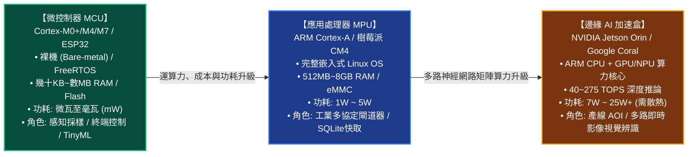
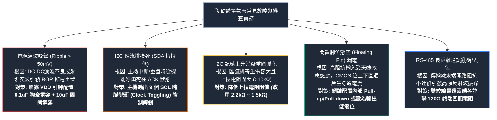
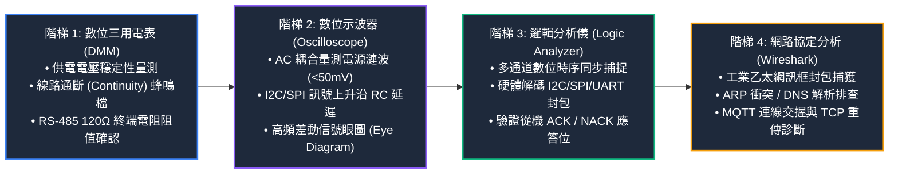
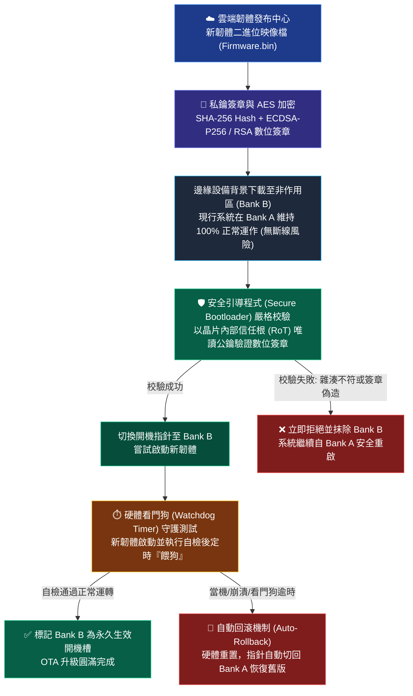

# L121 軟硬體整合規劃 考點精華筆記

> **對應科目**：科目 2【物聯網系統與應用】  
> **評鑑主題**：1. 軟硬體整合規劃  
> **涵蓋單元**：L12101 系統元件與架構、L12102 簡易系統故障問題判斷與排除、L12103 物聯網資訊安全  

---

## 📌 L12101 系統元件與架構

### 1. 邊緣運算處理器選型指南：MCU vs MPU vs 邊緣 AI 加速盒

在物聯網系統規劃中，處理器選型決定了設備的體積、功耗、散熱架構與軟體複雜度：

| 處理器類型 | 代表性晶片/產品 | 核心架構與主頻 | 記憶體與儲存容量 | 作業系統環境 | 典型功耗 | AIoT 系統角色與適用情境 |
|---|---|---|---|---|---|---|
| **微控制器 (MCU)** | STM32 (Cortex-M0+/M4/M7) ESP32 (Tensilica Xtensa) TI CC1352 | 32-bit RISC 48 MHz ~ 480 MHz | SRAM: 32KB ~ 1MB Flash: 128KB ~ 4MB | 裸機程式 (Bare-metal) 或即時作業系統 (FreeRTOS, Zephyr) | **極低** (工作時 10~50 mA，休眠時 $< 10\,\mu\text{A}$) | **感知端智慧節點**：電池供電環境監測、馬達電流即時控制、感測訊號採樣與輕量 TinyML 推論 |
| **微處理器 (MPU)** | NXP i.MX6/i.MX8 (Cortex-A) TI Sitara Raspberry Pi 4/5 | 32/64-bit 多核心 1.0 GHz ~ 2.0 GHz | DRAM: 512MB ~ 8GB eMMC / SD: 8GB ~ 64GB | 完整作業系統 (Embedded Linux, Ubuntu Core) | **中等** (1 W ~ 5 W，通常需外接電源變壓器) | **智慧閘道器 (Gateway)**：多協定轉換 (Modbus 轉 MQTT/OPC UA)、本機 SQLite 緩存、邊緣數據聚合 |
| **邊緣 AI 加速盒** | NVIDIA Jetson Orin Nano / NX Google Coral Dev Board | 多核 ARM CPU + 專用 GPU (Ampere) / NPU | 統一記憶體 (LPDDR5): 4GB ~ 16GB | Linux (Ubuntu for Jetson, JetPack SDK) | **偏高** (7 W ~ 25 W，需大型散熱鰭片或風扇) | **重度邊緣視覺推論**：智慧交通車牌辨識、產線 AOI 高清瑕疵即時檢測、AMR 機器人 3D SLAM 導航 |

---

### 2. 低功耗電源管理與電池壽命實測試算

物聯網感測節點大多佈署於戶外或不便更換電池的場域，必須依賴超低功耗電源管理策略：

#### (1) 四大核心電源狀態對比
1. **工作模式 (Active Mode)**：CPU 全速運轉，周邊射頻 (RF) 模組發射/接收封包；電流最大（典型 20mA ~ 150mA）。
2. **睡眠模式 (Sleep Mode)**：CPU 核心停止執行指令，但周邊硬體 (ADC, SPI, Timer) 仍在計時與監聽；電流中等（典型 1mA ~ 5mA）。
3. **深度睡眠模式 (Deep Sleep Mode)**：CPU、高速晶振與大部分數位周邊完全斷電，僅保留**內部低功耗計時器 (RTC)** 與超低功耗協同處理器 (ULP)，SRAM 部分資料維持；電流極低（典型 **$2\,\mu\text{A} \sim 15\,\mu\text{A}$**）。
4. **冬眠/關機模式 (Hibernation / Power Down)**：除外部喚醒電路 (Wake-up Pin) 外全部斷電，資料完全丟失，需冷啟動重置；電流小於 **$1\,\mu\text{A}$**。

#### (2) 電池壽命計算公式與數值實戰範例
感測節點多採週期性工作循環（Duty Cycle），其平均工作電流 $I_{avg}$ 為：
$$I_{avg} = \frac{T_{active} \times I_{active} + T_{sleep} \times I_{sleep}}{T_{cycle}}$$
系統電池預期使用壽命 $T_{lifetime}$（小時）：
$$T_{lifetime} = \frac{C_{battery} \times \eta}{I_{avg}}$$
其中 $C_{battery}$ 為電池額定容量 ($\text{mAh}$)，$\eta$ 為電池實際有效放電效率與自放電降額係數（通常取 $80\% \sim 85\%$ 即 $0.8 \sim 0.85$）。

#### 數值算例：智慧農業 LoRaWAN 節點電池壽命計算
* **已知系統規格**：
  * 電池容量：一節 ER14505 亞硫醯氯鋰電池 ($Li-SOCl_2$)，額定容量 $C_{battery} = 2400\,\text{mAh}$，降額係數 $\eta = 0.85$。
  * 採樣週期：每 10 分鐘 ($T_{cycle} = 600\,\text{s}$) 採樣回傳一次。
  * 工作時長與電流：喚醒採集感測器並透過 LoRa 發射封包共耗時 $T_{active} = 3\,\text{s}$，工作電流 $I_{active} = 40\,\text{mA}$。
  * 休眠時長與電流：其餘 $T_{sleep} = 600 - 3 = 597\,\text{s}$ 進入 Deep Sleep，休眠電流 $I_{sleep} = 5\,\mu\text{A} = 0.005\,\text{mA}$。
* **步驟 1：計算週期平均電流 $I_{avg}$**：
  $$I_{avg} = \frac{(3\,\text{s} \times 40\,\text{mA}) + (597\,\text{s} \times 0.005\,\text{mA})}{600\,\text{s}} = \frac{120 + 2.985}{600} \approx \frac{122.985}{600} \approx 0.205\,\text{mA}$$
* **步驟 2：計算電池壽命小時數與年限**：
  $$T_{lifetime} = \frac{2400\,\text{mAh} \times 0.85}{0.205\,\text{mA}} = \frac{2040}{0.205} \approx 9951\,\text{小時}$$
  $$\text{使用年限} = \frac{9951}{24 \times 365} \approx \frac{9951}{8760} \approx 1.136\,\text{年}$$
* **結論**：若將採樣間隔拉長至 30 分鐘，平均電流將驟降至約 $0.072\,\text{mA}$，壽命即可大幅延長至 3 年以上。

---

## 📌 L12102 簡易系統故障問題判斷與排除

### 1. 硬體電氣層常見故障與排查實戰

現場部署 IoT 硬體時，最常遇到的底層硬體問題及其根因對策矩陣：

| 故障現象 | 根本物理成因分析 | 現象波形特徵與檢測手法 | 最佳工程排除對策 |
|---|---|---|---|
| **電源漣波過大引起隨機重置 (Brown-Out)** | 供電開關電源 (DC-DC / LDO) 濾波不良，或負載射頻發射突波瞬間拉垮電壓，觸發 MCU 內部掉電重置 (BOR) | 使用示波器切換為 **AC 耦合 (AC Coupling)**，量測 VDD 電源軌上的高頻紋波峰峰值 ($V_{pp} > 50\text{mV}$) | • 在晶片 VDD/GND 腳位旁直連 **$0.1\,\mu\text{F}$ 高頻陶瓷電容** • 在射頻前端並聯低 ESR 大容量鉭電容或固態電容 ($10\,\mu\text{F} \sim 100\,\mu\text{F}$) |
| **I2C 匯流排掛死 (Bus Lock-up)** | 主機在與從機通訊時遭遇重置或異常中斷，剛好落在從機發送 ACK 或資料輸出低電位位元之瞬間；從機持續拉低 SDA 等待 SCL 時脈，導致全匯流排無法通訊 | 示波器或電表量測發現 **SDA 恆定為 0V (低電位)**，SCL 恆定為 3.3V | **時脈跳變解鎖法 (Clock Toggling)**：主機開機時將 SCL 腳位切為 GPIO 輸出，**手動發送 9 個時脈脈衝 (Clock Pulses)**，迫使從機移位暫存器排空並釋放 SDA，最後補發一個 STOP 條件 |
| **I2C 上拉電阻阻值不當** | • **阻值過大 ($>10\text{k}\Omega$)**：匯流排寄生電容 $C_b$ 使得 RC 上升時間過長，波形變形圓弧化導致採樣錯誤 • **阻值過小 ($<1\text{k}\Omega$)**：晶片內部開漏極驅動能力不足，灌電流過大導致邏輯低電位 $V_{OL}$ 被抬高超過 $0.3 V_{DD}$，無法被辨識為 0 | 示波器觀察上升沿：過大時上升沿極緩慢；過小時低電位凹陷不足 (無法降至 0.4V 以下) | • 標準模式 (100kbps)：選用 $4.7\,\text{k}\Omega$ • 快速模式 (400kbps)：選用 $2.2\,\text{k}\Omega \sim 1.5\,\text{k}\Omega$ • 嚴格依公式 $R_{min} = \frac{V_{DD} - V_{OL}}{I_{OL}}$ 計算極限值 |
| **懸空腳位 (Floating Pin) 引起異常高功耗** | 未使用的 GPIO 處於高阻抗輸入態 (High-Z)，受到空間環境電磁場天線效應感應，在 0 與 1 之間高頻隨機翻轉，導致內部 CMOS 上下推挽管同時導通形成穿通電流 | 休眠模式下總電流比晶片手冊大上數百倍 (如從 $5\,\mu\text{A}$ 飆升至數毫安) | **在韌體初始化中將所有未使用的閒置 GPIO 全部設定為內部上拉 (Pull-up)、內部下拉 (Pull-down) 或推挽輸出固定低電位**，嚴禁懸空！ |
| **RS-485 長距離通訊亂碼與丟包** | 差動訊號沿傳輸線傳播至末端開路處時，因阻抗突變產生**反射波 (Reflected Wave)**，反射波反向疊加回原始波形，造成訊號眼圖閉合與嚴重波形振鈴 (Ringing) | 示波器可見差動訊號邊沿出現嚴重過衝 (Overshoot)、下衝 (Undershoot) 與震盪波形 | **在 RS-485 實體雙絞線的最前端與最末端兩個終端節點之間，各並聯一顆 $120\,\Omega$ 的終端電阻 (Terminal Resistor)**，達成傳輸線特性阻抗匹配 |

---

### 2. 網路與通訊故障診斷工具實務

現場網路通訊異常的階梯式除錯 SOP：

* **ARP 解析失敗**：設備在同網段內發送廣播找不到目標 MAC 位址，通常為 IP 設定衝突或子網路遮罩 (Subnet Mask) 劃分錯誤。
* **DNS 解析失敗**：設備無法將網域名稱（如 `broker.hivemq.com`）解析為 IP 位址，應檢查 DHCP 配發之 DNS Server 位址是否可達，或手動指定公網 DNS (8.8.8.8)。
* **MQTT Keep Alive 逾時**：若 Broker 頻繁判定設備掉線並觸發遺言，通常是因為邊緣端 CPU 正在執行耗時的大型計算任務（如 AI 推論或同步阻塞式檔案讀寫），導致負責發送 `PINGREQ` 的背景工作線程被餓死，應將 MQTT 心跳改為非同步事件處理或拉長 Keep Alive 時間。

---

## 📌 L12103 物聯網資訊安全

### 1. 邊緣設備實體層硬體安全防護

邊緣物聯網設備暴露在無人監管的野外環境中，極易遭到攻擊者實體接觸：
1. **防拆偵測機制 (Tamper Detection)**：
   * 設備外殼設置物理微動開關或光敏微感測器，一旦機殼被物理撬開破壞，內部硬體觸發專用保護中斷，在數微秒內**自動主動抹除硬體安全元件內存儲的 AES 對稱金鑰與私鑰**。
2. **除錯介面物理熔斷 (Disable JTAG / SWD)**：
   * 在晶片研發與量產燒錄完成後，**必須透過韌體指令燒斷硬體 eFuse（電子保險絲）**，永久關閉或密碼鎖定晶片的 JTAG 與 SWD 除錯通訊埠，徹底杜絕黑客透過硬體模擬器直接 Dump 讀取晶片片上 Flash 內的韌體二進位代碼。

---

### 2. 安全韌體空中升級 (Secure OTA) 完整流程

物聯網設備上線後，修復漏洞與更新模型必須依賴空中升級 (Over-The-Air, OTA)：

1. **Dual-Bank (雙分割槽 A/B) 儲存架構**：
   * 設備 Flash 劃分為兩個獨立鏡像區：Bank A（運行現行系統）與 Bank B（備用升級區）。
   * 升級時系統在 Bank A 照常運作，將新韌體背景下載至 Bank B；若下載中斷或斷電，原系統不受任何影響，杜絕設備「變磚 (Bricking)」。
2. **數位簽章驗證 (Asymmetric Signature Verification)**：
   * 雲端伺服器使用**後台私鑰 (Private Key)** 對新韌體映像計算 SHA-256 雜湊並生成數位簽章（如 ECDSA-P256 或 RSA-2048）。
   * 邊緣設備的唯讀 Bootloader 內嵌有**官方公鑰 (Public Key)**，下載完畢後先驗證簽章真實性與完整性；任何被竄改一個位元的韌體皆會被立即拒絕。
3. **看門狗防死機與自動回滾 (Rollback) 機制**：
   * 驗證通過後，Bootloader 將開機指針切換至 Bank B 嘗試啟動。
   * 新韌體啟動後必須在**硬體看門狗計時器 (Watchdog Timer, WDT)** 倒數結束前成功執行自我檢測並「餵狗 (Kick Watchdog)」。若新韌體開機當機或崩潰，看門狗逾時觸發硬體重置，Bootloader 自動回滾切換回 Bank A 原系統。

---

### 3. 通訊鏈路安全配置與金鑰安全庫

* **TLS 1.3 傳輸防護**：
  * 相較於 TLS 1.2，**TLS 1.3 將交握時間縮短為 1-RTT**，並移除了 MD5、SHA-1、RC4 等不安全加密演算法，全面強制採用具備**完全前向保密 (Forward Secrecy, PFS)** 的橢圓曲線迪菲-赫爾曼 (ECDHE) 金鑰交換。
* **金鑰儲存層次原則**：
  * **一級禁忌**：嚴禁將 API Key、MQTT 帳號密碼或私鑰**硬編碼 (Hard-coded) 在原始碼程式碼或純文字配置檔中**！
  * **最佳防護**：採用外掛硬體安全元件 (如 ATECC608A) 儲存私鑰，或在 Linux 閘道器端採用受保護的 Secret Storage / KMS (Key Management Service) 進行動態金鑰注入。

---

> [!WARNING] ⚠ 官方教材陷阱與實務細節：
> 1. **GPIO 引腳嚴禁懸空 (Floating)**：未使用的 GPIO 處於高阻抗輸入態時，空間電磁波會引發高頻隨機翻轉，內部 CMOS 管上下直通產生穿通電流，使休眠電流自微安級飆升至數毫安，電池數天內即耗盡！必須在韌體中明確配置為內部上拉、下拉或輸出低電位。
> 2. **I2C 上拉電阻阻值雙向陷阱**：上拉電阻過大會因 RC 延遲導致上升沿嚴重圓弧化丟包；上拉電阻過小則會造成灌電流超載，低電平電壓 $V_{OL}$ 被抬升超過 $0.3V_{DD}$ 無法辨識為 0，且大幅增加動態功耗。
> 3. **RS-485 終端電阻只能加在最遠兩端**：120Ω 終端電阻是用於傳輸線兩端特性阻抗匹配以消除反射波；切勿在中間各分接節點任意加裝，否則多個 120Ω 並聯會拉垮整體總阻抗（小於 60Ω 負載極限），燒毀驅動晶片。
> 4. **單 Bank 原地覆蓋升級之致死風險**：OTA 升級若沒有採用 Dual-bank A/B 分割槽架構，一旦升級過程遇斷電或網路中斷，設備 Flash 內容破損將永久「變磚 (Bricking)」，必須現場拆機以治具重新燒錄。

---

### 🎯 考前衝刺「一句話考點」

1. 邊緣節點處理器中，MCU 運行 FreeRTOS 功耗最低（毫瓦級），MPU 運行 Linux 適合多工閘道器，邊緣 AI 盒（如 Jetson）專注重度視覺推論。
2. 節點平均電流試算公式為 $I_{avg} = \frac{T_{active} \cdot I_{active} + T_{sleep} \cdot I_{sleep}}{T_{cycle}}$，大幅延長休眠時間是延長電池壽命的最有效手段。
3. 示波器量測電源紋波 (Ripple) 應切換至 AC 耦合模式，在晶片 VDD 腳位緊靠並聯 $0.1\,\mu\text{F}$ 陶瓷電容可有效抑制高頻雜訊。
4. I2C 匯流排若發生 SDA 恆為低電位的鎖死現象，主機可向 SCL 手動發送 9 個時脈脈衝 (Clock Toggling) 迫使從機釋放匯流排。
5. I2C 上拉電阻過大會導致波形上升沿圓弧化引發採樣錯誤，上拉電阻過小則會造成灌電流過大使低電位電壓抬高無法辨識。
6. 微控制器未使用的 GPIO 懸空 (Floating) 會因天線效應隨機翻轉產生巨大穿通電流，應配置內部上拉、下拉或輸出低電位。
7. RS-485 長距離差動通訊必須在傳輸線最遠兩端各並聯 $120\,\Omega$ 終端電阻，以達成阻抗匹配並徹底消除反射波振鈴。
8. 物聯網防拆偵測 (Tamper Detection) 遭破壞時會觸發專用中斷主動銷毀金鑰，量產出廠時必須熔斷 eFuse 關閉 JTAG/SWD 介面。
9. 安全 OTA 升級必須採用 Dual-bank (A/B 分割槽) 架構，升級失敗或死機時藉由看門狗計時器自動觸發 Rollback 回滾機制。
10. OTA 韌體更新必須使用非對稱加密（如 ECDSA / RSA）驗證數位簽章，私鑰嚴禁硬編碼於程式中，應存於硬體安全元件 (SE) 內。
