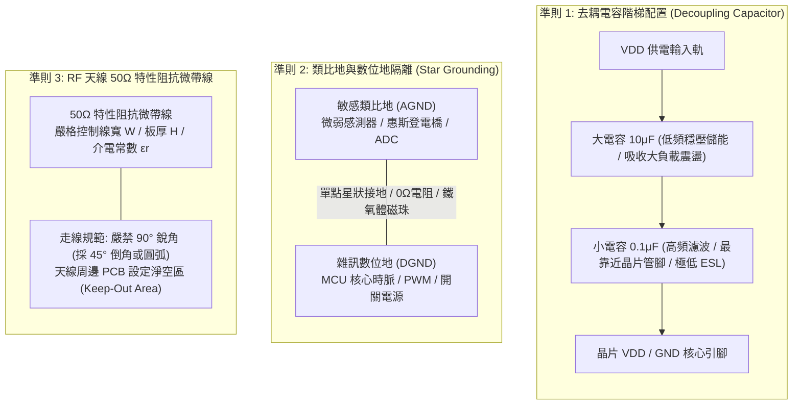
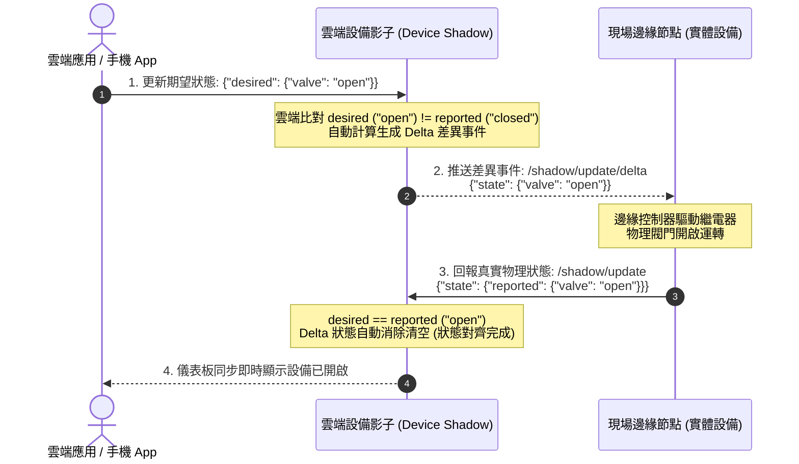
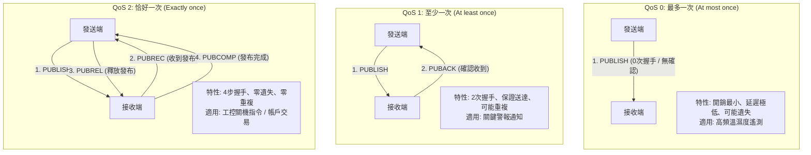
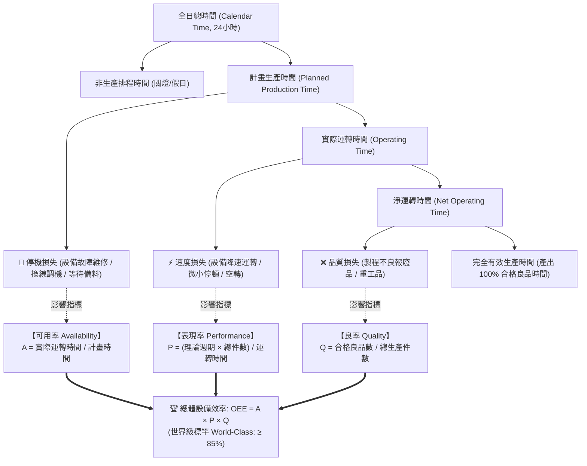
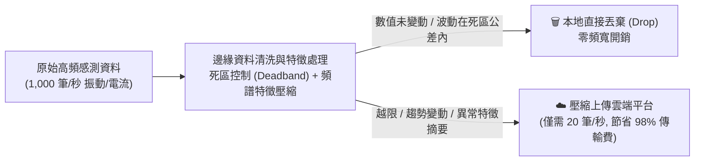

# L122 軟硬體設計 考點精華筆記

> **對應科目**：科目 2【物聯網系統與應用】  
> **評鑑主題**：2. 軟硬體設計  
> **涵蓋單元**：L12201 物聯網硬體設計基礎、L12202 雲端環境數據收集與平台設計、L12203 智慧製造流程優化與成本控制  

---

## 📌 L12201 物聯網硬體設計基礎

### 1. PCB 電路佈局 (Layout) 核心三大準則

物聯網邊緣裝置常整合敏感類比感測器、高頻射頻 (RF) 天線與高速微控制器，PCB 佈局良窳直接決定系統抗干擾能力與通訊品質：

1. **電源去耦電容 (Decoupling Capacitor) 放置準則**：
   * **距離最短化**：去耦電容必須**緊貼晶片的供電引腳 (VDD) 與地引腳 (GND)**，走線應盡可能短且粗，嚴禁經過長導線或過孔 (Via) 引入寄生電感。
   * **多電容並聯階梯配置**：當大小電容並聯時，**小容量高頻陶瓷電容 ($0.1\,\mu\text{F} / 100\,\text{nF}$)** 具有較低的高頻等效串聯電感 (ESL)，**必須比大容量電容 ($10\,\mu\text{F}$ 鉭電容或固態電解電容) 更靠近晶片管腳**，以就近提供高頻瞬態開關電流。
2. **高頻天線射頻 (RF) $50\,\Omega$ 特性阻抗微帶線設計**：
   * Wi-Fi、BLE 與 LoRa 射頻輸出線路必須嚴格控制其**特性阻抗為 $50\,\Omega$**。
   * **微帶線 (Microstrip) 計算要素**：阻抗取決於介質層厚度 $H$、基板介電常數 $\epsilon_r$ (FR-4 典型約 $4.2 \sim 4.4$)、銅箔厚度 $T$ 以及走線線寬 $W$。
   * **走線禁忌**：高頻射頻線**嚴禁出現 $90^\circ$ 銳角走線**（會造成阻抗不連續引發高頻反射），必須採用 $45^\circ$ 倒角或平滑圓弧；天線周邊的 PCB 板層必須設置**淨空區 (Keep-Out Area)**，禁止任何鋪銅、走線或金屬螺絲。
3. **類比地 (AGND) 與數位地 (DGND) 分割與單點星狀接地**：
   * 數位電路的高速開關訊號（如 MCU 系統時脈、PWM 驅動）會在地上產生大量高頻回流噪聲。
   * 必須將 PCB 鋪銅明確劃分為**類比地 (AGND)** 與**數位地 (DGND)**，兩者各自獨立鋪銅，最後僅在電源入口處或 ADC 晶片下方透過**單點星狀連接 (Star Grounding)、$0\,\Omega$ 電阻或高頻鐵氧體磁珠 (Ferrite Bead)** 相連，徹底阻絕數位噪聲串入微弱類比訊號前級。

---

### 2. 電磁相容性 (EMC) 與工業防護電路設計

工業現場常伴隨靜電放電 (ESD)、繼電器感性負載反峰與雷擊浪湧 (Surge)，硬體必須構築階梯式防護網：

| 防護元件/技術 | 核心物理工作原理 | 電路拓撲配置位置 | 防護目標與特性指標 |
|---|---|---|---|
| **TVS 二極體 (瞬態電壓抑制器)** | 利用 PN 結雪崩擊穿特性，在皮秒 ($ps$) 級別極速響應，將瞬間高壓鉗位至安全電壓，將浪湧電流導向大地 | **緊鄰外露物理接口** (如 USB、RS-485 連接器引腳、電源輸入插座) | 防禦人體觸摸或熱插拔引起的 **靜電放電 (ESD, 符合 IEC 61000-4-2 $\pm 8\text{kV}$ 接觸 / $\pm 15\text{kV}$ 空氣放電)** |
| **壓敏電阻 (MOV) + 氣體放電管 (GDT)** | • **GDT**：電弧放電，通流能力極大但響應較慢 ($ns \sim \mu s$) • **MOV**：氧化鋅非線性電阻，響應較快但存在漏電流老化 | **一級電源防護前端**：GDT 與 MOV 串/並聯組合跨接於 L、N 與 PE 之間 | 防禦戶外雷擊感應或電網大型感性開關突波 (**Surge 浪湧, 符合 IEC 61000-4-5 數千伏特衝擊**) |
| **光耦合器 (Optocoupler)** | 利用電-光-電轉換機制（輸入端紅外發光二極體，輸出端光電電晶體），**兩側僅有光子物理耦合，完全無電氣連接** | 隔離工控 24V 數位輸入/輸出 (DI/DO)、繼電器驅動迴路與 MCU 核心板 | **電氣隔離 (Galvanic Isolation)**：耐壓可達數千伏特 ($3\text{kV} \sim 5\text{kV}$)，徹底切斷工業地迴路電位差 (Ground Loop) 與共模干擾 |

---

## 📌 L12202 雲端環境數據收集與平台設計

### 1. 雲端物聯網與設備影子 (Device Shadow / Digital Twin)

以 AWS IoT Core 與 Azure IoT Hub 為代表的雲端物聯網架構中，「**設備影子 (Device Shadow / Device Twin)**」是實現端雲非同步狀態同步的核心機制：

* **三大 JSON 狀態欄位解析**：
  1. `desired`（期望狀態）：由手機 App、網頁儀表板或業務邏輯發起，代表雲端**希望**設備處於的狀態。
  2. `reported`（報告狀態）：由邊緣物理設備主動發送，代表設備當前**真實物理運作**的狀態。
  3. `delta`（差異狀態）：**由雲端平台自動計算生成**（當 `desired` 與 `reported` 數值不一致時產生），雲端會自動將 Delta 封包推送給設備，指示其執行對齊動作。

---

### 2. 資料儲存分層架構：熱資料 vs 冷資料

AIoT 每天產生海量感測數據，若全數存入昂貴關聯式資料庫將引發效能瓶頸與成本失控：

| 儲存層次 | 資料特徵與存取頻率 | 推薦技術與資料庫選型 | 讀寫效能與查詢特性 | 成本結構與資料保留期 |
|---|---|---|---|---|
| **熱資料 (Hot Data)** | • 最近數秒至數天內的高頻遙測資料 • 具備明確的時間戳記 (Timestamp) • 寫入頻率極高，查詢需即時呈現 | **時序資料庫 (Time Series DB)**： • **InfluxDB** • **TimescaleDB** • Redis (即時快取) | 專為時序連續寫入與滑動時間窗口（如計算過去 5 分鐘移動平均）高度最佳化；支援極致數據壓縮 | 儲存單價較高；通常設定保留策略 (Retention Policy)，過期資料 (如 30 天前) 自動降級或滾動刪除 |
| **溫/冷資料 (Cold Data)** | • 超過數月甚至數年前的歷史原始封包 • 查詢頻率極低（幾個月一次） • 供稽核存檔、AI 深度學習離線大模型訓練 | **分散式物件儲存 (Object Storage)**： • **AWS S3 / S3 Glacier** • **Azure Blob Storage** • Apache Parquet 列式儲存格式 | 延遲較高 (秒級至分鐘級)，不適合即時監控查詢；但具備無限擴展能力，適合批次巨量分析 (MapReduce / Spark) | **儲存成本極致低廉** (僅為熱儲存的 1/10 至 1/50)；支援永久長期封存 |

---

### 3. MQTT 服務品質 (QoS 0 vs QoS 1 vs QoS 2) 全面對比

MQTT 提供了三種等級的服務品質（Quality of Service），在**可靠度**與**網路頻寬/延遲**之間提供了精確的權衡：

| QoS 等級 | 官方定義與保證原則 | 封包交握次數 (Handshake) | 網路開銷與延遲 | 潛在資料風險 | AIoT 典型適用場景 |
|---|---|---|---|---|---|
| **QoS 0** | **最多一次 (At most once)** 盡力而為 (Best Effort) | **0 次握手** (發送端單向發出 PUBLISH 封包後立即關閉，無任何確認) | **最低** (開銷最小，延遲最短) | **可能遺失封包** (若遇網路抖動直接丟失，絕不重傳) | 高頻環境溫濕度遙測、機台週期性電流心跳包（遺失單筆不影響整體趨勢） |
| **QoS 1** | **至少一次 (At least once)** 保證送達 (Guaranteed Delivery) | **2 次握手** 發送 PUBLISH $\to$ 接收端回覆 **PUBACK** 確認 | 中等 | **可能重複收到 (Duplication)** (若 PUBACK 在回傳時丟失，發送端會觸發重傳) | 產線異常事件超限即時告警、設備啟停狀態回報（必須收到，重複處理無害） |
| **QoS 2** | **恰好一次 (Exactly once)** 嚴格保證只達一次 | **4 次握手 (四步交握)**： 1. PUBLISH $\to$ 2. $\leftarrow$ **PUBREC** 3. **PUBREL** $\to$ 4. $\leftarrow$ **PUBCOMP** | **最高** (交握步驟多，佔用頻寬大，延遲最長) | **零遺失、零重複** (雙方狀態機嚴格跟蹤 Packet ID) | **計費交易扣款、關鍵指令下發 (如遠端韌體升級啟動、高危工控閥門關閉)** |

---

## 📌 L12203 智慧製造流程優化與成本控制

### 1. 整體設備效率 (OEE) 公式定義與實戰範例

整體設備效率（Overall Equipment Effectiveness, OEE）是衡量製造工廠設備稼動水準的國際通用標準：

$$OEE = \text{可用率 (Availability)} \times \text{表現率 (Performance)} \times \text{良率 (Quality)}$$

1. **可用率 (Availability, $A$)**：衡量停機損失（故障停機、換模調機）：
   $$A = \frac{\text{實際運轉時間 (Operating Time)}}{\text{計畫生產時間 (Planned Production Time)}} = \frac{\text{計畫時間} - \text{停機時間}}{\text{計畫時間}}$$
2. **表現率 (Performance, $P$)**：衡量速度損失（設備降速、微小停頓）：
   $$P = \frac{\text{理論週期時間 (Ideal Cycle Time)} \times \text{總生產件數 (Total Pieces)}}{\text{實際運轉時間 (Operating Time)}}$$
3. **良率 (Quality, $Q$)**：衡量品質缺陷與報廢損失：
   $$Q = \frac{\text{良品件數 (Good Pieces)}}{\text{總生產件數 (Total Pieces)}} = \frac{\text{總件數} - \text{不良品件數}}{\text{總件數}}$$

---

#### 數值算例：智慧生產線 OEE 逐步詳細計算
* **已知工廠產線單班運行數據**：
  * 單班排程工作時間：8 小時 ($480\,\text{分鐘}$)。
  * 法定計畫休息與用餐時間：$30\,\text{分鐘}$。
  * 故障停機維修與更換刀具時間：$50\,\text{分鐘}$。
  * 該設備標準設計理論週期：每件 **$0.5\,\text{分鐘}$**（即理論產速 $2\,\text{件/分鐘}$）。
  * 該班次實際總生產工件數：**$700\,\text{件}$**。
  * 經品質檢驗合格良品數：**$679\,\text{件}$**（不良品報廢 $21\,\text{件}$）。

* **步驟 1：計算計畫生產時間與實際運轉時間**
  $$\text{計畫生產時間} = 480\,\text{分鐘} - 30\,\text{分鐘} = 450\,\text{分鐘}$$
  $$\text{實際運轉時間} = 450\,\text{分鐘} - 50\,\text{分鐘} = 400\,\text{分鐘}$$

* **步驟 2：計算可用率 ($A$)**
  $$A = \frac{400\,\text{分鐘}}{450\,\text{分鐘}} \approx 0.8889 \quad (88.89\%)$$

* **步驟 3：計算表現率 ($P$)**
  $$P = \frac{0.5\,\text{分鐘/件} \times 700\,\text{件}}{400\,\text{分鐘}} = \frac{350\,\text{分鐘}}{400\,\text{分鐘}} = 0.875 \quad (87.50\%)$$

* **步驟 4：計算良率 ($Q$)**
  $$Q = \frac{679\,\text{件}}{700\,\text{件}} = 0.970 \quad (97.00\%)$$

* **步驟 5：計算整體設備效率 (OEE)**

$$OEE = A \times P \times Q = 0.8889 \times 0.8750 \times 0.9700 \approx 0.7544 \quad (75.44\%)$$

* **結果剖析**：雖然良率高達 97%，但由於可用率與表現率雙重損耗，最終 OEE 僅約 75.44%；國際世界級製造業標竿 (World-Class OEE) 通常以 85% 為追求目標。

---

### 2. 邊緣計算與雲端頻寬/儲存成本優化策略

傳統「全量上傳」模式會導致雲端伺服器頻寬費與儲存費暴增。透過**邊緣過濾 (Edge Filtering)** 與**局部推論**可有效壓低 80% 以上成本：

* **邊緣過濾機制**：
  1. **死區控制 (Deadband Filter)**：僅當感測數值變化量超出閥值（例如 $|\Delta T| > 0.5^\circ\text{C}$）時才回傳。
  2. **邊緣特徵萃取 (Edge Feature Extraction)**：馬達高頻振動加速度以 10kHz 連續取樣，邊緣端直接在 DSP/MCU 計算 RMS、峰值與 FFT 頻譜，**僅上傳壓縮後的統計特徵指標**，上傳頻寬節省達 $99\%$。

---

### 3. 機聯網 ROI (投資回報率) 評估模型

導入智慧製造與工業物聯網的核心決策依據在於投資回報率 (Return on Investment, ROI)：

$$ROI = \frac{\text{累計年淨效益 (Annual Net Benefit)}}{\text{初期總投資成本 (Total Initial Cost)}} \times 100\%$$
$$\text{回本週期 (Payback Period, 年)} = \frac{\text{初期總投資成本}}{\text{每年創造之淨效益}}$$

* **初期成本 (CAPEX)**：感測器採購、工業閘道器、邊緣運算機台、系統整合 (SI) 工資與軟體授權。
* **創造效益 (OPEX Reduction)**：
  1. **非預期停機損失大幅降低**：預測性維護 (PdM) 提前發出警告，避免整線停工損失。
  2. **廢品率下降**：即時回授閉環控制減少不良品。
  3. **巡檢人力精簡**：自動化儀表板取代人工抄表。

---

> [!WARNING] ⚠ 官方教材陷阱與實務細節：
> 1. **OEE 三大指標乘積效應**：可用率 (Availability) 衡量「停機損失」、表現率 (Performance) 衡量「速度損失（降速/空轉）」、良率 (Quality) 衡量「缺陷報廢損失」。三者相乘才為 OEE，任一項低落（如 $0.9 \times 0.9 \times 0.9 \approx 72.9\%$）都會讓總效率大幅拉低。
> 2. **去耦電容的空間距離順序**：$0.1\,\mu\text{F}$ 高頻陶瓷電容具有極低的等效串聯電感 (ESL)，**必須比 $10\,\mu\text{F}$ 大電容更靠近晶片引腳**；若順序顛倒，高頻開關毛刺將無法及時被就近吸收。
> 3. **類比地 (AGND) 與數位地 (DGND) 嚴禁大面積多點短接**：兩者若隨意短接將引發地迴路 (Ground Loop)，數位開關突波會直接串入敏感類比前級；必須在電源入口或 ADC 下方實施「單點星狀接地 (Star Grounding)」。
> 4. **設備影子 Delta 狀態的觸發邏輯**：Delta 狀態僅在雲端期望狀態 (`desired`) 與設備實體回報狀態 (`reported`) 出現差異時才會由平台自動生成並下發；當兩者完全一致時，Delta 為空不產生任何通知。

---

### 🎯 考前衝刺「一句話考點」

1. PCB 去耦電容必須緊靠晶片 VDD/GND 引腳，且 $0.1\,\mu\text{F}$ 高頻陶瓷電容應比 $10\,\mu\text{F}$ 儲能電容更靠近晶片。
2. 高頻 RF 天線走線特性阻抗必須匹配為 $50\,\Omega$，轉角處應採用 $45^\circ$ 斜角或圓弧，嚴禁 $90^\circ$ 銳角走線。
3. 類比地 (AGND) 與數位地 (DGND) 應分區鋪銅，僅在電源入口處透過單點星狀接地或磁珠連通，防止地迴路噪聲串擾。
4. TVS 瞬態二極體應緊鄰外部接口以洩放 ESD 靜電；光耦合器透過光電轉換實現電氣隔離，切斷強電地迴路干擾。
5. 雲端設備影子 (Device Shadow) 包含 desired、reported 與 delta 三大狀態，delta 為雲端自動算得之狀態差異並下發給設備同步。
6. 時序資料庫 (InfluxDB/TimescaleDB) 專為毫秒級熱資料寫入設計；S3/Blob 物件儲存則適合低成本長期冷備份。
7. MQTT QoS 0 為最多一次（0次握手可能遺失），QoS 1 為至少一次（2次握手保證送達但可能重複），QoS 2 為恰好一次（4次握手零重複）。
8. 整體設備效率公式為 $OEE = \text{可用率} \times \text{表現率} \times \text{良率}$，世界級製造標竿 OEE 通常達到 $85\%$ 以上。
9. 可用率衡量停機維修損失，表現率衡量降速空轉損失，良率衡量報廢與重工損失。
10. 邊緣過濾 (Deadband) 與就地特徵萃取能濾除無效心跳包與高頻冗餘波形，可降低 80%~90% 的雲端頻寬與儲存費用。
